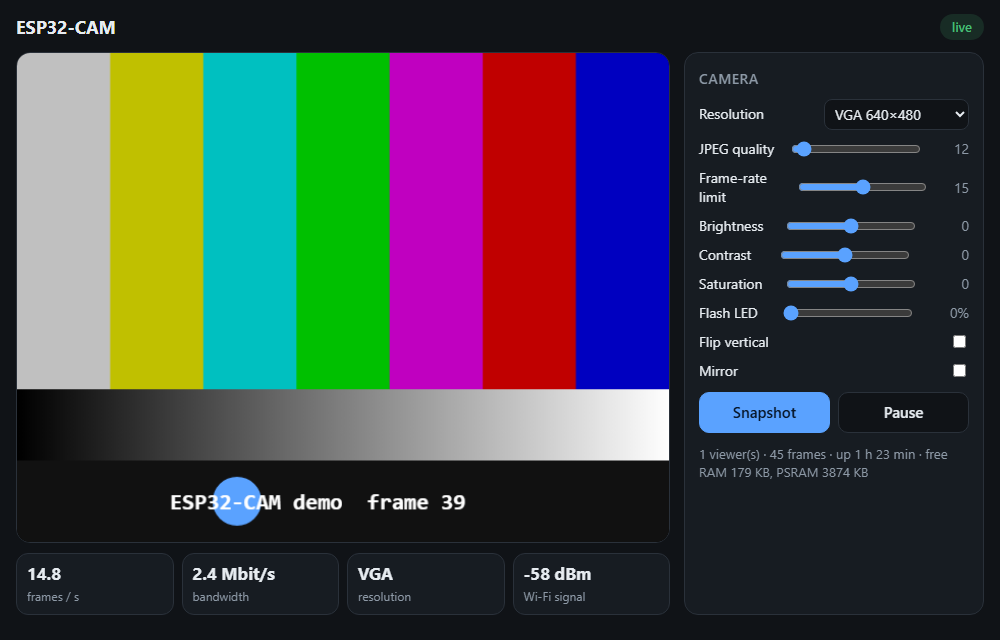
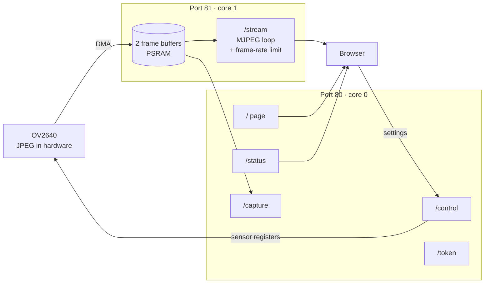
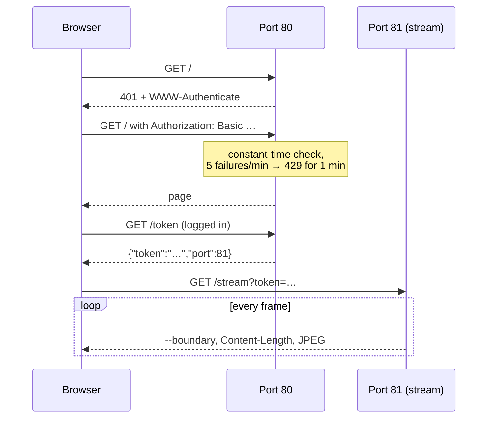

# Secure ESP32-CAM Streaming Server: MJPEG Video with Login, Snapshots and Live Camera Control


-2b6cb0)


A compact video server for the AI-Thinker ESP32-CAM, a board that costs a few dollars. It streams
live video to any browser on the network and protects the stream and the controls with a login.
The page also offers snapshots, the camera's image settings, a frame-rate limit, the flash LED,
and live figures for frame rate, bandwidth and Wi-Fi signal. The server is written from scratch
on the ESP-IDF HTTP server and replaces the usual demo sketch.

**Highlights**
- MJPEG streaming on its own HTTP server and CPU core, so the controls answer while video is
  running
- HTTP Basic login with a constant-time password check and a **lockout after five wrong
  attempts** within a minute
- A per-boot random **stream token** that only a logged-in page can read, so the stream port is
  protected too
- Two frame buffers in PSRAM with "latest frame" grabbing; a frame-rate limiter saves bandwidth
  and heat
- Measured frame rate and bandwidth (smoothed), viewer limit, uptime and memory in `/status`
- Credentials in a git-ignored `secrets.h`; joins a router or opens its own access point
- Portable core (base64, authentication, lockout, MJPEG framing, measurement, settings, JSON)
  with 66 host test checks; firmware compiled in CI

---

<details>
<summary><h2>📘 More Explanation for Students (click to expand)</h2></summary>

**How does a camera stream video to a browser?** A video is just many still pictures shown
quickly one after another. The ESP32-CAM's image sensor (the OV2640) can compress each picture
into a JPEG by itself, in hardware. The ESP32 then sends these JPEGs to the browser one after the
other over a single HTTP connection that never ends. This format is called **MJPEG** (Motion
JPEG): each picture is sent with a small header that says "a new JPEG of this many bytes follows",
and the browser replaces the old picture with the new one. That is why a plain `` tag can
show live video without any video player.

**Why does the board need PSRAM?** A picture at 1600×1200 pixels, even compressed, can take
100 KB or more. The ESP32 has only about 320 KB of internal RAM for everything, so the camera
driver keeps its frame buffers in the 4 MB external **PSRAM** chip on the board. With two buffers
the camera can fill one while the other is being sent, which raises the frame rate.

**How does the login work?** When the browser first opens the page, the ESP32 answers "401: login
required". The browser shows a username and password box and from then on sends the login with
every request, encoded in **base64**. Base64 is not encryption, it only turns text into safe
characters, so this protects the camera on a home or lab network but not on the open internet.
The password check takes the same time whether the first or the last letter is wrong, so an
attacker cannot guess it letter by letter by timing the answers. After five wrong attempts within
a minute, the camera refuses all logins for a minute, which makes guessing thousands of passwords
far too slow.

**Why are there two servers?** A stream request never finishes: the ESP32 keeps sending pictures
as long as the page is open. If the page, the settings and the stream all shared one server, the
server would be busy with the stream and could not answer anything else. So the stream has its
own server on port 81 and its own processor core, and the settings and status on port 80 stay
responsive.

</details>

---

## Try it

1. Copy `camera_server/secrets.example.h` to `camera_server/secrets.h` and set your router and a
   new camera password. (Without `secrets.h` the camera opens its own network **ESP32CAM-XXXX**,
   password `esp32cam123`, and uses the example login, with a warning on the serial port.)
2. Flash it: `make upload PORT=COM5`, or in the Arduino IDE choose **AI Thinker ESP32-CAM**.
   The board has no USB port: use a USB-serial adapter or an ESP32-CAM-MB base, and hold **IO0**
   to ground while pressing reset to enter the bootloader.
3. Open the address printed on the serial port and log in. The stream starts at once.



*The real page from `camera_server/web_ui.h`, opened in demo mode (`?demo`) with a moving test
pattern in place of the camera.*

## How it works



### Login and stream token



Browsers keep a login per address *and port*, so the stream on port 81 would ask for the password
again. The page instead reads a random 64-bit token, created at every boot, from port 80, where
it is already logged in, and passes it to the stream.

### Endpoints

| Path | What it returns |
|---|---|
| `/` | The page |
| `/status` | JSON: all settings, resolution, frame rate, bandwidth, frames, viewers, uptime, free RAM and PSRAM, RSSI |
| `/control?var=quality&val=20` | Changes one setting (range-checked; `400` otherwise) |
| `/capture` | One JPEG |
| `/token` | The stream token and port |
| `:81/stream?token=…` | The MJPEG stream (at most two viewers; `503` for a third) |

---

## Hardware

| Item | Notes |
|---|---|
| AI-Thinker ESP32-CAM | ESP32 + 4 MB PSRAM + OV2640; the camera pins are fixed by the board |
| USB-serial adapter or ESP32-CAM-MB base | For flashing; IO0 to GND during reset enters the bootloader |
| 5 V supply, 2 A | The camera and Wi-Fi together draw current peaks; a weak supply causes brownout resets |
| Flash LED (GPIO 4) | PWM-dimmed from the page |
| Red LED (GPIO 33) | On while someone is watching; blinks if the camera does not start |

## Resources

| Item | Value |
|---|---|
| Resolutions | QQVGA 160×120 to UXGA 1600×1200 (SVGA maximum without PSRAM) |
| Frame-rate limit | 1–30 frames/s or off; default 15 |
| Viewers | 2 at a time |
| Login lockout | 5 wrong attempts per minute → 1 minute |
| Memory (from the build) | 1.03 MB flash, 58 KB static RAM; frame buffers in PSRAM |

---

## Firmware structure

| File | Role |
|---|---|
| `camera_server/camera_server.ino` | Camera set-up, both HTTP servers, handlers, authentication, Wi-Fi |
| `camera_server/config.h` | Board pins, limits, ports; includes `secrets.h` |
| `camera_server/secrets.example.h` | Template for the Wi-Fi and login settings |
| `camera_server/web_ui.h` | The page (no external files) |
| `camera_server/src/core/cam_core.c` | Base64, Basic and token checks, lockout, MJPEG headers, frame-rate meter, pacing, settings, status JSON (portable, tested) |
| `tests/test_main.c` | 66 host checks |
| `docs/generate_figures.py` | The page screenshot |

## Design decisions

- **Own server instead of the CameraWebServer example.** The example is large, has no login and
  mixes the face-detection demo into the streaming code. This server does one job and is
  readable in one sitting.
- **Separate stream server.** Keeps `/control` and `/status` fast while frames are being sent, and
  lets the stream run on the core that the Wi-Fi stack does not use.
- **Token for the stream.** Avoids a second password prompt without opening the stream to anyone
  on the network.
- **Lockout counts only real attempts.** The browser's first request carries no login; it is
  answered with 401 but not counted as a failure.
- **LEDC timers chosen on purpose.** The camera clock (20 MHz) and the flash LED both use the LEDC
  peripheral; the camera is moved to timer 3, channel 7 so the flash can never share or retune
  its timer.
- **No brownout override.** Tutorials often switch off the brownout detector to hide resets
  caused by a weak supply; this firmware keeps it on and asks for a proper 5 V supply instead.

## Revision history

The original course project used a tutorial streaming sketch and Espressif's CameraWebServer
example, with the Wi-Fi name and password written into the code and the brownout detector
switched off. This rebuild is a new server: login with lockout, stream token, separate stream
server, settings and measurement, credentials outside the code, and host-tested core logic.

---

## Build and test

```bash
make                    # compile for the AI Thinker ESP32-CAM with arduino-cli (ESP32 core 3.x)
make upload PORT=COM5
make test               # 66 host checks (any C compiler)
python docs/generate_figures.py
```

## Bring-up checklist

1. Serial monitor: `camera ready, PSRAM found`, then the address. If the red LED blinks, reseat
   the camera ribbon cable.
2. Log in with a wrong password five times: the sixth request answers `429` for one minute.
3. Stream at VGA, quality 12: note the frame rate and bandwidth tiles; repeat at SVGA and XGA.
4. Set the frame-rate limit to 5: the frame-rate tile settles near 5 and bandwidth drops.
5. Open the stream in a third browser tab: it gets `503 too many viewers`.
6. Snapshot at UXGA: a 1600×1200 JPEG opens in a new tab.

---
## 👤 About the Author

**Faizan Saleem Siddiqui**, Embedded Firmware Engineer | Visiting Faculty | Research Scholar

Electronics engineer with 2+ years of experience in embedded systems and firmware development.
I build firmware for **BLE wearables** and **Bluetooth TWS audio devices** on Nordic nRF52 (Zephyr /
nRF Connect SDK), including **secure OTA updates (MCUboot, signed images)**, **low-power battery
management** and **charging-case firmware**. My background also covers STM32 and ESP32 with
FreeRTOS, real-time data acquisition, digital signal processing, industrial IoT, and Python tooling
for data, automation and machine learning.

- 🎓 MS Electronics, Quaid-i-Azam University, Islamabad (BS Electronics: 1st position, merit scholar)
- 🧑‍🏫 Visiting Faculty Member, Quaid-i-Azam University: teaching Real-Time Systems (STM32, FreeRTOS),
  Microcontroller Interfacing (ESP32) and AI/ML on Embedded Devices (TinyML)
- 🔬 Former Research Assistant, Autonomous Vehicle Engineering (COMSIP Lab, QAU)
- 🌍 Open to embedded / firmware engineering opportunities worldwide

[](https://www.linkedin.com/in/faizan-saleem-siddiqui-4411bb247/)
[](https://github.com/FaizanSSDQ)
[](mailto:faizansaleemsdq@yahoo.com)

Application code licensed under the [MIT License](../../LICENSE).
