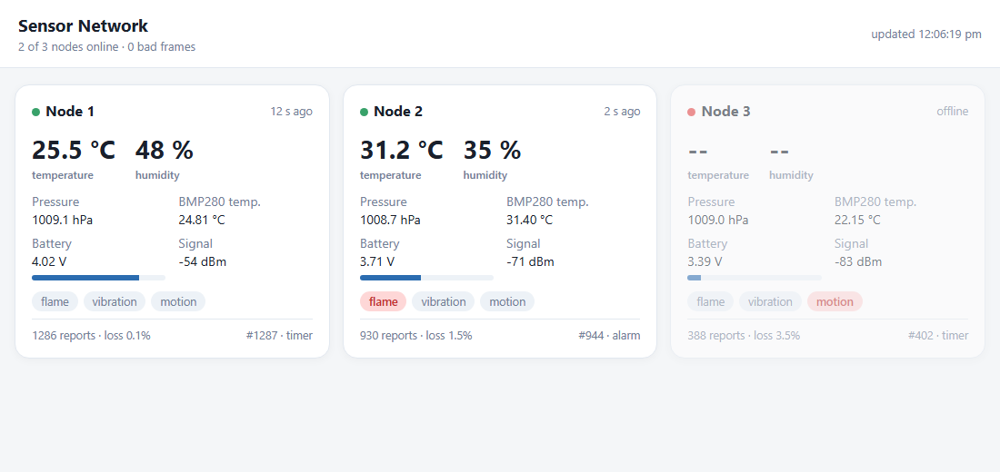
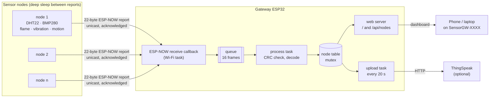
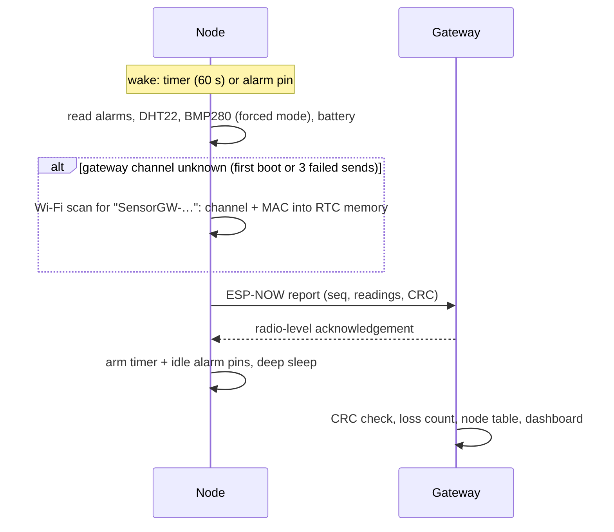
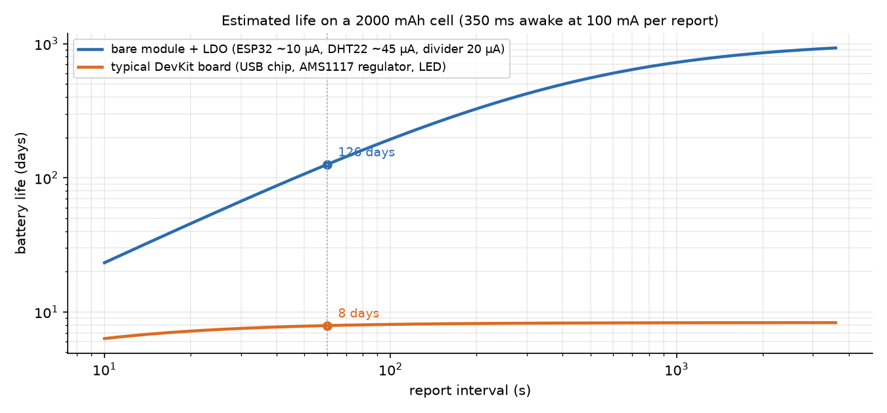

# ESP-NOW Wireless Sensor Network on ESP32: Deep-Sleep Nodes, Gateway Dashboard and Cloud Upload


Battery-powered sensor nodes measure temperature, humidity and air pressure and watch three
alarm inputs (flame, vibration, motion). Each node wakes, measures, sends one small **ESP-NOW**
packet to the gateway and goes back into **deep sleep**; an alarm wakes it at once. The gateway
checks every packet, keeps track of each node's signal strength, packet loss and online state,
serves a **live dashboard** on its own Wi-Fi network and, when connected to a router, uploads
the data to **ThingSpeak**.

**Highlights**
- Event-driven low-power nodes: timer wake-up every 60 s, immediate wake-up on alarms (ext0 and
  ext1), state kept in RTC memory across deep sleep
- Compact 22-byte binary packet with a CRC-16; unicast ESP-NOW so the gateway's radio
  acknowledges each report
- Nodes find the gateway and its radio channel by themselves and search again after repeated
  delivery failures
- Gateway with a FreeRTOS pipeline: radio callback → queue → processing task → node table
  (mutex), plus web and cloud-upload tasks
- Per-node packet-loss accounting from sequence numbers, with duplicates and reboots handled
- Own drivers: bit-banged DHT22 and BMP280 with the Bosch integer compensation, verified against
  the datasheet example
- One sketch, two roles; 46 host test checks; both roles compiled in CI

---

<details>
<summary><h2>📘 More Explanation for Students (click to expand)</h2></summary>

**What is a wireless sensor network?** Many small, cheap sensor boards (the **nodes**) are
placed around a building or a field. Each one measures something and sends it by radio to one
central board (the **gateway**), which collects everything, shows it and forwards it to the
internet. Weather stations, smart farms and factory monitoring all work this way. The hard parts
are making the radio link reliable and making the batteries last for months.

**What is ESP-NOW?** ESP-NOW is a radio protocol from Espressif that lets ESP32 boards send short
messages (up to 250 bytes) directly to each other, without a Wi-Fi router and without connecting
first. A message takes only a few milliseconds, which is why it is ideal for battery-powered
sensors. When a message is sent to one specific board (unicast), the receiving radio sends back a
tiny acknowledgement, so the sender knows it arrived.

**How can a battery last for months?** An ESP32 with its radio on uses about 100 mA, which would
empty a battery in a day. In **deep sleep** almost everything is switched off and it uses about
10 µA, ten thousand times less. So each node is awake for only about a third of a second per
minute: it measures, sends and sleeps again. The chart below shows the effect, and also why the
board matters: a development board's USB chip and voltage regulator keep drawing milliamps even
while the ESP32 sleeps. An alarm input such as a flame sensor can wake the node instantly, so
nothing important waits for the next minute.

**How does the gateway know if data is missing?** Every report carries a **sequence number** that
goes up by one each time. If the gateway receives report 101 and then report 105, it knows that
reports 102 to 104 were lost, and it shows the loss in percent for each node. Each report also
carries a **CRC**, a checksum calculated from all its bytes; if even one bit is changed on the
way, the checksum no longer matches and the gateway throws the report away. The gateway also
measures how strong each node's signal is (RSSI), which helps when choosing where to place nodes.

</details>

---

## Try it

1. Flash one board as the **gateway** (`make upload-gateway PORT=COM6`, or set `NET_ROLE` to
   `ROLE_GATEWAY` in `config.h` and upload from the Arduino IDE).
2. Flash each sensor board as a **node** with its own ID (`make upload-node PORT=COM5 NODE=2`).
3. Join the Wi-Fi network **SensorGW-XXXX** (password `sensornet123`) and open
   **http://192.168.4.1**. Nodes appear within a minute; trigger an alarm input to see an instant
   report.
4. Optional: copy `sensor_network/secrets.example.h` to `secrets.h` and enter your router and
   ThingSpeak write key. The gateway then also uploads one node every 20 s and shows the dashboard
   on its router address.



*The real dashboard from `sensor_network/dashboard.h`, opened in demo mode (`?demo`) with sample
data: node 2 reports a flame alarm, node 3 has missed its reports and is shown offline.*

## System overview



### One node wake-up



### Packet

| Bytes | Field | Bytes | Field |
|---|---|---|---|
| 0 | magic `0x5A` | 10–13 | pressure (Pa) |
| 1 | version | 14–15 | BMP280 temperature (0.01 °C) |
| 2 | node ID | 16–17 | battery (mV) |
| 3 | flags (DHT ok, BMP ok) | 18 | alarms (flame, vibration, motion) |
| 4–5 | sequence number | 19 | wake reason (timer, alarm, power-on) |
| 6–7 | temperature (0.01 °C) | 20–21 | CRC-16/CCITT-FALSE |
| 8–9 | humidity (0.01 %) | | |

### Battery life



*Estimate from stated assumptions (0.35 s awake at 100 mA per report, the listed sleep
currents); the node prints its awake time on the serial port, and the real currents should be
measured with a power profiler. The development board's regulator and USB chip, not the ESP32,
decide the battery life.*

---

## Hardware

| Node | GPIO | Notes |
|---|---|---|
| DHT22 data | 4 | 10 kΩ pull-up to 3.3 V |
| BMP280 SDA / SCL | 21 / 22 | I2C address 0x76 |
| Flame sensor DO | 27 | Active low, wakes the node through ext0 |
| Vibration sensor (SW-420) | 26 | Active high, wakes through ext1 |
| Motion (PIR or IR module) | 25 | Active high, wakes through ext1 |
| Battery | 35 | 100 kΩ / 100 kΩ divider (ADC1) |
| LED | 2 | On while awake |

The gateway needs no extra hardware. Wi-Fi network names, the channel, intervals and timeouts are
in [`config.h`](sensor_network/config.h); credentials go in `secrets.h`, which git ignores.

## Resources

| Item | Value |
|---|---|
| Report interval | 60 s, or at once on an alarm |
| Gateway: node offline after | 3 missed reports (180 s) |
| Packet | 22 bytes |
| Memory (from the build) | node 929 KB flash · gateway 957 KB flash; about 47–51 KB static RAM |

---

## Firmware structure

| File | Role |
|---|---|
| `sensor_network/sensor_network.ino` | Selects the role at build time |
| `sensor_network/node.cpp` | Wake-up cause, sensors, gateway search, ESP-NOW send, deep sleep with wake-up sources |
| `sensor_network/gateway.cpp` | Access point (and router), ESP-NOW receive queue, processing, ThingSpeak, web server |
| `sensor_network/drivers.cpp` | DHT22 single-wire timing, BMP280 I2C forced mode |
| `sensor_network/dashboard.h` | The dashboard page |
| `sensor_network/src/core/packet.c` | Packet encoding, decoding and CRC (portable, tested) |
| `sensor_network/src/core/sensor_math.c` | DHT22 frame decoding, BMP280 compensation, battery (portable, tested) |
| `sensor_network/src/core/node_table.c` | Per-node state, RSSI average, loss accounting, JSON (portable, tested) |
| `tests/test_main.c` | 46 host checks |
| `docs/generate_figures.py` | Battery-life estimate and dashboard screenshot |

## Design decisions

- **ESP-NOW instead of Wi-Fi for nodes.** Joining a Wi-Fi network takes seconds; an ESP-NOW frame
  takes milliseconds, so the node spends far less time with its radio on.
- **Unicast to the gateway's access point.** Broadcasts are never acknowledged; unicast gives the
  node a delivery report and lets it detect that the gateway is gone.
- **Channel discovery by scanning.** When the gateway joins a router it must use the router's
  channel; nodes find that channel themselves instead of having it hard-coded.
- **Binary packet with a CRC.** 22 bytes instead of a text format keeps the radio time short, and
  the CRC catches every single-bit error in the payload (tested exhaustively).
- **Callback → queue → task.** The receive callback runs in the Wi-Fi driver's task; it only
  queues the frame so that decoding, logging and the web server never block the radio.

## Revision history

This project merges four earlier course projects: Bluetooth messaging between two ESP32 boards,
a one-to-many Bluetooth network, an environmental sensor (DHT and BMP sensors with ThingSpeak) and
the flame, IR and vibration sketches from a set of single-sensor examples. The rebuild replaces
Bluetooth Classic with ESP-NOW, adds deep sleep and alarm wake-ups, and replaces the third-party
sensor libraries with its own tested drivers.

---

## Build and test

```bash
make              # compile node and gateway with arduino-cli (ESP32 Arduino core 3.x)
make upload-node PORT=COM5 NODE=2
make upload-gateway PORT=COM6
make test         # 46 host checks (any C compiler)
python docs/generate_figures.py
```

## Bring-up checklist

1. Gateway: the serial monitor shows the network name, channel and dashboard address.
2. Node: the serial monitor shows `node 1 seq 1 delivered in … ms`, and the node appears on the
   dashboard. Note the awake time; it feeds the battery estimate.
3. Unplug the gateway for three reports: the node reports `not delivered`, then searches again;
   the gateway shows the node offline, then online with the loss counted.
4. Trigger each alarm input: the node wakes at once and the dashboard shows the alarm.
5. Measure deep-sleep current with a power profiler (bare module and DevKit) and update the
   assumptions in `docs/generate_figures.py`.
6. With `secrets.h`: the ThingSpeak channel receives one update every 20 s.

---
## 👤 About the Author

**Faizan Saleem Siddiqui**, Embedded Firmware Engineer | Visiting Faculty | Research Scholar

Electronics engineer with 2+ years of experience in embedded systems and firmware development.
I build production firmware for **BLE wearables and biosignal devices** on Nordic nRF52 (Zephyr / nRF
Connect SDK), including **secure OTA updates (MCUboot, signed images)**, **low-power battery
management** and **true-wireless Bluetooth audio**. My background also covers STM32 and ESP32 with
FreeRTOS, real-time data acquisition, digital signal processing, industrial IoT, and Python tooling
for data, automation and machine learning.

- 🎓 MS Electronics, Quaid-i-Azam University, Islamabad (BS Electronics: 1st position, merit scholar)
- 🧑‍🏫 Visiting Faculty Member, Quaid-i-Azam University: teaching Real-Time Systems (STM32, FreeRTOS),
  Microcontroller Interfacing (ESP32) and AI/ML on Embedded Devices (TinyML)
- 🔬 Former Research Assistant, Autonomous Vehicle Engineering (COMSIP Lab, QAU)
- 🌍 Open to embedded / firmware engineering opportunities worldwide

[](https://www.linkedin.com/in/faizan-saleem-siddiqui-4411bb247/)
[](https://github.com/FaizanSSDQ)
[](mailto:faizansaleemsdq@gmail.com)

Application code licensed under the [MIT License](../../LICENSE).
