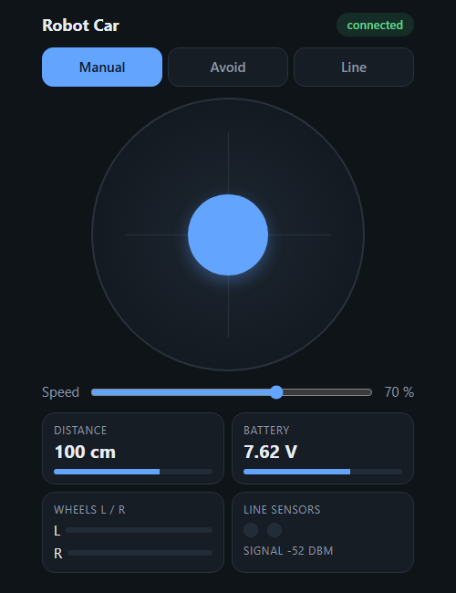
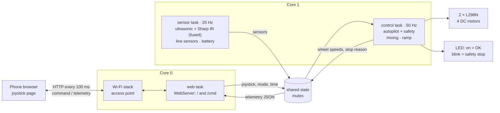
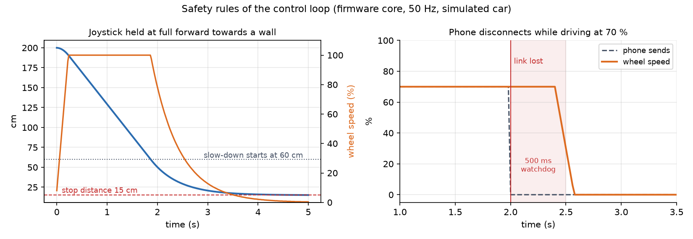
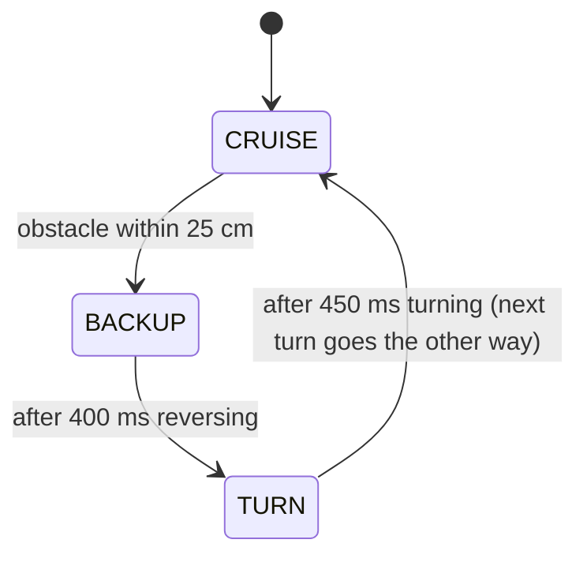

# FreeRTOS Wi-Fi Robot Car on ESP32: Phone Control, Obstacle Avoidance and Line Following

-E7352C?logo=espressif&logoColor=white)
-2f855a)


A four-wheel robot car that hosts its own Wi-Fi network and control page: connect a phone, open
the page, and drive with an on-screen joystick, or switch to **obstacle avoidance** or **line
following**. The firmware splits the work across the ESP32's two cores with FreeRTOS. Motor
control runs on its own core, away from the Wi-Fi stack, and safety rules stop the car when the
phone disconnects, the battery runs low or an obstacle gets too close.

**Highlights**
- Dual-core FreeRTOS design: 50 Hz control and 20 Hz sensing on core 1, the web server on
  core 0 next to the Wi-Fi stack; shared data guarded by a mutex
- Self-contained control page (no app, no internet): joystick, speed limit, modes and live
  telemetry (distance, battery, wheel speeds, line sensors, signal strength)
- **Safety first**: a 500 ms link watchdog, battery cut-off, forward speed scaled down from
  60 cm to a stop at 15 cm, and ramped speed changes; reversing is always allowed
- Obstacle distance fused from an **ultrasonic** and a **Sharp infrared** sensor, which fail on
  different surfaces; median filtering of the infrared reading
- Arcade mixing for differential drive, PWM deadband compensation for real DC motors
- Portable control core with 64 host test checks and a simulation of the control loop; firmware
  compiled in CI with arduino-cli

---

<details>
<summary><h2>📘 More Explanation for Students (click to expand)</h2></summary>

**How does a car with four fixed wheels steer?** It has no steering wheel. The two left motors
and the two right motors are controlled separately, like a tank. Both sides forward: it drives
straight. The left side faster than the right: it curves to the right. Left forward and right
backward: it spins on the spot. This is called **differential drive**. The firmware turns the
joystick position (forward/back and left/right) into the two side speeds; this step is called
**mixing**. Each motor speed is set with **PWM**: the motor driver (L298N) switches the battery
voltage on and off 20 000 times a second, and the share of "on" time sets the speed.

**Why use an RTOS and two cores?** The car must do several things at once: read sensors, run the
motors at a steady rate, and answer the phone over Wi-Fi. With FreeRTOS each job is its own
**task**. The ESP32 has two processor cores, and its Wi-Fi software runs on core 0, so the
firmware puts the motor-control task on core 1, where network traffic can never delay it. The
tasks share the latest sensor values and commands through memory protected by a **mutex**, a
lock that makes sure one task never reads data while another is halfway through writing it.

**How does the phone control it without an app?** The ESP32 creates its own Wi-Fi network (an
**access point**) and runs a small **web server**. The control page, written in HTML and
JavaScript, is stored inside the firmware. Every 100 ms the page sends the joystick position to
the car, and the car answers with its sensor readings, which the page shows as live tiles.

**What keeps it safe?** Real robots must fail safely. If the phone's messages stop for half a
second (the phone locked, the user walked out of range), a **watchdog** stops the car. An
ultrasonic sensor (sound echo) and an infrared sensor (light) measure the distance ahead; the
nearer reading counts, because each sensor misses some surfaces. Going forward, the speed is
reduced smoothly from 60 cm and reaches zero at 15 cm, so the car cannot drive into a wall, but
it can always reverse away. Speed changes are ramped, so the car never jerks.

</details>

---

## Try it

1. Wire the car as in the table below and flash the firmware.
2. On the phone, join the Wi-Fi network **RobotCar-XXXX** (password `robotcar123`, set in
   `config.h`) and open **http://192.168.4.1**.
3. Drag the joystick. Tap **Avoid** or **Line** to switch modes; the joystick keeps working as a
   heartbeat, and closing the page stops the car.

<p align="center"></p>

*The real control page from `robot_car/web_ui.h`, opened in a browser in demo mode (`?demo`)
with simulated telemetry.*

## System overview



### Control step (every 20 ms)

| Order | Rule | Effect |
|---|---|---|
| 1 | Link watchdog | No valid `/cmd` for 500 ms → stop (all modes) |
| 2 | Battery cut-off | Battery below 6.4 V (2S pack) → stop |
| 3 | Mode | Manual: joystick · Avoid: state machine below · Line: steer from the two IR sensors |
| 4 | Obstacle guard | Forward speed × limit, limit falls linearly from 1 at 60 cm to 0 at 15 cm |
| 5 | Mixing | left = throttle + steer, right = throttle − steer, scaled to ±1 |
| 6 | Speed limit and ramp | × speed slider, then at most 4 full-scale units per second |
| 7 | PWM | duty = 35 % + 65 % × speed (motors stall below about 35 %), 20 kHz |



*The firmware's control core (autopilot, mixing and ramp at 50 Hz) on a simple car model,
`tests/sim_drive.c`. Left: holding full forward towards a wall, the car slows from 60 cm and
settles at 15 cm. Right: the phone stops sending at 2.0 s; the watchdog acts after 500 ms and the
ramp brings the wheels to rest.*

### Obstacle avoidance



### Line following

| Left sensor | Right sensor | Action |
|---|---|---|
| off | off | straight ahead |
| on | off | slow down, steer left |
| off | on | slow down, steer right |
| on | on | stop (end of track or junction) |

---

## Hardware

| Part | Notes |
|---|---|
| ESP32 DevKit (WROOM module) | Powered from the L298N 5 V output to VIN |
| 2 × L298N motor driver | Driver 1: front motors, driver 2: back motors |
| 4 × DC gear motor, 4WD chassis | Left pair and right pair driven together |
| HC-SR04 ultrasonic sensor | Echo through a 1 kΩ / 2 kΩ divider (5 V → 3.3 V) |
| Sharp GP2Y0A21 infrared distance sensor | 10–80 cm, analog |
| 2 × TCRT5000 line sensor modules | Digital outputs |
| 2S Li-ion pack (7.4 V) | Through a 20 kΩ / 10 kΩ divider to the battery ADC pin |

| Signal | GPIO | Signal | GPIO |
|---|---|---|---|
| Front-left EN / IN1 / IN2 | 25 / 26 / 27 | Back-left EN / IN1 / IN2 | 23 / 16 / 17 |
| Front-right EN / IN1 / IN2 | 4 / 14 / 13 | Back-right EN / IN1 / IN2 | 22 / 18 / 19 |
| Ultrasonic trigger / echo | 21 / 34 | Line sensors left / right | 36 / 39 |
| Sharp IR (ADC1) | 33 | Battery (ADC1) | 32 |
| Status LED | 2 (on-board) | | |

All pins avoid the boot-strapping pins and the USB serial port. The analog inputs are on ADC1,
because ADC2 cannot be used while Wi-Fi is active. Everything is in [`config.h`](robot_car/config.h),
including flags to reverse a side if its motors were wired the other way round.

## Resources

| Item | Value |
|---|---|
| Tasks | control (core 1, priority 3), sensors (core 1, priority 2), web (core 0, priority 1) |
| Control / sensor rate | 50 Hz / 20 Hz, both with `vTaskDelayUntil` |
| Link watchdog | 500 ms; the page sends every 100 ms |
| Memory (from the build) | 955 KB flash (73 % of the default app partition) · 47.7 KB static RAM |

---

## Firmware structure

| File | Role |
|---|---|
| `robot_car/robot_car.ino` | Tasks, shared state, web endpoints, Wi-Fi access point |
| `robot_car/src/core/autopilot.c` | Modes, link watchdog, battery cut-off, obstacle guard (portable, tested) |
| `robot_car/src/core/drive.c` | Mixing, ramp, PWM duty with deadband compensation (portable, tested) |
| `robot_car/src/core/sensing.c` | Ultrasonic and Sharp conversions, median filter, distance fusion (portable, tested) |
| `robot_car/src/core/telemetry.c` | Command parsing and telemetry JSON (portable, tested) |
| `robot_car/motors.cpp`, `sensors.cpp` | Hardware access: LEDC PWM, GPIO, `pulseIn`, calibrated ADC |
| `robot_car/web_ui.h` | The control page (HTML, CSS and JavaScript in one string) |
| `robot_car/config.h` | Pins, PWM, Wi-Fi name and password, rates |
| `tests/test_main.c` | 64 host checks |
| `tests/sim_drive.c`, `docs/generate_figures.py` | Control-loop simulation and README figures |

## Design decisions

- **Motor control on its own core.** Wi-Fi interrupts and the TCP/IP stack run on core 0; the
  control loop on core 1 therefore keeps a steady 50 Hz.
- **Access point, not router mode.** The car works anywhere, with no network setup, and the phone
  talks to it directly.
- **Polling instead of WebSockets.** A request every 100 ms is simple, needs no extra library,
  and doubles as the heartbeat for the watchdog.
- **Safety in the portable core.** Every rule is plain C without hardware calls, so each one is
  covered by host tests, including timer wrap-around.
- **Two distance sensors.** Ultrasonic misses soft or angled surfaces; infrared misses dark or
  very close ones. Taking the nearer valid reading is a simple, conservative fusion.

## Revision history

This project combines four earlier course projects: an RTOS car controller, a robot motion
controller, a Wi-Fi web-server car and a task-handling exercise. Problems fixed on the way:
- motors on GPIO 1 and 3 (the USB serial pins) and sensors on GPIO 41, 42, 51, 52, 61 and 62,
  which do not exist on the ESP32;
- `ENA_2` written twice while `ENB_2` was never driven, and the back-right motor commanded
  through the front driver's `IN3_1` / `IN4_1` pins;
- an IR-sensor task looping without any delay, which starved lower-priority tasks;
- no stop when the connection was lost.

---

## Build, test and flash

```bash
make              # arduino-cli compile for esp32:esp32:esp32 (ESP32 Arduino core 3.x)
make upload PORT=COM5
make test         # 64 host checks + the simulation (any C compiler)
python docs/generate_figures.py
```
In the **Arduino IDE**: open `robot_car/robot_car.ino`, board *ESP32 Dev Module*, then Upload.

## Bring-up checklist

1. Wheels off the ground. Power up: the serial monitor prints the network name; the LED blinks
   (link watchdog: no phone yet).
2. Connect the phone and open the page: the LED stays on and the tiles update.
3. Push the joystick forward: all four wheels turn forwards (otherwise set `LEFT_REVERSED` /
   `RIGHT_REVERSED`, or swap IN1/IN2 of that motor).
4. Hold a hand in front of the sensors: forward speed drops from 60 cm and stops at 15 cm;
   reversing still works.
5. Close the page while driving: the wheels stop within about 0.7 s.
6. On the floor: Avoid mode backs up and turns at obstacles; Line mode follows black tape
   (adjust `IR_LINE_LEVEL` if your modules output the opposite level).

---
## 👤 About the Author

**Faizan Saleem Siddiqui**, Embedded Firmware Engineer | Visiting Faculty | Research Scholar

Electronics engineer with 2+ years of experience in embedded systems and firmware development.
I build production firmware for **BLE wearables and biosignal devices** on Nordic nRF52 (Zephyr / nRF
Connect SDK), including **secure OTA updates (MCUboot, signed images)**, **low-power battery
management** and **true-wireless Bluetooth audio**. My background also covers STM32 and ESP32 with
FreeRTOS, real-time data acquisition, digital signal processing, industrial IoT, and Python tooling
for data, automation and machine learning.

- 🎓 MS Electronics, Quaid-i-Azam University, Islamabad (BS Electronics: 1st position, merit scholar)
- 🧑‍🏫 Visiting Faculty Member, Quaid-i-Azam University: teaching Real-Time Systems (STM32, FreeRTOS),
  Microcontroller Interfacing (ESP32) and AI/ML on Embedded Devices (TinyML)
- 🔬 Former Research Assistant, Autonomous Vehicle Engineering (COMSIP Lab, QAU)
- 🌍 Open to embedded / firmware engineering opportunities worldwide

[](https://www.linkedin.com/in/faizan-saleem-siddiqui-4411bb247/)
[](https://github.com/FaizanSSDQ)
[](mailto:faizansaleemsdq@gmail.com)

Application code licensed under the [MIT License](../../LICENSE).
