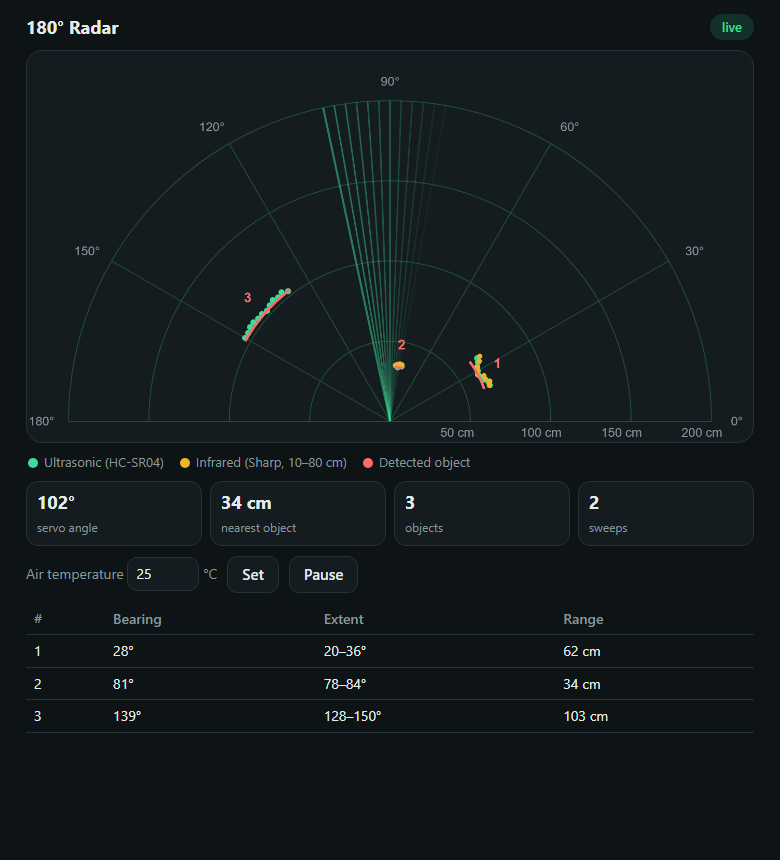
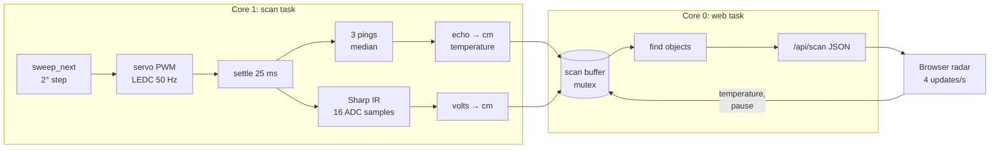
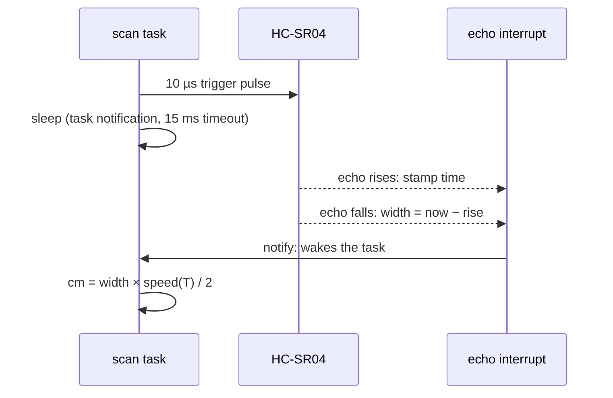
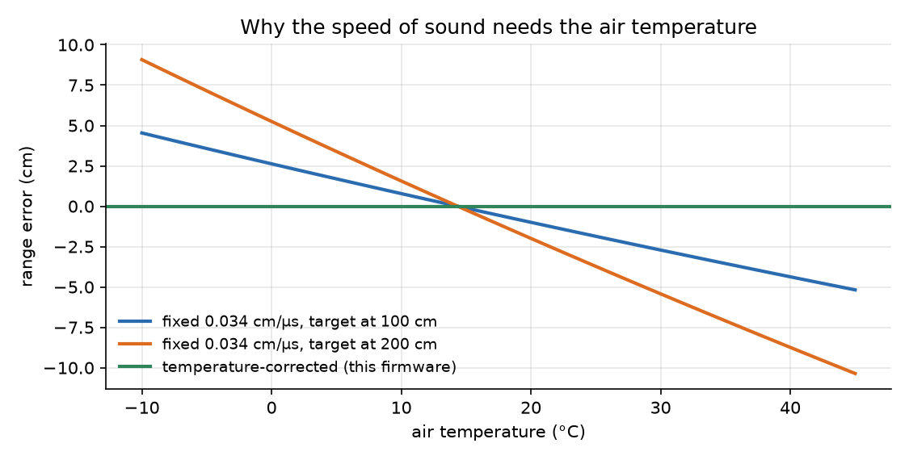
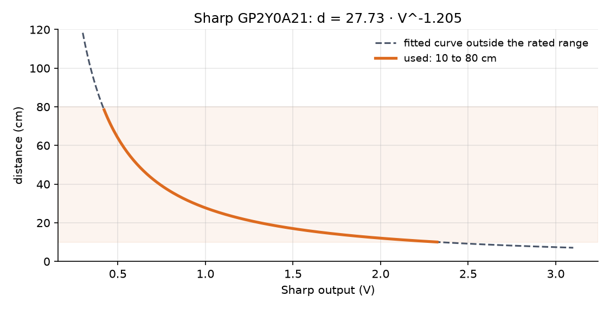

# 180° Ultrasonic and Infrared Radar on ESP32 with a Live Browser Display


-2f855a)


A servo turns an ultrasonic sensor and an infrared sensor across a half circle, 2° at a time,
and the ESP32 builds a map of everything within two metres. It groups the points into
**objects** (direction, width and distance) and shows the scan live on a **radar display in the
browser**, served by the ESP32 over its own Wi-Fi network. No PC program or cable is needed.

**Highlights**
- Non-blocking ranging: the echo pulse is timed by a GPIO interrupt and the microsecond timer;
  the scan task sleeps while it waits, with a timeout, instead of busy-waiting in `pulseIn()`
- Speed of sound corrected for air temperature (331.3 + 0.606·T m/s), set from the browser
- Median of three pings per step against single bad echoes
- Two sensors on one mount, shown together: ultrasonic out to 200 cm, Sharp IR from 10 to 80 cm
- Object detection: neighbouring points at similar ranges are grouped into objects with a bearing,
  an angular extent and the nearest range
- FreeRTOS on both cores: the scan task on core 1, the web server on core 0 next to the Wi-Fi
  stack, shared data under one mutex
- Portable core (sweep, servo timing, conversions, detection, JSON) with 29 host test checks;
  firmware compiled in CI

---

<details>
<summary><h2>📘 More Explanation for Students (click to expand)</h2></summary>

**What does this radar do?** A real radar sends out radio waves and listens for their
reflections. This project does the same with sound and light, on a small scale. A servo motor
turns a sensor from 0° to 180° and back, like a lighthouse. At every position the sensor measures
how far away the nearest thing is. Putting all the measurements together gives a map of the room
in front of it, drawn as a half circle on your phone.

**How does an ultrasonic sensor measure distance?** The HC-SR04 sends a short burst of sound at
40 kHz, too high for people to hear, and waits for the echo. Sound travels at about 343 m/s, so
the time until the echo comes back tells the distance: an object 1 m away returns the echo after
about 5.8 ms, because the sound goes there and back. Sound is faster in warm air and slower in cold
air, so the firmware uses the air temperature. Using the same speed all year makes the reading
several centimetres wrong at 2 m, as the chart below shows.

**Why is there also an infrared sensor?** The Sharp sensor sends a narrow beam of infrared light
and measures the angle at which the reflected spot comes back (triangulation). It sees a much
narrower area than the ultrasonic sensor, whose sound spreads out in a cone about 30° wide, so it
finds edges more sharply, but it only works from 10 to 80 cm. Showing both on the same display
lets you compare the two ways of measuring: the ultrasonic points of a narrow post spread out
sideways, the infrared points do not.

**How does it find objects?** The scan is a list of 91 distances, one per 2°. When neighbouring
directions have similar distances, they belong to the same surface, so the firmware joins them
into one object. A sudden jump in distance means the beam has passed the edge of one object and
now sees something behind it. For each object the firmware reports the direction of its centre,
how wide it looks and how far its nearest point is.

</details>

---

## Try it

1. Wire the board as in [Hardware](#hardware) and flash it (`make upload PORT=COM5`, or open
   `radar/radar.ino` in the Arduino IDE with the ESP32 core 3.x).
2. Join the Wi-Fi network **Radar-XXXX** (password `radar1234`) and open **http://192.168.4.1**.
3. Set the air temperature, then put objects in front of the radar. The display fills in as the
   servo sweeps; detected objects are numbered on the display and listed below it.



*The real page from `radar/web_ui.h`, opened in demo mode (`?demo`) with a simulated room: a box,
a post and part of a wall. Green: ultrasonic, yellow: infrared (only within 80 cm), red: detected
objects.*

## How it works



### One ping



If no echo returns within 15 ms (more than 200 cm), the task wakes on its own and counts the
ping as lost. The next ping first waits until the sensor has released its output.

### Temperature and the Sharp curve



*The old sketch used 0.034 cm/µs at every temperature. That is right only near 15 °C; at 35 °C a
target at 200 cm reads about 7 cm short. The firmware calculates the speed from the temperature.*



*The Sharp sensor's output is not linear in distance. The firmware uses a fitted power law and
ignores readings outside the rated 10 to 80 cm, where the curve becomes ambiguous.*

---

## Hardware

| Part | GPIO | Notes |
|---|---|---|
| Servo (SG90) signal | 18 | Powered from 5 V, grounds joined; LEDC PWM, 50 Hz, 16-bit |
| HC-SR04 trigger | 21 | 3.3 V is enough to trigger it |
| HC-SR04 echo | 34 | Through a 1 kΩ / 2 kΩ divider (5 V → 3.3 V); input-only pin |
| Sharp GP2Y0A21 output | 33 | ADC1 (works while Wi-Fi is on), 100 µF across its supply |
| LED | 2 | On at each end of the sweep |

The two sensors sit side by side on the servo horn. The pins avoid the ESP32's boot-strapping
pins and the flash pins 6 to 11.

## Resources

| Item | Value |
|---|---|
| Resolution | 2°, 91 points per sweep |
| Range | ultrasonic 2–200 cm, infrared 10–80 cm |
| Sweep time | about 8–10 s from 0° to 180° (settle 25 ms + 3 pings per step) |
| Display update | 4 per second, about 1 KB of JSON |
| Memory (from the build) | 963 KB flash, 53 KB static RAM |

---

## Firmware structure

| File | Role |
|---|---|
| `radar/radar.ino` | Tasks, shared scan buffer, web server and endpoints |
| `radar/ranger.cpp` | Interrupt-timed echo, Sharp ADC averaging, servo PWM |
| `radar/config.h` | Pins, servo calibration, timing, detection limits, Wi-Fi |
| `radar/web_ui.h` | The radar page (canvas, no external files) |
| `radar/src/core/radar_core.c` | Sweep, servo timing, conversions, median, object detection, JSON (portable, tested) |
| `tests/test_main.c` | 29 host checks |
| `docs/generate_figures.py` | The figures above and the page screenshot |

## Design decisions

- **Interrupt and task notification instead of `pulseIn()`.** `pulseIn()` blocks the CPU for up to
  a second when nothing answers. Timing the edges in an interrupt lets the task sleep, keeps the
  timing exact and puts a hard limit on a lost echo.
- **The browser is the display.** The old version needed a Processing program on a PC connected by
  USB. Serving the page from the ESP32 works on any phone, and the JSON can be used by other tools.
- **Objects are found on request, from a copy.** The web task copies the scan under the mutex and
  does the grouping and formatting outside it, so the scan task never waits for the network.
- **Median of three, not an average.** One wrong echo (a reflection from the side, or a missed
  echo) would pull an average far off; the median ignores it.
- **Portable core.** Everything that is maths, not hardware, is plain C with host tests, so it is
  checked without the radar.

## Revision history

This project merges two earlier course projects: a radar sketch written for an Arduino Uno (Servo
library, `pulseIn()`, a fixed speed of sound, serial output to a Processing visualizer) and a
Sharp IR distance example that used a third-party library. On an ESP32 the old pins 10, 11 and 12
are flash and strapping pins and would stop the board from booting. The rebuild moves to safe
pins, adds both sensors on one mount, temperature correction, interrupt timing, object detection,
FreeRTOS tasks and the browser display.

---

## Build and test

```bash
make                    # compile the firmware with arduino-cli (ESP32 Arduino core 3.x)
make upload PORT=COM5
make test               # 29 host checks (any C compiler)
python docs/generate_figures.py
```

## Bring-up checklist

1. Serial monitor: the network name and address appear.
2. Servo: at 0° and 180° the horn should be at the ends of its travel; trim `SERVO_MIN_US` and
   `SERVO_MAX_US` in `config.h` if it hits a stop or falls short.
3. A flat board at 50 cm and 100 cm straight ahead (90°): the ultrasonic trace reads within
   about 1 cm once the temperature is set.
4. The same board at 30 cm: the infrared trace agrees with the ultrasonic one within a few cm.
5. A thin post at 60 cm: the ultrasonic points spread wider than the infrared ones (beam width).
6. Two boxes at different distances: they appear as two numbered objects.

---
## 👤 About the Author

**Faizan Saleem Siddiqui**, Embedded Firmware Engineer | Visiting Faculty | Research Scholar

Electronics engineer with 2+ years of experience in embedded systems and firmware development.
I build firmware for **BLE wearables** and **Bluetooth TWS audio devices** on Nordic nRF52 (Zephyr /
nRF Connect SDK), including **secure OTA updates (MCUboot, signed images)**, **low-power battery
management** and **charging-case firmware**. My background also covers STM32 and ESP32 with
FreeRTOS, real-time data acquisition, digital signal processing, industrial IoT, and Python tooling
for data, automation and machine learning.

- 🎓 MS Electronics, Quaid-i-Azam University, Islamabad (BS Electronics: 1st position, merit scholar)
- 🧑‍🏫 Visiting Faculty Member, Quaid-i-Azam University: teaching Real-Time Systems (STM32, FreeRTOS),
  Microcontroller Interfacing (ESP32) and AI/ML on Embedded Devices (TinyML)
- 🔬 Former Research Assistant, Autonomous Vehicle Engineering (COMSIP Lab, QAU)
- 🌍 Open to embedded / firmware engineering opportunities worldwide

[](https://www.linkedin.com/in/faizan-saleem-siddiqui-4411bb247/)
[](https://github.com/FaizanSSDQ)
[](mailto:faizansaleemsdq@yahoo.com)

Application code licensed under the [MIT License](../../LICENSE).
