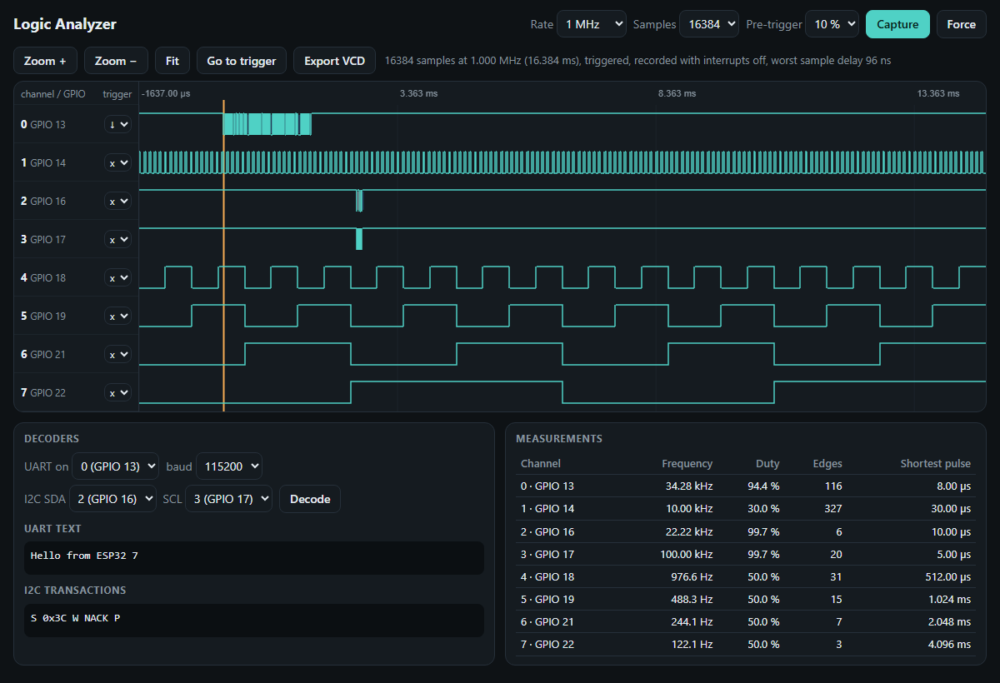
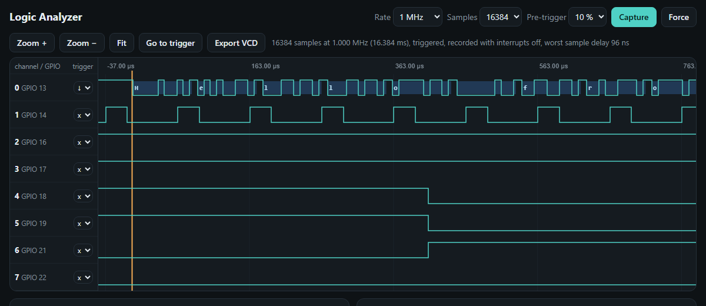
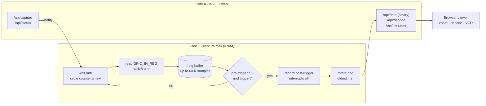

# Wi-Fi Logic Analyzer on ESP32: 8 Channels at up to 2 MS/s with Triggers, UART/I2C Decoding and a Browser Viewer


An eight-channel logic analyzer that needs nothing but an ESP32 and a browser. It records digital
signals at up to 2 million samples per second, starts on a trigger you set per channel, keeps the
moments just before the trigger, and shows the result in a zoomable waveform view on your phone
or PC. Built-in decoders turn UART lines into text and I2C lines into addresses and data bytes,
and the board can output its own test signals so it can be tried with three jumper wires.

**Highlights**
- Sampling on a dedicated CPU core: one 32-bit read of the GPIO input register per sample, paced
  by the CPU cycle counter (4.2 ns steps); the loop runs from IRAM
- The part after the trigger is recorded with interrupts off, so no sample is delayed; the
  worst sample delay is measured and reported with every capture
- Per-channel triggers (low, high, rising, falling, or combinations) with 1–50 % pre-trigger in a
  ring buffer, plus a timeout and a "force" button
- UART (8N1, any baud rate with at least 3 samples per bit) and I2C (start, repeated start,
  address, R/W, data, ACK/NACK, stop) decoders on the ESP32
- Browser viewer: zoom and pan, decoded bytes drawn on the trace, frequency/duty/pulse
  measurements, export to VCD for PulseView or GTKWave
- The recording loop reaches the hardware only through four hooks, so the host tests run the
  exact loop on a simulated cycle counter; 53 checks; firmware compiled in CI

---

<details>
<summary><h2>📘 More Explanation for Students (click to expand)</h2></summary>

**What is a logic analyzer?** An oscilloscope shows how a voltage changes over time. A logic
analyzer does the same for digital signals, which are only high or low, but for many signals at
once. It is the tool for debugging communication between chips: you connect it to the wires of a
UART, I2C or SPI bus and see exactly which bits were sent and when. This project explains how such
an instrument works by building one. A deeper version on STM32 with DMA, which works with the
PulseView program, is the [SUMP logic analyzer](../../stm32/sump-logic-analyzer) in this
repository.

**How does it sample?** "Sampling" means checking all inputs at fixed, equal time steps. The
ESP32 has a register, `GPIO_IN_REG`, whose bits show the level of every pin at once. Reading it
once gives all eight channels in the same instant. The timing comes from the CPU's cycle counter,
which counts at 240 MHz: at 1 MHz sampling, the loop waits for exactly 240 cycles between two
reads. This work runs on the ESP32's second core, while Wi-Fi runs on the first, so the network
cannot disturb the timing.

**What are triggers and pre-trigger?** A signal of interest may happen only once in a while, for
example a single message on a bus. A **trigger** is the condition that says "this is the
moment", such as "channel 0 goes from high to low". While waiting, the analyzer keeps recording
into a **ring buffer**: when the buffer is full it starts overwriting the oldest samples. So when
the trigger comes, the samples from just before it are already stored. That is why you can see
what led up to an event, not only what followed.

**How are UART and I2C decoded?** A UART byte starts with a low **start bit**, then 8 data
bits (lowest first) and a high **stop bit**, each lasting 1/baud seconds. The decoder finds each
falling edge and reads the line in the middle of each bit. I2C uses two wires: SCL is the clock
and SDA the data. A **start** is SDA falling while SCL is high, a **stop** is SDA rising while
SCL is high, and in between one data bit is read at each rising SCL edge. After every 8 bits the
receiver pulls SDA low for one clock to say "acknowledged" (ACK); if nobody answers, the line stays
high (NACK).

</details>

---

## Try it

1. Flash the board (`make upload PORT=COM5`, or open `analyzer/analyzer.ino` in the Arduino IDE
   with the ESP32 core 3.x).
2. Connect the built-in test signals: **GPIO 25 → channel 0** (UART text), **GPIO 26 →
   channel 1** (10 kHz PWM), **GPIO 33 → channel 2** and **GPIO 32 → channel 3** (I2C).
3. Join **LogicAnalyzer-XXXX** (password `analyzer123`), open **http://192.168.4.1**, set the
   trigger of channel 0 to ↓ (falling) and press **Capture**.



*The real page from `analyzer/web_ui.h` in demo mode, with synthetic signals that match the
built-in test signals: UART text on channel 0, PWM on channel 1, an I2C write to 0x3C that nobody
acknowledges on channels 2 and 3, and a counter on channels 4 to 7.*



*The same capture zoomed in on the trigger: every UART byte is decoded on the trace.*

## How it works



### Capture plan

| Rate | Cycles per sample | Interrupts during post-trigger |
|---|---|---|
| 5 k – 200 kS/s | 48 000 – 1 200 | on (the 1 kHz tick costs a few µs, far below one sample) |
| 500 k – 2 MS/s | 480 – 120 | off, when the post-trigger part lasts at most 100 ms |

The interrupt watchdog fires after 300 ms with interrupts off, so the planner keeps every
interrupts-off stretch to 100 ms. While waiting for a trigger, the task yields for one tick every
200 ms so that the idle task can run. The yield leaves a gap in the ring, so the pre-trigger part
is refilled before the trigger is armed again. The host tests check this case.

### Pins

The inputs are GPIO 13, 14, 16, 17, 18, 19, 21 and 22: all in `GPIO_IN_REG` and none of them a
strapping, flash or UART pin. They are not contiguous, so one sample is packed with three shifts
and masks:

```c
(in >> 13 & 0x03) | (in >> 14 & 0x3C) | (in >> 15 & 0xC0)   // GPIO 13,14 | 16..19 | 21,22
```

---

## Hardware

| Connection | GPIO | Notes |
|---|---|---|
| Channels 0–7 | 13, 14, 16, 17, 18, 19, 21, 22 | **3.3 V logic only**; use a level shifter or divider for 5 V signals |
| Ground | GND | Join with the circuit under test |
| Test UART TX | 25 | "Hello from ESP32 *n*" at 115200 baud, every 20 ms |
| Test PWM | 26 | 10 kHz, 30 % |
| Test I2C SDA / SCL | 33 / 32 | 100 kHz write to address 0x3C every 20 ms |
| LED | 2 | On during a capture |

Set `TEST_SIGNALS` to 0 in `config.h` to free the test pins.

## Specifications

| Item | Value |
|---|---|
| Channels | 8 |
| Sample rates | 5, 10, 20, 50, 100, 200, 500 kS/s, 1, 2 MS/s |
| Memory | 4096 to 65536 samples (64 KB buffer from the heap) |
| Trigger | Per channel: don't care, low, high, rising, falling (all conditions on one sample) |
| Pre-trigger | 1–50 % |
| Decoders | UART 8N1, I2C |
| Export | VCD (opens in PulseView and GTKWave) |
| Memory (from the build) | 977 KB flash, 63 KB static RAM + 64 KB sample buffer + 24 KB decoder output |

---

## Firmware structure

| File | Role |
|---|---|
| `analyzer/analyzer.ino` | Capture task and its hardware hooks, web server and endpoints, test signals |
| `analyzer/config.h` | Test-signal pins, timeouts, Wi-Fi |
| `analyzer/web_ui.h` | The viewer page (no external files) |
| `analyzer/src/core/la_core.c` | Plan, recording loop, ring rotation, measurements, UART and I2C decoders, JSON (portable, tested) |
| `analyzer/src/core/la_trigger.c` | Trigger matching, shared with the STM32 SUMP logic analyzer |
| `tests/test_main.c` | 53 host checks, including the recording loop on a simulated cycle counter |
| `docs/generate_figures.py` | Page screenshots |

## Endpoints

| Path | Returns |
|---|---|
| `/api/capture?rate=1000000&samples=16384&pre=10&trigger=fxxxxxxx&timeout=3000` | Starts a capture (`202`) |
| `/api/status` | `{"busy":true}`, then rate, trigger position, interrupts off, worst sample delay |
| `/api/abort` | Stops waiting and captures at once |
| `/api/data` | The samples, one byte each (bit *n* = channel *n*) |
| `/api/decode?type=uart&ch=0&baud=115200` · `?type=i2c&sda=2&scl=3` | Decoded frames or events |
| `/api/measure` | Frequency, duty cycle, edges and shortest pulse per channel |

## Design decisions

- **Register read instead of `digitalRead()`.** The old version called `digitalRead()` eight times
  per sample and timed itself with `micros()`, which allows a few kHz with uneven steps. One
  register read gives all channels at the same instant.
- **Cycle-counter pacing with absolute deadlines.** Each sample is due at `start + k × period`. A
  late sample does not shift the ones after it, and its lateness is measured.
- **Hooks instead of hardware calls in the loop.** The same `la_record()` runs on the ESP32 and in
  the host tests, so wrap-around, ring rotation, timeouts and restarts are tested, not assumed.
- **Asynchronous capture.** The web request returns at once and the page polls, so "force" works
  while the analyzer waits for a trigger.
- **Decoding on the ESP32.** The decoders are C code with tests; the page only draws the results.

## Revision history

The original course project read eight pins with `digitalRead()` in a loop timed by
`delayMicroseconds()`, saved the result to SPIFFS and printed it on the serial port, with no
trigger. This rebuild is a new instrument: register sampling on its own core, triggers with
pre-trigger, decoders, measurements, a browser viewer and tests.

---

## Build and test

```bash
make                    # compile the firmware with arduino-cli (ESP32 Arduino core 3.x)
make upload PORT=COM5
make test               # 53 host checks (any C compiler)
python docs/generate_figures.py
```

## Bring-up checklist

1. With the test signals connected, capture at 1 MS/s with channel 0 on ↓: the UART text panel
   reads `Hello from ESP32 …`.
2. Channel 1 measures 10.00 kHz at 30 % duty.
3. Channels 2/3 decode `S 0x3C W NACK P` (no device on the bus).
4. At 2 MS/s, note the "worst sample delay" in the status line; it should stay below 100 ns with
   interrupts off. Compare with the same capture at 200 kS/s (interrupts on).
5. Set an impossible trigger (channel 7 ↑ with nothing connected): after 3 s the capture completes
   with "no trigger"; press Force during the wait to end it early.
6. Export VCD and open it in PulseView: the edges match the viewer.

---
## 👤 About the Author

**Faizan Saleem Siddiqui**, Embedded Firmware Engineer | Visiting Faculty | Research Scholar

Electronics engineer with 2+ years of experience in embedded systems and firmware development.
I build firmware for **BLE wearables** and **Bluetooth TWS audio devices** on Nordic nRF52 (Zephyr /
nRF Connect SDK), including **secure OTA updates (MCUboot, signed images)**, **low-power battery
management** and **charging-case firmware**. My background also covers STM32 and ESP32 with
FreeRTOS, real-time data acquisition, digital signal processing, industrial IoT, and Python tooling
for data, automation and machine learning.

- 🎓 MS Electronics, Quaid-i-Azam University, Islamabad (BS Electronics: 1st position, merit scholar)
- 🧑‍🏫 Visiting Faculty Member, Quaid-i-Azam University: teaching Real-Time Systems (STM32, FreeRTOS),
  Microcontroller Interfacing (ESP32) and AI/ML on Embedded Devices (TinyML)
- 🔬 Former Research Assistant, Autonomous Vehicle Engineering (COMSIP Lab, QAU)
- 🌍 Open to embedded / firmware engineering opportunities worldwide

[](https://www.linkedin.com/in/faizan-saleem-siddiqui-4411bb247/)
[](https://github.com/FaizanSSDQ)
[](mailto:faizansaleemsdq@yahoo.com)

Application code licensed under the [MIT License](../../LICENSE).
