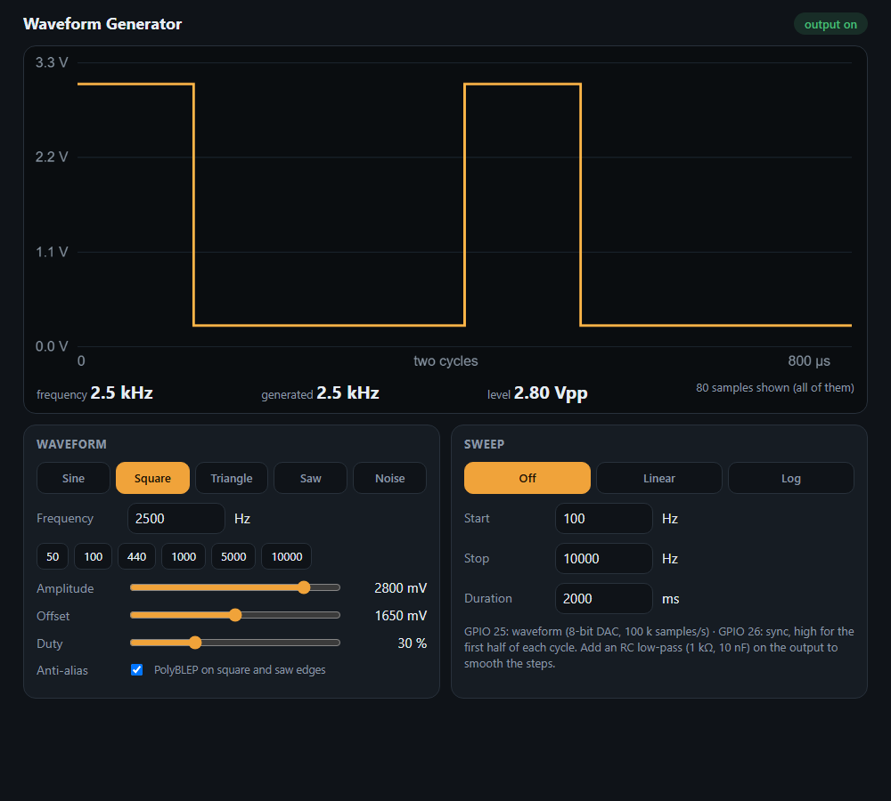
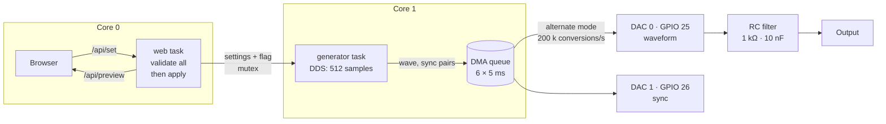
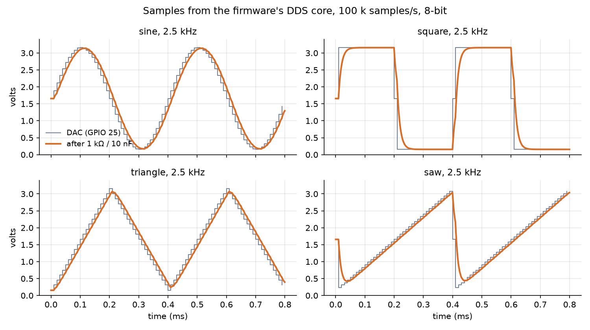
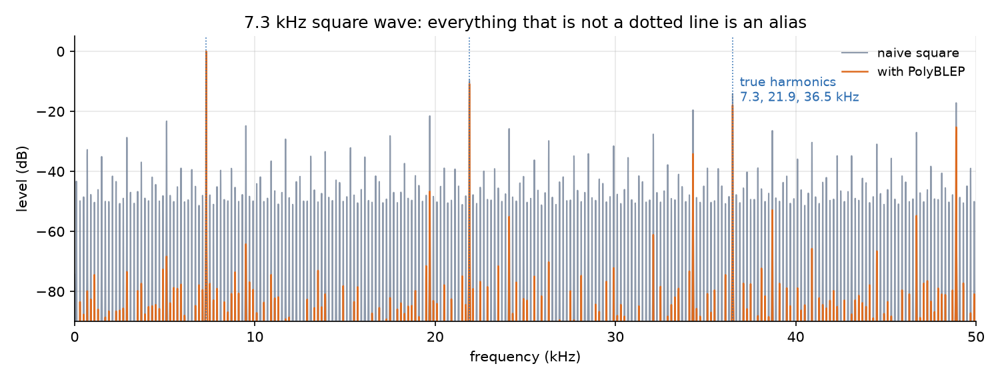

# Wi-Fi Waveform Generator on ESP32: DDS through the DAC with DMA, Sweeps and a Live Preview


A signal generator built from one ESP32 board and a resistor and capacitor. It produces sine,
square, triangle, sawtooth and noise from 0.01 Hz to 20 kHz with 23 µHz frequency resolution,
adjustable amplitude, offset and duty cycle, and linear or logarithmic frequency sweeps. A
second output gives a sync signal for triggering an oscilloscope. Everything is set from a phone
or PC browser, which also shows a preview of the exact samples being output.

**Highlights**
- Direct digital synthesis: a 32-bit phase accumulator at 100 k samples/s, a sine table with
  linear interpolation, glitch-free frequency changes (the phase is kept)
- Both DACs fed by DMA in alternate mode: waveform on GPIO 25 and sync on GPIO 26 from one
  stream, so they can never drift apart
- PolyBLEP anti-aliasing on square and saw edges: aliases fall from about −50 dB to −80 dB
  (spectrum below)
- Linear and logarithmic sweeps up to 10 minutes long, restarting automatically
- FreeRTOS: a generator task on core 1 kept in step by the DMA queue, the web server on core 0
- The DDS core is shared with the [STM32 DDS waveform generator](../../stm32/dds-waveform-generator)
  in this repository; 42 host test checks, firmware compiled in CI

---

<details>
<summary><h2>📘 More Explanation for Students (click to expand)</h2></summary>

**What is a function generator?** It is a lab instrument that produces test signals: sine waves,
square waves and others at a frequency and voltage you choose. Engineers use it to test filters,
amplifiers and sensors: feed in a known signal and look at what comes out. This project turns an
ESP32 into a small one that you control from your phone.

**How does a microcontroller make an analog signal?** The ESP32 has a **DAC**
(digital-to-analog converter): you give it a number from 0 to 255 and it outputs a voltage from
0 to about 3.3 V. Changing the number 100,000 times per second draws a waveform as a staircase
of small steps. A simple **RC low-pass filter** (one resistor and one capacitor) after the DAC
smooths the steps, as the orange lines in the first chart show. To keep the timing perfect, the
numbers are moved to the DAC by **DMA**, a hardware unit that copies data without the CPU, so the
signal does not stutter when the CPU is busy with Wi-Fi.

**What is DDS?** Direct digital synthesis decides which number to output next. A 32-bit counter,
the **phase accumulator**, adds a fixed step at every sample and wraps around once per cycle of
the waveform. The top bits of the counter say where in the cycle we are, and a table turns that
position into the sine value. A bigger step means a faster wrap and so a higher frequency. Because
the counter has 32 bits, the frequency can be set in steps of 0.000023 Hz, and changing it never
causes a jump in the waveform.

**What is aliasing and what does PolyBLEP do?** A sampled signal cannot contain frequencies
above half the sample rate (here 50 kHz). A perfectly sharp square edge contains endless high
harmonics, and the ones above 50 kHz do not disappear: they fold back and show up as false tones
at random lower frequencies, called **aliases**. PolyBLEP replaces the two samples around each
edge with a slightly rounded version, which removes most of those high harmonics before they can
fold back. The spectrum below shows the difference.

</details>

---

## Try it

1. Flash the board (`make upload PORT=COM5`, or open `wavegen/wavegen.ino` in the Arduino IDE
   with the ESP32 core 3.x).
2. Join **WaveGen-XXXX** (password `wavegen123`) and open **http://192.168.4.1**.
3. Connect an oscilloscope to the RC filter output and trigger it from GPIO 26. Pick a waveform,
   type a frequency or tap a preset; the preview and the output change at once.



*The real page from `wavegen/web_ui.h`, opened in demo mode: a 2.5 kHz square wave at 30 % duty.
At this frequency two cycles are only 80 samples, and the preview shows every one of them.*

## How it works



Every sample:

```
phase += tuning_word                    tuning_word = f × 2³² / 100 kHz
w      = shape(phase)                   sine table + interpolation, square/saw + PolyBLEP, triangle, noise
code   = offset + w × amplitude         8-bit DAC code, clamped to 0..255
sync   = 255 if phase < 2³¹ else 0
```

The generator task renders one 512-sample block (5.12 ms) and hands it to the DAC driver, which
waits while all six DMA buffers are full. The DMA therefore paces the task, the output never
waits for the CPU, and a settings change reaches the output within about 30 ms.



*Samples produced by the firmware's DDS core (compiled on the PC by `make dump`), before and after
the RC filter. The filter's 10 µs time constant smooths the steps while keeping edges sharp.*



*A 7.3 kHz square wave. Only the dotted lines are real harmonics; every other line is an alias
folded back from above 50 kHz. PolyBLEP lowers them by about 30 dB.*

---

## Hardware

| Connection | GPIO | Notes |
|---|---|---|
| Waveform | 25 | DAC channel 0 → 1 kΩ → output, 10 nF to ground |
| Sync | 26 | DAC channel 1, 0 V / 3.3 V square, high for the first half of each cycle |
| LED | 2 | On while the output is enabled |

For loads below about 10 kΩ, add a rail-to-rail op-amp buffer after the filter. The ESP32 DAC is
not perfectly linear near 0 V and 3.3 V, so the cleanest sine uses an amplitude of about 2.8 Vpp
around 1.65 V.

## Specifications

| Item | Value |
|---|---|
| Waveforms | Sine, square (duty 1–99 %), triangle, sawtooth, noise |
| Frequency | 0.01 Hz to 20 kHz, resolution 23 µHz |
| Sample rate | 100 k samples/s per channel, 8 bits |
| Amplitude / offset | 0–3.3 V each, in mV steps (8-bit output: 13 mV per code) |
| Sweep | Linear or logarithmic, 10 ms to 10 min |
| Settings latency | About 30 ms (DMA queue) |
| Memory (from the build) | 958 KB flash, 50 KB static RAM |

---

## Firmware structure

| File | Role |
|---|---|
| `wavegen/wavegen.ino` | DAC DMA set-up, generator and web tasks, endpoints |
| `wavegen/config.h` | Pins, DMA buffers, Wi-Fi |
| `wavegen/web_ui.h` | The control page (no external files) |
| `wavegen/src/core/dds.c` | DDS engine, PolyBLEP, sweeps, preview, settings parser and JSON (portable, tested) |
| `wavegen/src/core/dds_tables.c` | 257-point Q15 sine table |
| `wavegen/src/core/gen_config.h` | Sample rate, scaling, limits |
| `tests/test_main.c` | 42 host checks |
| `tests/dump_wave.c` | Prints the generated samples for the figures |
| `docs/generate_figures.py` | Figures and page screenshot |

## Design decisions

- **DMA instead of `dacWrite()` in a loop.** A software loop is interrupted by Wi-Fi and gives
  uneven timing; the DMA outputs every sample on time.
- **Alternate mode for the sync output.** One DMA stream carries both channels, so waveform and
  sync come from the same sample clock and stay locked together.
- **The same DDS core as the STM32 version.** Only the output stage differs (8-bit DAC codes
  instead of PWM compare values), so the tests and the maths are shared.
- **Preview from the real samples.** The page shows what the DACs output, steps included, not an
  idealised curve, so students can see why high frequencies look coarse.
- **All-or-nothing settings.** A request with several settings is checked completely before any
  of them is applied; one bad value leaves the output unchanged.

## Revision history

The original course project was a set of separate sketches, one per waveform, using lookup tables
and `dacWrite()` or printing values to the Serial Plotter, with the frequency fixed in the code.
This rebuild combines all waveforms in one DMA-driven generator with browser control, sweeps,
anti-aliasing, a sync output and tests.

---

## Build and test

```bash
make                    # compile the firmware with arduino-cli (ESP32 Arduino core 3.x)
make upload PORT=COM5
make test               # 42 host checks (any C compiler)
python docs/generate_figures.py
```

## Bring-up checklist

1. Defaults (1 kHz sine, 2 Vpp around 1.65 V): the oscilloscope shows 1.000 kHz. If it shows
   2 kHz, the DAC driver runs alternate mode at the full conversion rate: set
   `cfg.freq_hz = GEN_SAMPLE_RATE_HZ` in `dac_begin()`.
2. Sync on GPIO 26 rises at the waveform's centre crossing (rising sine).
3. Square at 30 % duty: the high time is 30 % of the period.
4. 20 kHz sine: five samples per cycle, smoothed by the filter into a recognisable sine.
5. Log sweep 100 Hz → 10 kHz over 2 s: the period shrinks smoothly, with no jumps.
6. Change the frequency while watching: no glitch at the change.

---
## 👤 About the Author

**Faizan Saleem Siddiqui**, Embedded Firmware Engineer | Visiting Faculty | Research Scholar

Electronics engineer with 2+ years of experience in embedded systems and firmware development.
I build firmware for **BLE wearables** and **Bluetooth TWS audio devices** on Nordic nRF52 (Zephyr /
nRF Connect SDK), including **secure OTA updates (MCUboot, signed images)**, **low-power battery
management** and **charging-case firmware**. My background also covers STM32 and ESP32 with
FreeRTOS, real-time data acquisition, digital signal processing, industrial IoT, and Python tooling
for data, automation and machine learning.

- 🎓 MS Electronics, Quaid-i-Azam University, Islamabad (BS Electronics: 1st position, merit scholar)
- 🧑‍🏫 Visiting Faculty Member, Quaid-i-Azam University: teaching Real-Time Systems (STM32, FreeRTOS),
  Microcontroller Interfacing (ESP32) and AI/ML on Embedded Devices (TinyML)
- 🔬 Former Research Assistant, Autonomous Vehicle Engineering (COMSIP Lab, QAU)
- 🌍 Open to embedded / firmware engineering opportunities worldwide

[](https://www.linkedin.com/in/faizan-saleem-siddiqui-4411bb247/)
[](https://github.com/FaizanSSDQ)
[](mailto:faizansaleemsdq@yahoo.com)

Application code licensed under the [MIT License](../../LICENSE).
