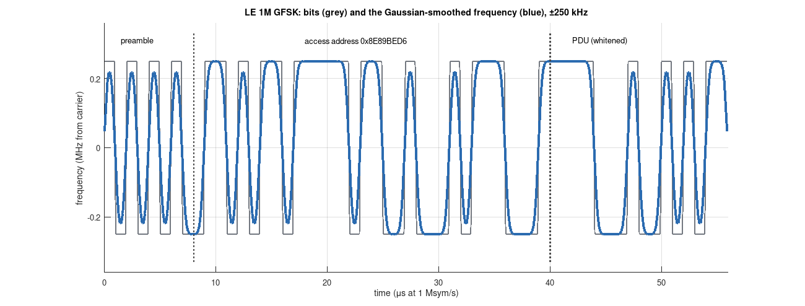
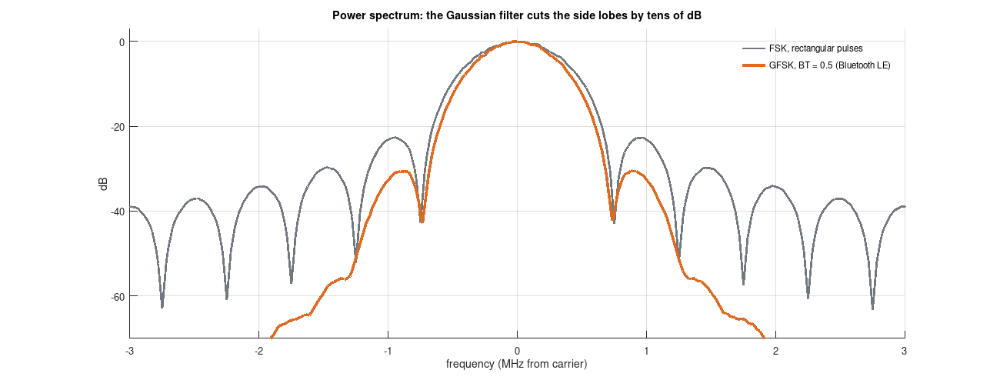
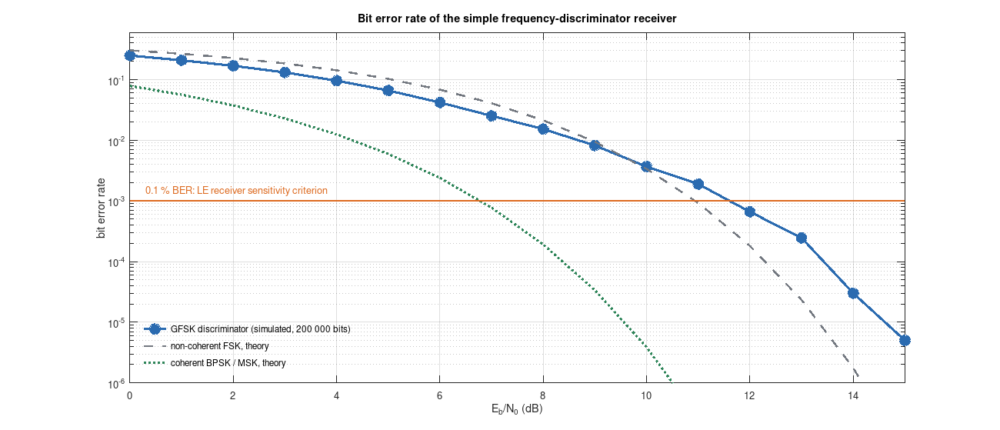
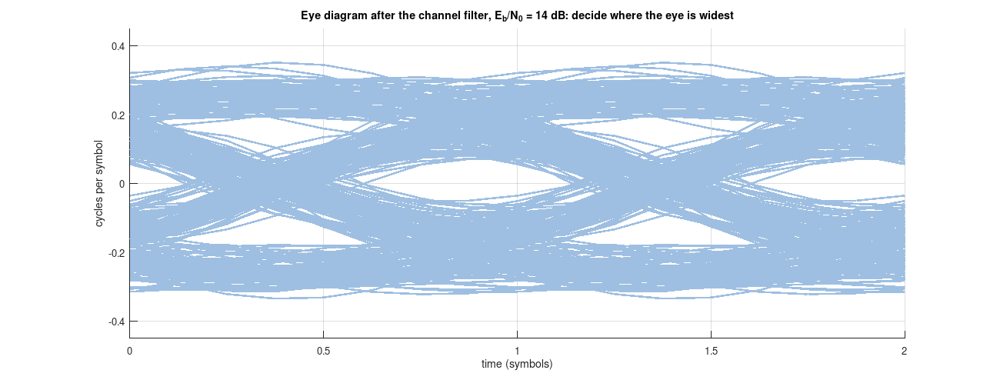
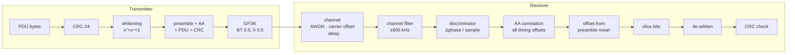

# Bluetooth LE 1M PHY Simulator: GFSK Modem, Packet Format, Synchronisation and BER


A from-scratch simulation of the Bluetooth Low Energy 1 Msym/s physical layer: packet assembly
with CRC-24 and data whitening, Gaussian frequency-shift keying (BT 0.5, modulation index 0.5),
a noisy channel with carrier frequency offset, and a receiver that filters, demodulates, finds
the access address, removes the offset, de-whitens and checks the CRC. It measures the bit error
rate against Eb/N0 and compares it with theory. Base MATLAB only, also runs in GNU Octave.

**Highlights**
- Complete packet: alternating preamble, access address, PDU and CRC, least significant bit
  first, PDU and CRC whitened per channel
- CRC-24 (x²⁴ + x¹⁰ + x⁹ + x⁶ + x⁴ + x³ + x + 1) as a bit-serial shift register: every one of 200
  corrupted packets detected
- Whitening LFSR x⁷ + x⁴ + 1 checked as a maximum-length sequence (period 127, 64 ones)
- GFSK modulator with constant envelope and ±250 kHz deviation
- Receiver: channel filter → frequency discriminator → access-address correlation over every
  timing offset → frequency-offset removal from the preamble → CRC
- Decodes packets at 14 dB Eb/N0 with a **50 kHz carrier offset**, estimating that offset
- **0.1 % BER at 11.6 dB Eb/N0**, 0.7 dB from non-coherent FSK theory
- 23 checks in MATLAB and Octave on every push

---

<details>
<summary><h2>📘 More Explanation for Students (click to expand)</h2></summary>

**How does Bluetooth LE send bits?** It shifts the radio frequency slightly up for a 1 and down
for a 0: 250 kHz either side of the channel's centre, one million times per second. This is
frequency-shift keying. Bluetooth LE smooths each frequency change with a Gaussian-shaped filter
(GFSK), which keeps the signal inside its 2 MHz channel and away from its neighbours, as the
spectrum figure shows. The amplitude never changes, so the transmitter's power amplifier can be
simple and efficient: ideal for a coin-cell device.

**What is in a packet?** First an 8-bit preamble of alternating bits, so the receiver can adjust
its gain and frequency. Then a 32-bit access address, which marks the start of the packet (on the
advertising channels it is always 0x8E89BED6). Then the payload (PDU), and finally a 24-bit CRC,
a checksum that lets the receiver throw away any packet with even a single wrong bit.

**What are whitening and CRC for?** Real data often contains long runs of zeros or ones, which
look to a receiver like a constant frequency offset. Whitening XORs the data with a pseudo-random
sequence from a 7-bit shift register (seeded with the channel number), so the bits look random on
the air; the receiver applies the same sequence again to undo it. The CRC is computed by a 24-bit
shift register; if the received bits and CRC do not fit together exactly, the packet is
discarded.

**How does the receiver find and read a packet?** It filters away the noise outside the channel,
then measures how fast the phase of the signal turns: that is the frequency, so positive means 1
and negative means 0. It slides the known access-address pattern along the decoded stream until
it matches; this gives both the packet start and the best moment within each bit to decide. The
average of the preamble reveals any offset between transmitter and receiver crystals, which is
subtracted before the bits are read.

</details>

---

## Results



*The start of an advertising packet: the bits (grey) and the transmitted frequency after the
Gaussian filter (blue). Single bits never reach the full ±250 kHz; runs of equal bits do.*



*The Gaussian filter (BT = 0.5) lowers the side lobes of plain FSK by tens of decibels, keeping
the signal in its channel.*



*Measured bit error rate of the discriminator receiver (200 000 bits per point). The Bluetooth LE
receiver sensitivity is defined at 0.1 % BER, reached here at 11.6 dB, about 0.7 dB from the
theory for non-coherent FSK. Coherent detection (green) would need about 4 dB less, at the cost of
a much more complex receiver.*



*Discriminator output after the channel filter at 14 dB: the eye is open, and the receiver decides
in its widest part.*

## Signal chain



## Files

| File | Role |
|---|---|
| `src/ble_packet.m` | Packet in air order: preamble, access address, whitened PDU and CRC |
| `src/ble_crc24.m` | Bit-serial CRC-24 |
| `src/ble_whiten.m` | Whitening LFSR (also de-whitens) |
| `src/gfsk_mod.m` | Gaussian pulse shaping and frequency modulation |
| `src/awgn_channel.m` | Noise for a given Eb/N0, carrier frequency offset |
| `src/channel_filter.m` | Receiver channel filter (zero-delay FIR) |
| `src/gfsk_demod.m` | Channel filter, discriminator, integrate-and-dump |
| `src/ble_receive.m` | Synchronisation, offset removal, de-whitening, CRC |
| `src/gfsk_ber.m` | Monte-Carlo bit error rate |
| `tests/run_tests.m` | 23 checks |

## Run it

```matlab
cd matlab/ble-gfsk-modem
addpath tests;    run_tests        % 23 checks, MATLAB or Octave
addpath examples; make_figures

[bits, ~] = ble_packet(uint8([2 6 1 2 3 4 5 6]));     % build
s  = gfsk_mod([zeros(1,20) bits zeros(1,20)], 8);      % modulate, 8 samples per symbol
r  = awgn_channel(s, 14, 8, 0.05);                     % 14 dB, 50 kHz offset
rx = ble_receive(r, 8, 8)                              % found, crc_ok, pdu, cfo ...
```

## Scope and limits

Bit-level behaviour follows the Core Specification's description of the 1M uncoded PHY
(preamble, access address, CRC-24 polynomial, whitening polynomial and seeding, GFSK BT 0.5 and
h 0.5). It is a simulation for understanding and testing algorithms: it does not model the
2M or Coded PHYs, the link layer, or multipath, and the CRC is checked by its properties
(zero remainder, error detection) rather than against certified test vectors.

---
## 👤 About the Author

**Faizan Saleem Siddiqui**, Embedded Firmware Engineer | Visiting Faculty | Research Scholar

Electronics engineer with 2+ years of experience in embedded systems and firmware development.
I build firmware for **BLE wearables** and **Bluetooth TWS audio devices** on Nordic nRF52 (Zephyr /
nRF Connect SDK), including **secure OTA updates (MCUboot, signed images)**, **low-power battery
management** and **charging-case firmware**. My background also covers STM32 and ESP32 with
FreeRTOS, real-time data acquisition, digital signal processing, industrial IoT, and Python tooling
for data, automation and machine learning.

- 🎓 MS Electronics, Quaid-i-Azam University, Islamabad (BS Electronics: 1st position, merit scholar)
- 🧑‍🏫 Visiting Faculty Member, Quaid-i-Azam University: teaching Real-Time Systems (STM32, FreeRTOS),
  Microcontroller Interfacing (ESP32) and AI/ML on Embedded Devices (TinyML)
- 🔬 Former Research Assistant, Autonomous Vehicle Engineering (COMSIP Lab, QAU)
- 🌍 Open to embedded / firmware engineering opportunities worldwide

[](https://www.linkedin.com/in/faizan-saleem-siddiqui-4411bb247/)
[](https://github.com/FaizanSSDQ)
[](mailto:faizansaleemsdq@yahoo.com)

Application code licensed under the [MIT License](../../LICENSE).
