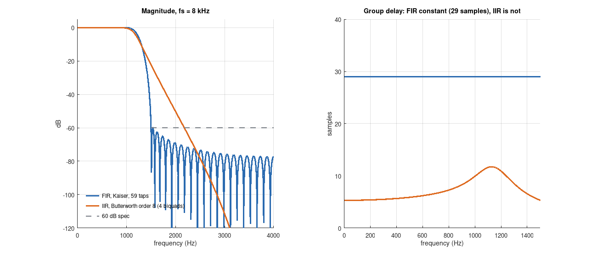
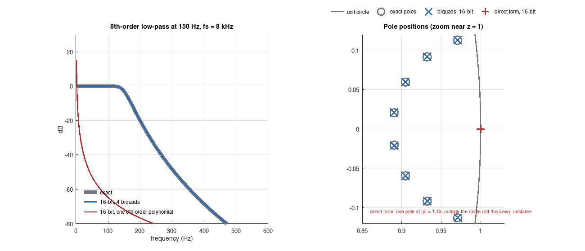
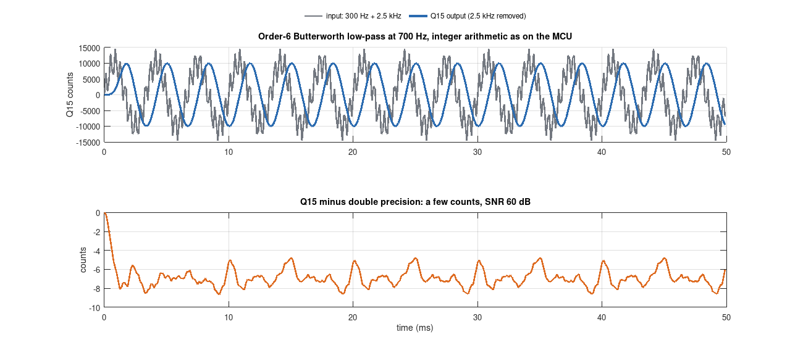
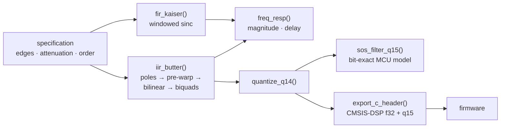

# Digital Filter Designer: FIR and IIR from First Principles to Fixed-Point MCU Code


Designs digital filters without the Signal Processing Toolbox and takes them all the way to
firmware: Kaiser-window FIR filters, Butterworth IIR filters via the bilinear transform as
second-order sections, a bit-exact model of the Q15 integer arithmetic an MCU runs, a
demonstration of why high-order IIR filters must be built from biquads, and a generated C
header ready for CMSIS-DSP.

**Highlights**
- Butterworth design written out: analog poles, pre-warped cut-off, bilinear transform, pole
  pairing into biquads. The magnitude matches the exact bilinear Butterworth formula to 10⁻⁹
  and is −3.01 dB at the cut-off for orders 2, 4, 5 and 8
- Kaiser FIR from a specification (edges, attenuation): 59 taps for 60 dB, measured −59.7 dB
  stop band and 0.009 dB pass-band ripple, symmetric (linear phase)
- **Coefficient sensitivity, measured**: an 8th-order low-pass with 16-bit coefficients is
  **unstable** as one polynomial (a pole at |z| = 1.43) but exact as four biquads
- Bit-exact Q15 model of `arm_biquad_cascade_df1_q15`: 61 dB SNR against double precision
- `export_c_header` writes float and Q15 coefficient arrays in CMSIS-DSP order
  ([example](examples/lowpass_1k.h))
- 33 checks in MATLAB and Octave on every push

---

<details>
<summary><h2>📘 More Explanation for Students (click to expand)</h2></summary>

**What does a digital filter do?** It keeps the frequencies you want and removes the others, using
only multiplications and additions on the samples. A low-pass filter on a sensor removes fast
noise; a band-pass filter picks out a heart rate; an audio equaliser is a bank of filters. In a
microcontroller, every filter is just a short list of numbers, the coefficients, and a loop.

**FIR or IIR?** An FIR (finite impulse response) filter is a weighted average of the last N input
samples. It is always stable and can delay every frequency by exactly the same time (linear
phase), so it keeps the shape of a pulse, but it needs many coefficients. An IIR (infinite impulse
response) filter also feeds back its own past outputs. It reaches the same sharpness with far
fewer operations, but its delay varies with frequency and it can become unstable. The first figure
puts both side by side for the same task.

**What is the bilinear transform?** Classic filter families such as Butterworth were invented for
analog circuits. The bilinear transform maps an analog design into a digital one by squeezing the
whole analog frequency axis into the range up to half the sample rate. The squeeze bends the
frequencies, so the cut-off is "pre-warped" beforehand to land exactly where it should.

**Why biquads and fixed point?** Most microcontrollers compute fastest with 16-bit integers (Q15:
numbers between −1 and 1 stored as integers). Rounding the coefficients to 16 bits moves the
filter's poles slightly. In one big 8th-order polynomial, tiny coefficient changes move the poles
a lot, enough to push one outside the unit circle, and the filter then blows up. Split into
second-order sections ("biquads"), each pair of poles depends on only two coefficients and the
rounding barely matters. The second figure shows both cases.

</details>

---

## Results



*The same job, two ways (fs = 8 kHz). Left: a 59-tap Kaiser FIR meets the 60 dB specification
with a sharp edge; an 8th-order Butterworth rolls off more gently. Right: the FIR delays every
frequency by exactly 29 samples, the IIR's delay varies.*



*An 8th-order Butterworth low-pass at 150 Hz with 16-bit coefficients. As four biquads (blue) it
is indistinguishable from the exact filter. As one 8th-order polynomial (red) the response is
destroyed, and one pole moves to |z| = 1.43, outside the unit circle: the filter is unstable.*



*Integer filtering exactly as the MCU does it. The 2.5 kHz component is removed. The output
differs from double precision by a few counts: 61 dB SNR. The small negative offset comes from
the arithmetic right shift, which rounds towards minus infinity, as CMSIS-DSP's does.*

## Design flow



| Check | Result |
|---|---|
| Butterworth vs exact bilinear formula | max error < 10⁻⁹ (orders 2, 4, 5, 8; low- and high-pass) |
| Gain at the cut-off | −3.0103 dB |
| Kaiser low-pass 1.0/1.5 kHz, 60 dB | 59 taps, −59.7 dB stop band\*, 0.009 dB ripple |
| Kaiser high-pass and band-pass | meet 50 dB and 55 dB |
| Cascade vs `filter(b, a, x)` | identical to 10⁻¹⁰ |
| Q15 vs double precision | 61 dB SNR, no saturation at −6 dBFS |
| 16-bit direct form, 8th order | unstable (pole at 1.43); biquads stay at 0.9773 |

\* Kaiser's length formula is an estimate; one more pair of taps reaches the full 60 dB.

## Files

| File | Role |
|---|---|
| `src/fir_kaiser.m` | Low-, high- and band-pass FIR by the Kaiser method |
| `src/iir_butter.m` | Butterworth low- and high-pass as second-order sections |
| `src/freq_resp.m` | Frequency response of FIR, SOS or b/a (replaces `freqz`) |
| `src/sos_filter.m`, `src/sos_to_tf.m` | Double-precision cascade, cascade to polynomial |
| `src/quantize_q14.m`, `src/sos_filter_q15.m` | Q14 coefficients and the bit-exact Q15 model |
| `src/export_c_header.m` | C header for CMSIS-DSP |
| `examples/lowpass_1k.h` | Generated example: 4th-order, 1 kHz, fs = 8 kHz |
| `tests/run_tests.m` | 33 checks |

## Run it

```matlab
cd matlab/digital-filter-designer
addpath tests;    run_tests        % 33 checks, MATLAB or Octave
addpath examples; make_figures     % figures and examples/lowpass_1k.h

sos = iir_butter(4, 1000, 8000);                       % design
export_c_header(sos, 'lp1k', 8000, 'lp1k.h');          % hand over to firmware
```

## Revision history

Goes beyond the course exercise in [`filter-design`](../filter-design) (refined in place), which
applies an ideal frequency mask with the DFT. This project designs real FIR and IIR filters,
measures them, models the fixed-point implementation and generates firmware code.

---
## 👤 About the Author

**Faizan Saleem Siddiqui**, Embedded Firmware Engineer | Visiting Faculty | Research Scholar

Electronics engineer with 2+ years of experience in embedded systems and firmware development.
I build firmware for **BLE wearables** and **Bluetooth TWS audio devices** on Nordic nRF52 (Zephyr /
nRF Connect SDK), including **secure OTA updates (MCUboot, signed images)**, **low-power battery
management** and **charging-case firmware**. My background also covers STM32 and ESP32 with
FreeRTOS, real-time data acquisition, digital signal processing, industrial IoT, and Python tooling
for data, automation and machine learning.

- 🎓 MS Electronics, Quaid-i-Azam University, Islamabad (BS Electronics: 1st position, merit scholar)
- 🧑‍🏫 Visiting Faculty Member, Quaid-i-Azam University: teaching Real-Time Systems (STM32, FreeRTOS),
  Microcontroller Interfacing (ESP32) and AI/ML on Embedded Devices (TinyML)
- 🔬 Former Research Assistant, Autonomous Vehicle Engineering (COMSIP Lab, QAU)
- 🌍 Open to embedded / firmware engineering opportunities worldwide

[](https://www.linkedin.com/in/faizan-saleem-siddiqui-4411bb247/)
[](https://github.com/FaizanSSDQ)
[](mailto:faizansaleemsdq@yahoo.com)

Application code licensed under the [MIT License](../../LICENSE).
