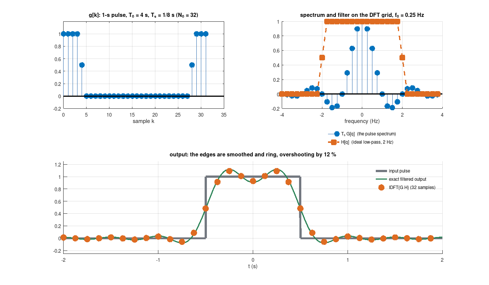
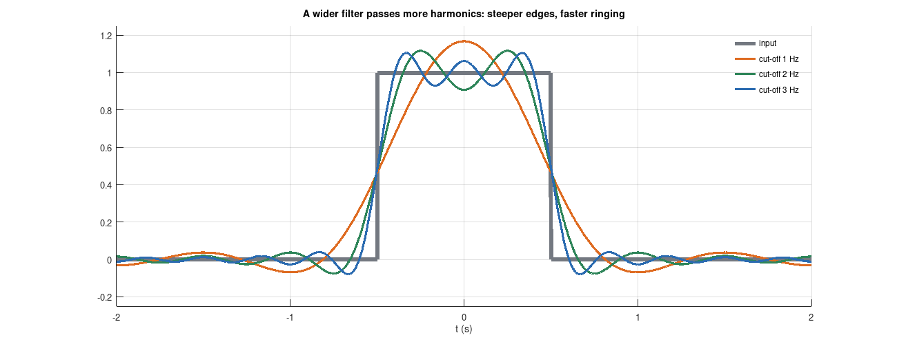
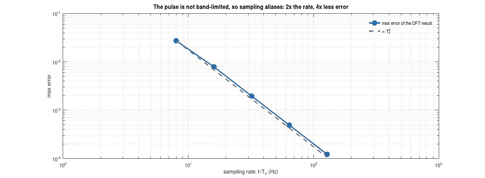

# Ideal Low-Pass Filtering with the DFT: a Pulse Train Through a 2 Hz Filter


The textbook exercise on filtering with the DFT: a 1-second rectangular pulse, repeating every
4 s, is sampled at 8 Hz (32 samples), transformed, multiplied by an ideal 2 Hz low-pass response
and transformed back. The result is compared with the exact continuous output, and the error
caused by sampling a signal that is not band-limited is measured.

**Highlights**
- Pulse samples, mask and filter as small functions; the sample table matches the textbook
  (1 for k = 0..3 and 29..31, ½ at the edges k = 4 and 28)
- Symmetric mask (½ exactly on the cut-off), real output, DC gain 1
- DFT result within 0.027 of the exact filtered pulse train at 32 samples; the error falls 4× for
  every doubling of the sampling rate (0.0005 at 256 samples)
- Ideal filtering makes the pulse ring and overshoot by 12 %; a wider filter gives steeper edges
- 10 checks in MATLAB and Octave on every push

---

<details>
<summary><h2>📘 More Explanation for Students (click to expand)</h2></summary>

**Filtering in the frequency domain.** A filter can be applied in two equivalent ways: by
convolution in time, or by multiplication in frequency. The second is often simpler: take the
DFT of the signal, multiply each frequency by the filter's response (1 to keep it, 0 to remove
it) and take the inverse DFT. Here the "ideal" low-pass filter keeps everything below 2 Hz and
removes everything above.

**Reading the DFT grid.** With 32 samples covering 4 s, the DFT has a frequency step of
1/4 s = 0.25 Hz. Bin q stands for q × 0.25 Hz, and the upper half of the bins stands for the
negative frequencies. The filter must treat both halves alike (bin q and bin 32 − q), otherwise
the filtered signal is no longer real. A sample exactly on the cut-off gets ½, like a sample
exactly on the edge of the pulse.

**Why the edges ring.** A rectangular pulse contains frequencies up to infinity; it is its
high-frequency content that makes its edges sharp. Removing everything above 2 Hz makes the edges
slow and leaves ripples, with an overshoot of about 12 % here. Every ideal (brick-wall) filter
does this; real filters with gentler slopes ring less.

**Why sampling causes an error.** Because the pulse has frequencies above half the sampling rate
(4 Hz), sampling folds them back into the band below 4 Hz (aliasing). The DFT result is
therefore slightly different from the true filtered signal. Sampling faster reduces the error,
by a factor of four for every doubling of the rate, as the last figure measures.

</details>

---

## Results



*Top: the 32 samples of one period, and the pulse spectrum with the 2 Hz filter on the DFT grid.
Bottom: the DFT result (orange) lies on the exact filtered output (green).*



*The same pulse through ideal low-pass filters at 1, 2 and 3 Hz.*



*Maximum difference between the DFT result and the exact output against the sampling rate.*

| Samples per period | Sampling interval | Max error |
|---|---|---|
| 32 | 1/8 s | 0.0273 |
| 64 | 1/16 s | 0.0079 |
| 128 | 1/32 s | 0.0020 |
| 256 | 1/64 s | 0.0005 |

## Files

| File | Role |
|---|---|
| `src/pulse_samples.m` | One period of the centred pulse train, wrapped for the DFT |
| `src/lowpass_mask.m` | Ideal low-pass response on the DFT grid, symmetric |
| `src/dft_filter.m` | DFT → multiply → inverse DFT |
| `src/lowpass_pulse_train.m` | Exact filtered output (finite Fourier sum), the reference |
| `tests/run_tests.m` | 10 checks |
| `examples/make_figures.m` | The figures above |

## Run it

```matlab
cd matlab/filter-design
addpath tests;    run_tests
addpath examples; make_figures
```

## Revision history

Refined from the original course scripts, which remain viewable in the
[repository history](https://github.com/FaizanSSDQ/Automation-and-Signal-Processing-Projects/tree/b11b1e1/matlab/filter-design).
Fixed on the way: the edge conditions `k==4 & k==28` could never be true, so the ½ samples were
never set; the mask loop ran `for m=length(q)` and filled only one bin; the upper pass band was
set to 2 instead of 1; and a script called a function `Exponent` that did not exist. For
designing real FIR and IIR filters and running them on an MCU, see the
[digital filter designer](../digital-filter-designer).

---
## 👤 About the Author

**Faizan Saleem Siddiqui**, Embedded Firmware Engineer | Visiting Faculty | Research Scholar

Electronics engineer with 2+ years of experience in embedded systems and firmware development.
I build firmware for **BLE wearables** and **Bluetooth TWS audio devices** on Nordic nRF52 (Zephyr /
nRF Connect SDK), including **secure OTA updates (MCUboot, signed images)**, **low-power battery
management** and **charging-case firmware**. My background also covers STM32 and ESP32 with
FreeRTOS, real-time data acquisition, digital signal processing, industrial IoT, and Python tooling
for data, automation and machine learning.

- 🎓 MS Electronics, Quaid-i-Azam University, Islamabad (BS Electronics: 1st position, merit scholar)
- 🧑‍🏫 Visiting Faculty Member, Quaid-i-Azam University: teaching Real-Time Systems (STM32, FreeRTOS),
  Microcontroller Interfacing (ESP32) and AI/ML on Embedded Devices (TinyML)
- 🔬 Former Research Assistant, Autonomous Vehicle Engineering (COMSIP Lab, QAU)
- 🌍 Open to embedded / firmware engineering opportunities worldwide

[](https://www.linkedin.com/in/faizan-saleem-siddiqui-4411bb247/)
[](https://github.com/FaizanSSDQ)
[](mailto:faizansaleemsdq@yahoo.com)

Application code licensed under the [MIT License](../../LICENSE).
