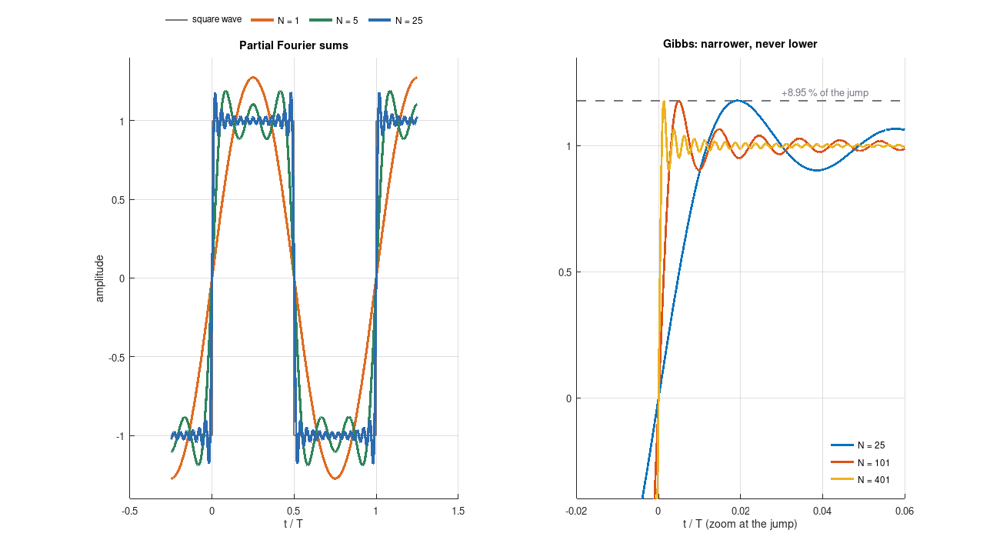
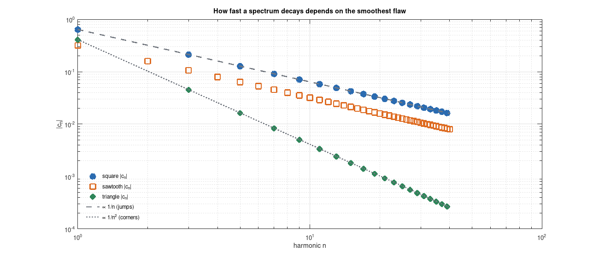
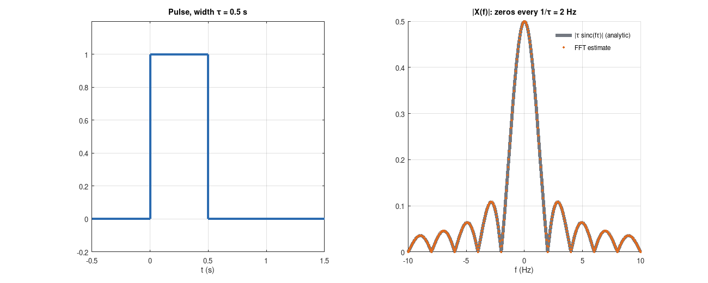
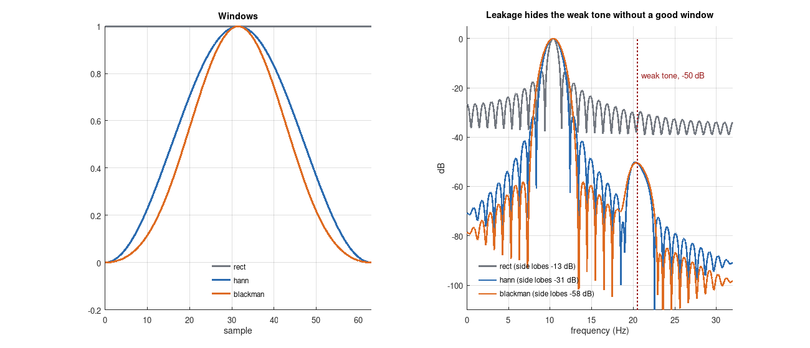
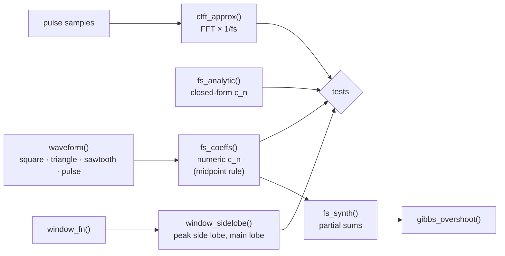

# Fourier Analysis Lab: Series, Transforms, the Gibbs Phenomenon and Spectral Leakage


A compact laboratory for the Fourier ideas every signal-processing engineer uses: computing
Fourier series numerically and checking them against closed forms, rebuilding signals from
their harmonics, measuring the Gibbs overshoot, verifying Parseval's theorem, estimating a
continuous-time Fourier transform with the FFT, and choosing a window to stop spectral leakage.
Everything is plain MATLAB: no toolbox, and it runs unchanged in GNU Octave.

**Highlights**
- Numerical Fourier coefficients (midpoint rule) agree with the closed forms to 10⁻⁴ for square,
  triangle, sawtooth and pulse waves
- The Gibbs overshoot is measured at 8.95 % of the jump for 25, 101 and 401 harmonics: more
  terms make the ripple narrower, never lower
- Decay rates made visible: a jump gives harmonics falling as 1/n, a corner as 1/n²
- FFT estimate of a pulse's transform matches τ·sinc(fτ) to 10⁻³
- Window side lobes measured: rectangular −13 dB, Hann −31 dB, Hamming −43 dB, Blackman −58 dB,
  and a weak tone 50 dB below a strong one that only the good windows reveal
- 27 checks in MATLAB and Octave on every push

---

<details>
<summary><h2>📘 More Explanation for Students (click to expand)</h2></summary>

**What is a Fourier series?** Any repeating signal, however sharp its corners, can be built by
adding sine waves whose frequencies are whole multiples of the repetition rate: the fundamental
and its harmonics. The Fourier coefficients say how much of each harmonic is needed and with
what phase. A square wave, for example, is the sum of the odd harmonics with sizes 1, 1/3, 1/5,
and so on. This lab computes those coefficients numerically, compares them with the formulas from
the textbook and adds the sine waves back together to show the signal re-appearing.

**What is the Gibbs phenomenon?** When a signal jumps, as a square wave does, a sum of a finite
number of sine waves overshoots the jump by about 9 % of its height. Adding more harmonics squeezes
the overshoot closer to the jump but never makes it smaller. It is why a sharply filtered signal
"rings" next to every edge, in audio, in images and on an oscilloscope.

**What is the Fourier transform?** A signal that happens only once, such as a single pulse, has no
repetition rate, so instead of a list of harmonics it has a continuous spectrum: the Fourier
transform. A rectangular pulse of width τ has the sinc-shaped spectrum τ·sin(πfτ)/(πfτ), with zeros
every 1/τ hertz: the shorter the pulse, the wider its spectrum. The FFT, which works on samples,
gives the same curve when scaled correctly, as the third figure shows.

**What is spectral leakage, and why windows?** The FFT looks at only a finite piece of a signal.
Cutting a sine wave off abruptly at both ends spreads its energy into side lobes across the whole
spectrum, and those side lobes can hide a weaker signal nearby. A window tapers the piece smoothly
to zero at both ends. The side lobes fall dramatically, at the cost of a slightly wider main peak.
Choosing the window is choosing that trade-off.

</details>

---

## Results



*Left: partial Fourier sums of a square wave with 1, 5 and 25 harmonics. Right: zoom at the jump
for 25, 101 and 401 harmonics. The peak stays at +8.95 % of the jump; only its width shrinks.*



*Coefficient magnitudes on log-log axes. The square wave and the sawtooth have jumps and decay as
1/n; the triangle is continuous with corners and decays as 1/n², which is why it needs far fewer
harmonics to look right.*



*The FFT of a sampled 0.5-second pulse, scaled by the sampling interval, lies on the analytic
τ·sinc(fτ) with its zeros every 2 Hz.*



*A strong tone between two FFT bins, plus a tone 50 dB weaker at 20.5 Hz. With the rectangular
window the strong tone's side lobes bury the weak one; Hann and Blackman windows reveal it.*

## How it works



The coefficients are integrals over one period. The midpoint rule is used deliberately: for a
periodic integrand it converges extremely fast, and sampling at slice midpoints never lands on a
discontinuity, so square and pulse waves need no special treatment.

## Files

| File | Role |
|---|---|
| `src/waveform.m` | Periodic test signals |
| `src/fs_coeffs.m` | Numerical complex Fourier coefficients |
| `src/fs_analytic.m` | Closed-form coefficients for checking and decay plots |
| `src/fs_synth.m` | Partial Fourier sums |
| `src/gibbs_overshoot.m` | Overshoot of the partial sum at a jump |
| `src/ctft_approx.m` | Continuous-time transform from the FFT |
| `src/sincn.m`, `src/window_fn.m` | sinc and windows without the Signal Processing Toolbox |
| `src/window_sidelobe.m` | Peak side-lobe level and main-lobe width of a window |
| `tests/run_tests.m` | 27 checks |
| `examples/make_figures.m` | The figures above |

## Run it

```matlab
cd matlab/fourier-analysis-lab
addpath tests;    run_tests        % 27 checks, MATLAB or Octave
addpath examples; make_figures     % regenerates docs/*.png
```

## Revision history

This project goes beyond the course exercises in [`fourier-series`](../fourier-series),
[`fourier-transform`](../fourier-transform), [`signal-basics`](../signal-basics) and
[`function-generator`](../function-generator), which have themselves been refined in place. Where
those reproduce the assignments, this lab adds the closed-form checks for every waveform,
Parseval, the Gibbs measurement, FFT-based transforms and the window study.

---
## 👤 About the Author

**Faizan Saleem Siddiqui**, Embedded Firmware Engineer | Visiting Faculty | Research Scholar

Electronics engineer with 2+ years of experience in embedded systems and firmware development.
I build firmware for **BLE wearables** and **Bluetooth TWS audio devices** on Nordic nRF52 (Zephyr /
nRF Connect SDK), including **secure OTA updates (MCUboot, signed images)**, **low-power battery
management** and **charging-case firmware**. My background also covers STM32 and ESP32 with
FreeRTOS, real-time data acquisition, digital signal processing, industrial IoT, and Python tooling
for data, automation and machine learning.

- 🎓 MS Electronics, Quaid-i-Azam University, Islamabad (BS Electronics: 1st position, merit scholar)
- 🧑‍🏫 Visiting Faculty Member, Quaid-i-Azam University: teaching Real-Time Systems (STM32, FreeRTOS),
  Microcontroller Interfacing (ESP32) and AI/ML on Embedded Devices (TinyML)
- 🔬 Former Research Assistant, Autonomous Vehicle Engineering (COMSIP Lab, QAU)
- 🌍 Open to embedded / firmware engineering opportunities worldwide

[](https://www.linkedin.com/in/faizan-saleem-siddiqui-4411bb247/)
[](https://github.com/FaizanSSDQ)
[](mailto:faizansaleemsdq@yahoo.com)

Application code licensed under the [MIT License](../../LICENSE).
