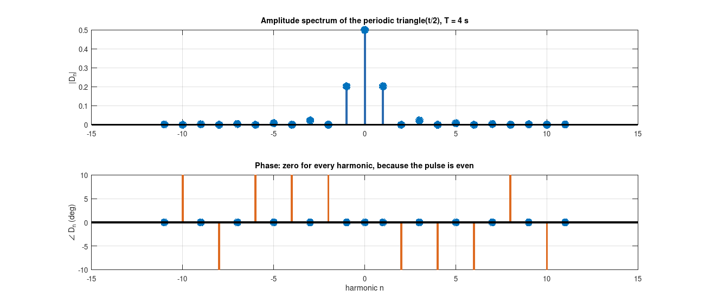
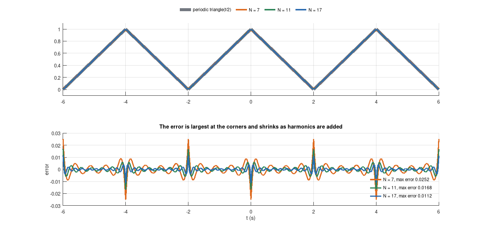
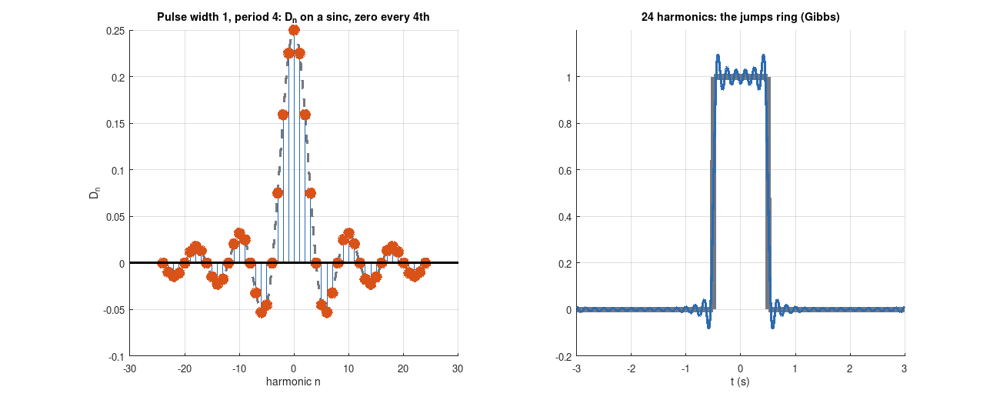

# Fourier Series of a Triangular Pulse Train: Coefficients, Spectrum and Reconstruction


The classic course assignment, done properly: compute the exponential Fourier series
coefficients Dₙ of the periodic pulse triangle(t/2) (period 4 s) by numerical integration, plot
the amplitude and phase spectra, and rebuild the signal from 7, 11 and 17 harmonics on each side.
A rectangular pulse train shows the contrasting case of a signal with jumps.

**Highlights**
- One function computes Dₙ for any N; the numerical coefficients match the closed form
  D₀ = ½, Dₙ = 2/(π²n²) for odd n to 10⁻⁹
- Reconstruction error falls from 0.025 (N = 7) to 0.017 (N = 11) and 0.011 (N = 17)
- Rectangular pulse train: Dₙ = ¼·sinc(n/4), every fourth harmonic exactly zero, Gibbs ringing
  at the jumps
- 11 checks in MATLAB and Octave on every push

---

<details>
<summary><h2>📘 More Explanation for Students (click to expand)</h2></summary>

**What the assignment asks.** A repeating signal can be written as a sum of complex
exponentials e^(j2πnt/T), one for each harmonic n. The coefficient Dₙ says how much of harmonic
n the signal contains: its magnitude is the size of that harmonic, its angle the phase. Dₙ is
found by multiplying the signal by e^(−j2πnt/T) and averaging over one period. Once the
coefficients are known, adding the harmonics back together rebuilds the signal.

**Reading the spectrum.** For the triangular pulse, D₀ = ½ is its average value. Only the odd
harmonics are non-zero, and they shrink as 1/n², very fast: a few harmonics already give a good
triangle. All the phases are zero because the pulse is symmetric about t = 0 (an even signal),
so every harmonic is a cosine that peaks at t = 0 together with the pulse.

**Why the reconstruction is not perfect.** With a limited number of harmonics, the sharpest
features are the hardest to reproduce. For the triangle these are its corners, where the error
plot shows spikes that shrink as harmonics are added. A rectangular pulse has jumps instead of
corners; its coefficients shrink only as 1/n, and the rebuilt signal overshoots each jump by
about 9 %, however many harmonics are used (the Gibbs phenomenon).

</details>

---

## Results



*Amplitude spectrum of the periodic triangle(t/2): D₀ = 0.5 and odd harmonics 2/(π²n²). The
phase is zero everywhere because the pulse is even.*



*Rebuilt from 7, 11 and 17 harmonics (top) and the error (bottom): largest at the corners,
shrinking as harmonics are added.*



*Pulse width 1 s, period 4 s: the coefficients follow a sinc envelope and vanish at every fourth
harmonic; the rebuilt pulse rings at its jumps.*

## Files

| File | Role |
|---|---|
| `src/fs_coefficients.m` | Dₙ for n = −N … N by numerical integration over one period |
| `src/fs_reconstruct.m` | Signal from its coefficients |
| `src/tri_pulse.m`, `src/rect_pulse.m` | The pulses |
| `tests/run_tests.m` | 11 checks |
| `examples/make_figures.m` | The figures above |

## Run it

```matlab
cd matlab/fourier-series
addpath tests;    run_tests
addpath examples; make_figures

[D, n] = fs_coefficients(@(t) tri_pulse(t/2), -2, 2, 7);   % the assignment, N = 7
```

## Revision history

Refined from the original course scripts, which remain viewable in the
[repository history](https://github.com/FaizanSSDQ/Automation-and-Signal-Processing-Projects/tree/b11b1e1/matlab/fourier-series).
Twenty-five files, mostly copies of the same script for N = 7, 11 and 17 in three folders, became
two functions with tests. Fixed on the way: the period was computed as a − b and came out
negative; the 1/T factor was applied to D₀ only; the reconstruction used the wrong frequency
variable and took the magnitude of the sum, folding negative values upwards; one copy of the
triangle function had a syntax error; and a 23-line hand-written sum became one matrix product.

---
## 👤 About the Author

**Faizan Saleem Siddiqui**, Embedded Firmware Engineer | Visiting Faculty | Research Scholar

Electronics engineer with 2+ years of experience in embedded systems and firmware development.
I build firmware for **BLE wearables** and **Bluetooth TWS audio devices** on Nordic nRF52 (Zephyr /
nRF Connect SDK), including **secure OTA updates (MCUboot, signed images)**, **low-power battery
management** and **charging-case firmware**. My background also covers STM32 and ESP32 with
FreeRTOS, real-time data acquisition, digital signal processing, industrial IoT, and Python tooling
for data, automation and machine learning.

- 🎓 MS Electronics, Quaid-i-Azam University, Islamabad (BS Electronics: 1st position, merit scholar)
- 🧑‍🏫 Visiting Faculty Member, Quaid-i-Azam University: teaching Real-Time Systems (STM32, FreeRTOS),
  Microcontroller Interfacing (ESP32) and AI/ML on Embedded Devices (TinyML)
- 🔬 Former Research Assistant, Autonomous Vehicle Engineering (COMSIP Lab, QAU)
- 🌍 Open to embedded / firmware engineering opportunities worldwide

[](https://www.linkedin.com/in/faizan-saleem-siddiqui-4411bb247/)
[](https://github.com/FaizanSSDQ)
[](mailto:faizansaleemsdq@yahoo.com)

Application code licensed under the [MIT License](../../LICENSE).
