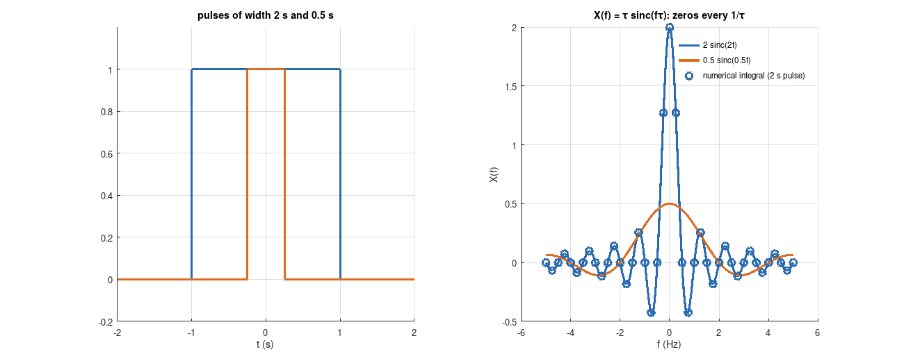
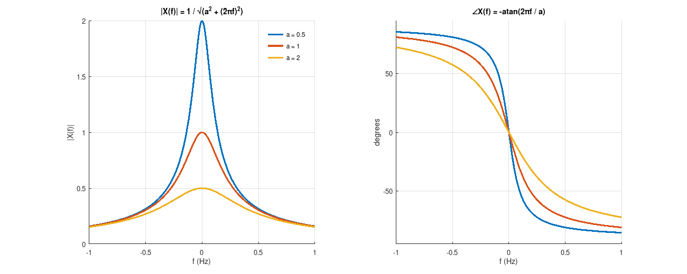
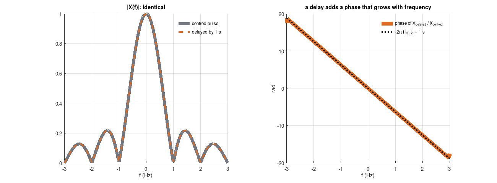

# Fourier Transform Exercises: Pulses, Exponentials and the Time-Shift Property


Continuous-time Fourier transforms computed by numerical integration and checked against the
textbook pairs: rectangular pulses of different widths, the one-sided exponential e⁻ᵃᵗu(t) with
its magnitude and phase, the two-sided e^(−|t|), the time-shift property and Parseval's theorem.

**Highlights**
- `ctft` evaluates X(f) = ∫ x(t) e^(−j2πft) dt directly; every result matches its closed form to
  10⁻⁹
- Width and bandwidth: a 2 s pulse has zeros every 0.5 Hz, a 0.5 s pulse every 2 Hz
- e⁻ᵃᵗu(t) → 1/(a + j2πf): magnitude 1/√(a² + (2πf)²), phase −atan(2πf/a), for a = 0.5, 1, 2
- A 1 s delay leaves |X(f)| unchanged and adds exactly −2πf radians of phase
- 11 checks in MATLAB and Octave on every push

---

<details>
<summary><h2>📘 More Explanation for Students (click to expand)</h2></summary>

**From series to transform.** A Fourier series describes a repeating signal by a list of
harmonics. A signal that happens only once has no repetition rate, so its frequencies are not a
list but a continuous curve: the Fourier transform X(f). |X(f)| says how strongly each frequency
is present, and the angle of X(f) its phase.

**Short in time, wide in frequency.** A rectangular pulse of width τ has the transform
τ·sinc(fτ), which first reaches zero at 1/τ. Halve the pulse width and the spectrum doubles in
width. This trade-off is everywhere: short radar pulses need wide bandwidth, and fast digital
edges spread energy to high frequencies.

**Exponentials and filters.** The decaying exponential e⁻ᵃᵗ is the impulse response of the
simplest RC circuit. Its transform 1/(a + j2πf) is that circuit's frequency response: flat at low
frequencies, falling off above f = a/(2π), with a phase that bends from 0 to −90°.

**Delaying a signal.** Delaying a signal by t₀ does not change which frequencies it contains, so
|X(f)| stays the same. Every frequency is simply delayed by the same time, which is a phase of
−2πf·t₀ radians: a straight line through zero, steeper for longer delays.

</details>

---

## Results



*Pulses of width 2 s and 0.5 s and their transforms τ·sinc(fτ); the circles are the numerical
integral for the 2 s pulse.*



*Magnitude and phase of e⁻ᵃᵗu(t) for three decay rates: a faster decay gives a wider spectrum.*



*Delaying the pulse by 1 s: identical magnitude, and a phase of exactly −2πf radians.*

## Files

| File | Role |
|---|---|
| `src/ctft.m` | Continuous-time Fourier transform by numerical integration |
| `src/sincn.m` | Normalised sinc without a toolbox |
| `tests/run_tests.m` | 11 checks against closed-form transform pairs |
| `examples/make_figures.m` | The figures above |

## Run it

```matlab
cd matlab/fourier-transform
addpath tests;    run_tests
addpath examples; make_figures
```

## Revision history

Refined from the original course scripts, which remain viewable in the
[repository history](https://github.com/FaizanSSDQ/Automation-and-Signal-Processing-Projects/tree/b11b1e1/matlab/fourier-transform).
The folder held a copy of the Fourier series script, a copy of the broken energy/power script, an
editor backup (`.asv`) and a "transform" script that plotted sin(nπf)/(πf) fifty times in a
loop. It now computes transforms numerically, checks them against the standard pairs and
demonstrates the properties the original scripts were aiming at.

---
## 👤 About the Author

**Faizan Saleem Siddiqui**, Embedded Firmware Engineer | Visiting Faculty | Research Scholar

Electronics engineer with 2+ years of experience in embedded systems and firmware development.
I build firmware for **BLE wearables** and **Bluetooth TWS audio devices** on Nordic nRF52 (Zephyr /
nRF Connect SDK), including **secure OTA updates (MCUboot, signed images)**, **low-power battery
management** and **charging-case firmware**. My background also covers STM32 and ESP32 with
FreeRTOS, real-time data acquisition, digital signal processing, industrial IoT, and Python tooling
for data, automation and machine learning.

- 🎓 MS Electronics, Quaid-i-Azam University, Islamabad (BS Electronics: 1st position, merit scholar)
- 🧑‍🏫 Visiting Faculty Member, Quaid-i-Azam University: teaching Real-Time Systems (STM32, FreeRTOS),
  Microcontroller Interfacing (ESP32) and AI/ML on Embedded Devices (TinyML)
- 🔬 Former Research Assistant, Autonomous Vehicle Engineering (COMSIP Lab, QAU)
- 🌍 Open to embedded / firmware engineering opportunities worldwide

[](https://www.linkedin.com/in/faizan-saleem-siddiqui-4411bb247/)
[](https://github.com/FaizanSSDQ)
[](mailto:faizansaleemsdq@yahoo.com)

Application code licensed under the [MIT License](../../LICENSE).
