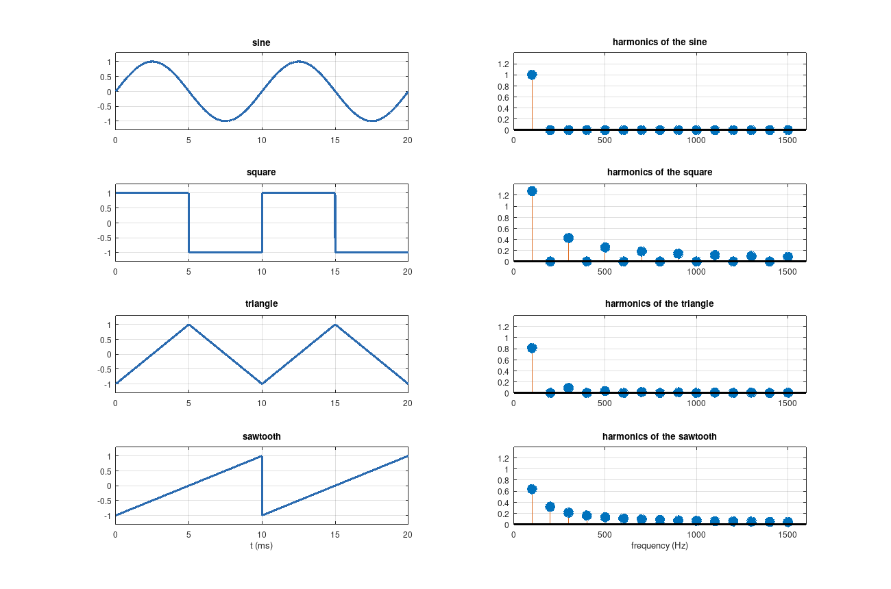
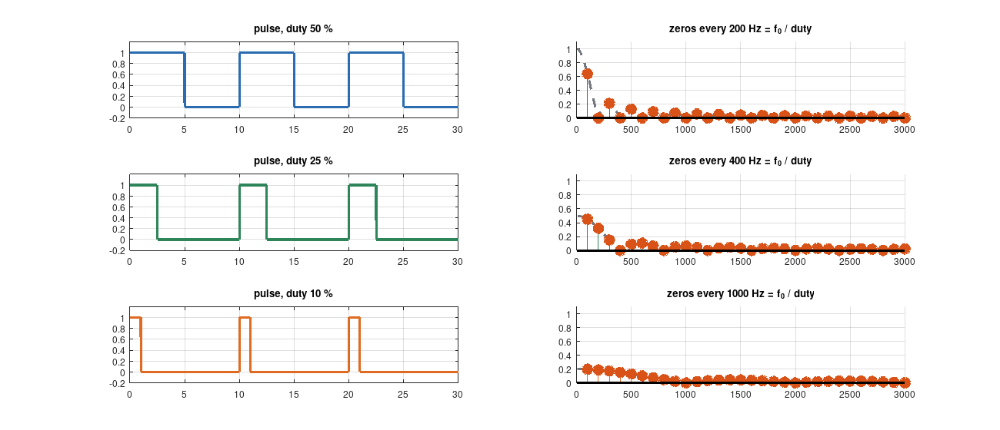
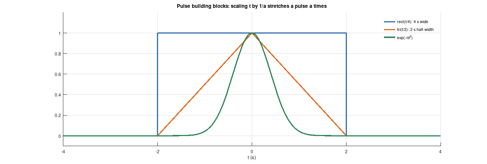

# Waveform Generator: Pulses, Periodic Waves and Their Harmonics


The waveforms of a bench function generator in MATLAB, with what an oscilloscope's FFT would show
for each: sine, square, triangle, sawtooth and pulse waves of any duty cycle, their harmonic
amplitudes, and the basic pulse shapes (rectangular, triangular, Gaussian) used to build them.

**Highlights**
- `periodic_wave` and `pulse_shapes` without `rectpuls` or any other toolbox function
- Edge samples land on the correct side (phase snapped against floating-point rounding)
- Harmonics measured with the FFT and checked against theory: square 4/(πk) (odd k), triangle
  8/(π²k²) (odd k), sawtooth 2/(πk) (all k), sine a single line
- Duty cycle: a 25 % pulse wave has no 4th, 8th, … harmonic; in general the zeros fall at
  f₀ / duty
- 17 checks in MATLAB and Octave on every push

---

<details>
<summary><h2>📘 More Explanation for Students (click to expand)</h2></summary>

**What a function generator makes.** A lab function generator produces repeating test signals:
a smooth sine, a square wave that switches between two levels, a triangle that ramps up and
down, a sawtooth that ramps up and drops, and pulses whose "on" time can be set as a fraction of
the period, the duty cycle.

**Why harmonics differ.** Every repeating wave is a sum of sine waves at the fundamental
frequency and its multiples (harmonics). A pure sine has only the fundamental. A square wave
needs odd harmonics that shrink slowly (1/k) to build its sudden jumps. A triangle has no jumps,
only corners, so its harmonics shrink much faster (1/k²) and it looks almost like a sine. The
right-hand plots are what you would see with an oscilloscope's FFT function.

**Duty cycle and missing harmonics.** A pulse wave with 25 % duty cycle repeats a shape that fits
exactly four times into the period at the 4th harmonic, so that harmonic cancels out completely,
and so do the 8th, 12th, and so on. The general rule is that the zeros fall at the fundamental
divided by the duty cycle. Shorter pulses spread their energy over more harmonics.

</details>

---

## Results



*Four waveforms at 100 Hz and their harmonic amplitudes from the FFT.*



*Pulse waves with 50 %, 25 % and 10 % duty cycle. The harmonics follow a sinc-shaped envelope
(dashed) with zeros every f₀ / duty.*



*The single-pulse building blocks; dividing t by a stretches a pulse a times.*

## Files

| File | Role |
|---|---|
| `src/periodic_wave.m` | Sine, square, triangle, sawtooth and pulse waves |
| `src/pulse_shapes.m` | Rectangular, triangular and Gaussian pulses |
| `src/harmonics.m` | Harmonic amplitudes from the FFT (whole number of periods, no leakage) |
| `tests/run_tests.m` | 17 checks |
| `examples/make_figures.m` | The figures above |

## Run it

```matlab
cd matlab/function-generator
addpath tests;    run_tests
addpath examples; make_figures
```

## Revision history

Refined from the original course scripts, which remain viewable in the
[repository history](https://github.com/FaizanSSDQ/Automation-and-Signal-Processing-Projects/tree/b11b1e1/matlab/function-generator).
The folder held single-pulse functions, a script that needed `rectpuls` from the Signal
Processing Toolbox and a third copy of the broken energy/power script. It is now a small,
tested waveform library with harmonic analysis. The firmware counterparts are the
[STM32 DDS generator](../../stm32/dds-waveform-generator) and the
[ESP32 Wi-Fi waveform generator](../../esp32/wifi-waveform-generator).

---
## 👤 About the Author

**Faizan Saleem Siddiqui**, Embedded Firmware Engineer | Visiting Faculty | Research Scholar

Electronics engineer with 2+ years of experience in embedded systems and firmware development.
I build firmware for **BLE wearables** and **Bluetooth TWS audio devices** on Nordic nRF52 (Zephyr /
nRF Connect SDK), including **secure OTA updates (MCUboot, signed images)**, **low-power battery
management** and **charging-case firmware**. My background also covers STM32 and ESP32 with
FreeRTOS, real-time data acquisition, digital signal processing, industrial IoT, and Python tooling
for data, automation and machine learning.

- 🎓 MS Electronics, Quaid-i-Azam University, Islamabad (BS Electronics: 1st position, merit scholar)
- 🧑‍🏫 Visiting Faculty Member, Quaid-i-Azam University: teaching Real-Time Systems (STM32, FreeRTOS),
  Microcontroller Interfacing (ESP32) and AI/ML on Embedded Devices (TinyML)
- 🔬 Former Research Assistant, Autonomous Vehicle Engineering (COMSIP Lab, QAU)
- 🌍 Open to embedded / firmware engineering opportunities worldwide

[](https://www.linkedin.com/in/faizan-saleem-siddiqui-4411bb247/)
[](https://github.com/FaizanSSDQ)
[](mailto:faizansaleemsdq@yahoo.com)

Application code licensed under the [MIT License](../../LICENSE).
