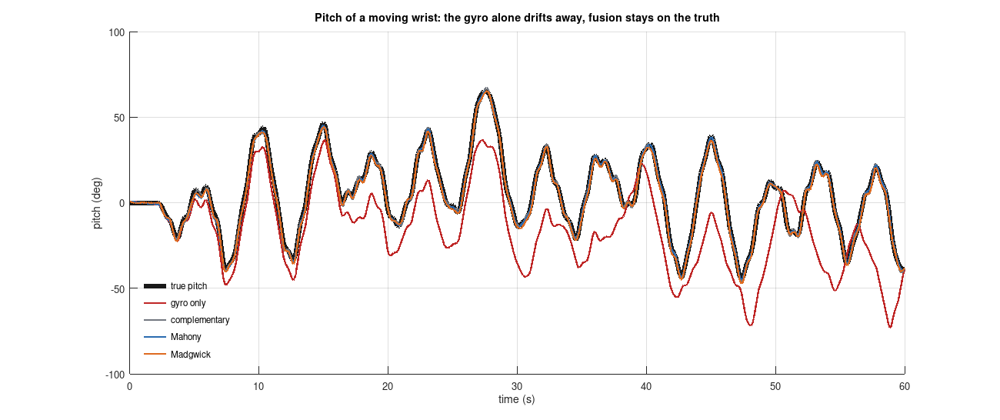
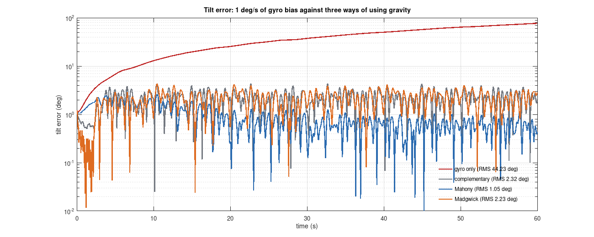
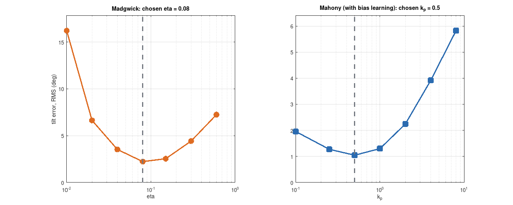
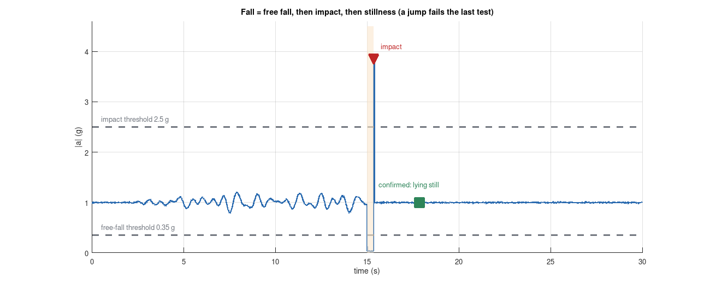
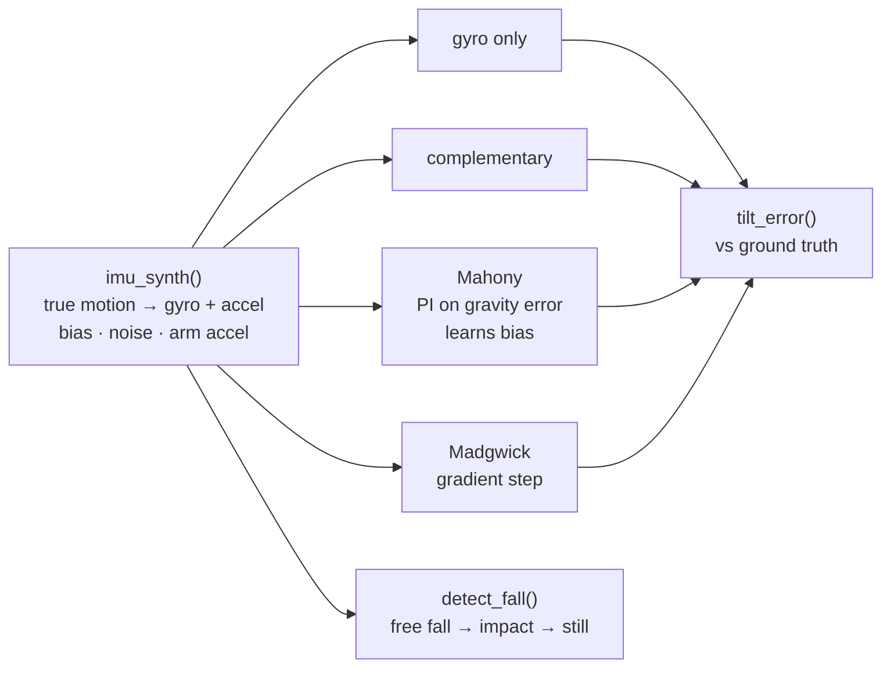

# IMU Orientation Fusion and Fall Detection: Complementary, Mahony and Madgwick Compared


How a wearable knows which way it is pointing. A 6-axis IMU (gyroscope and accelerometer) is
simulated on a moving wrist with exact ground truth, then orientation is estimated four ways:
gyroscope integration alone, a complementary filter, the Mahony filter and the Madgwick filter.
The errors are measured against the truth, the filter gains are tuned from data, and a three-stage
fall detector (free fall, impact, stillness) is built on top. Base MATLAB only, also runs in GNU
Octave.

**Highlights**
- Quaternion toolkit: product, rotation, Euler conversion, exact integration of body rates
- Realistic sensor model: gyroscope bias (about 1 °/s) and noise, accelerometer noise and the
  linear accelerations of a moving arm, a still start for initialisation
- Tilt error RMS over 60 s: **gyro only 44°, complementary 2.3°, Madgwick 2.2°, Mahony 1.05°**
- Mahony's integral term learns the gyroscope bias on the two tilt axes
- Gains chosen by sweeping them, with the optimum shown
- Fall detector that rejects a jump (free fall and landing, but movement continues)
- 16 checks in MATLAB and Octave on every push

---

<details>
<summary><h2>📘 More Explanation for Students (click to expand)</h2></summary>

**What do the two sensors measure?** A gyroscope measures how fast the device turns, in degrees
per second, around three axes. An accelerometer measures acceleration, and when the device is
still, the only acceleration it feels is gravity, pointing down. So the accelerometer says which
way is down, and the gyroscope says how the device is rotating.

**Why not use just one of them?** Adding up (integrating) the gyroscope's turning rate gives the
orientation, but every gyroscope has a small constant error, its bias. Integrated, the bias
becomes a steadily growing angle error: the red line in the figures drifts by tens of degrees
within a minute. The accelerometer never drifts, but it is noisy and is confused by movement,
because moving the arm adds accelerations on top of gravity. Sensor fusion combines the two: the
gyroscope for quick, smooth changes, the accelerometer to pull the estimate slowly back to the true
"down".

**How do the three filters differ?** The complementary filter mixes the two estimates of the tilt
angles with fixed weights. The Mahony filter works on the whole rotation: it measures the angle
between the gravity it expects and the gravity the accelerometer sees, and turns that error into a
correction of the gyroscope rate, including a slowly learned correction for the bias. The
Madgwick filter takes a small step that makes the predicted gravity agree better with the measured
one at every sample. All three use quaternions, a four-number description of a rotation that never
suffers from the "gimbal lock" of angles.

**What about heading (yaw)?** Gravity says nothing about which way you face, so without a
magnetometer no filter can correct the heading, and it drifts. That is why this project measures
the tilt error (roll and pitch together), which the accelerometer can observe.

**How is a fall detected?** A real fall has three stages: a short free fall, when the
accelerometer reads almost zero; an impact, a spike of several g; then the person lying still.
Requiring all three, in order, separates a fall from a jump (no stillness afterwards) or from
slapping the hand on a table (no free fall before).

</details>

---

## Results



*Pitch of the simulated wrist over a minute. Gyroscope integration (red) drifts away; the three
fusion filters stay on the true pitch (black).*



*Tilt error over time on a log scale. The gyroscope's 1 °/s bias makes integration diverge;
Mahony, which also learns the bias, stays mostly below 1°.*



*Too little correction lets the bias win, too much lets arm movements pull the estimate around.
The chosen gains sit at the minimum of each curve. They are tuned on this simulated motion; real
motion should be re-tuned the same way.*



*A fall at 15 s: free fall (shaded, |a| below 0.35 g), an impact above 2.5 g, then stillness, which
confirms the fall about 2.5 s after the impact.*

## Structure



| Estimator | Tilt error RMS (60 s) | Notes |
|---|---|---|
| Gyroscope integration | 44.2° | drifts with the bias |
| Complementary (α 0.98) | 2.3° | Euler angles, fixed weights |
| Madgwick (β 0.08) | 2.2° | no bias learning, β tuned |
| Mahony (kp 0.5, ki 0.05) | 1.05° | integral term learns the bias |

## Files

| File | Role |
|---|---|
| `src/quat.m` | Quaternion operations (one place for the conventions) |
| `src/imu_synth.m` | Simulated wrist motion, sensors and ground truth, optional fall |
| `src/fuse_orientation.m` | Gyro, complementary, Mahony and Madgwick estimators |
| `src/tilt_error.m` | Angle between estimated and true gravity |
| `src/detect_fall.m` | Three-stage fall detector |
| `tests/run_tests.m` | 16 checks |

## Run it

```matlab
cd matlab/imu-orientation-fusion
addpath tests;    run_tests        % 16 checks, MATLAB or Octave
addpath examples; make_figures
```

## Related firmware

The firmware side of this topic, a 1600 Hz IMU streaming engine for a health band with a live 3D
monitor, is [MotionCore](../../nrf52/motioncore-imu-healthband).

---
## 👤 About the Author

**Faizan Saleem Siddiqui**, Embedded Firmware Engineer | Visiting Faculty | Research Scholar

Electronics engineer with 2+ years of experience in embedded systems and firmware development.
I build firmware for **BLE wearables** and **Bluetooth TWS audio devices** on Nordic nRF52 (Zephyr /
nRF Connect SDK), including **secure OTA updates (MCUboot, signed images)**, **low-power battery
management** and **charging-case firmware**. My background also covers STM32 and ESP32 with
FreeRTOS, real-time data acquisition, digital signal processing, industrial IoT, and Python tooling
for data, automation and machine learning.

- 🎓 MS Electronics, Quaid-i-Azam University, Islamabad (BS Electronics: 1st position, merit scholar)
- 🧑‍🏫 Visiting Faculty Member, Quaid-i-Azam University: teaching Real-Time Systems (STM32, FreeRTOS),
  Microcontroller Interfacing (ESP32) and AI/ML on Embedded Devices (TinyML)
- 🔬 Former Research Assistant, Autonomous Vehicle Engineering (COMSIP Lab, QAU)
- 🌍 Open to embedded / firmware engineering opportunities worldwide

[](https://www.linkedin.com/in/faizan-saleem-siddiqui-4411bb247/)
[](https://github.com/FaizanSSDQ)
[](mailto:faizansaleemsdq@yahoo.com)

Application code licensed under the [MIT License](../../LICENSE).
