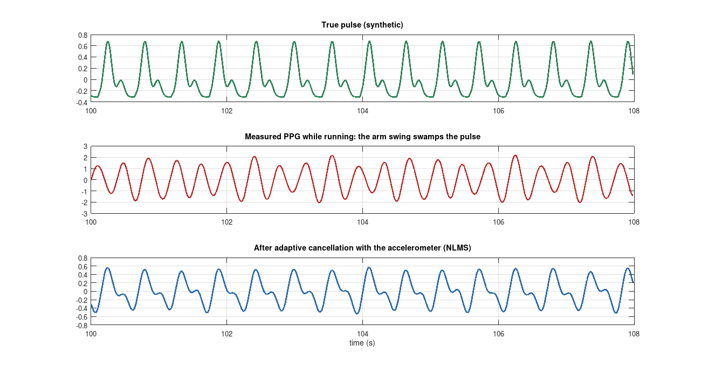
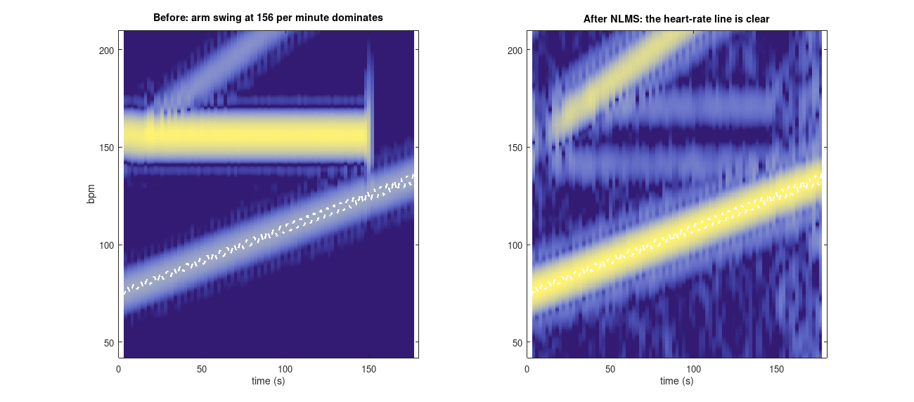
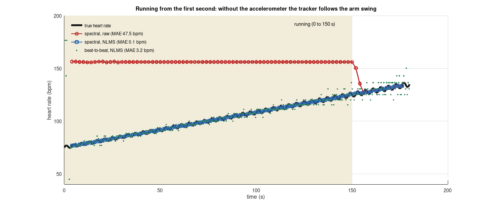
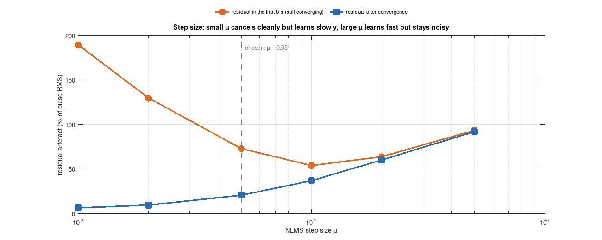
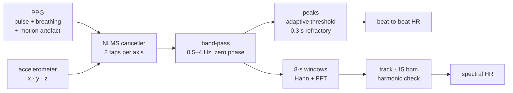

# Wrist PPG Heart-Rate Estimator with Accelerometer-Based Motion-Artefact Removal


Heart rate from a wrist-worn optical sensor (PPG) is easy at rest and hard while running: the arm
swing moves the sensor on the skin and creates an artefact larger than the pulse, at a rate close
to the heart rate. This project estimates heart rate with two methods (beat-to-beat peaks and a
tracked spectral peak) and removes the motion artefact with a normalised LMS adaptive filter that
uses the band's accelerometer as its reference. All signals are synthetic, with an exact known
heart rate to measure the error against.

**Highlights**
- Synthetic wrist PPG with systolic and dicrotic waves, breathing, heart-rate ramps and a motion
  artefact derived from a matching 3-axis accelerometer
- Zero-phase band-pass (0.5–4 Hz), adaptive beat detector, sliding-window spectral estimator
  with ±15 bpm tracking and a second-harmonic check
- NLMS canceller with one adaptive FIR per accelerometer axis
- Running from the first second: **47.5 bpm error without the accelerometer, 0.1 bpm with it**
- Step-size trade-off measured and chosen from data (μ = 0.05)
- 12 checks in MATLAB and Octave on every push

---

<details>
<summary><h2>📘 More Explanation for Students (click to expand)</h2></summary>

**How does a smartwatch measure heart rate?** A green or infrared LED shines into the skin and a
photodiode measures how much light comes back. With each heartbeat the small arteries fill with
blood, which absorbs more light, so the reflected light dips once per beat. This signal is called
a photoplethysmogram (PPG). Counting its peaks, or finding its dominant frequency, gives the heart
rate.

**Why does running break it?** When the arm swings, the sensor shifts slightly on the skin and
the amount of reflected light changes with every swing. This motion artefact can be several times
larger than the pulse, and the arm swing (about 150 per minute when running) is close to a
runner's heart rate. A naive estimator then reports the running cadence instead of the heart
rate, as the red line in the third figure does.

**What does the adaptive filter do?** The band also has an accelerometer, which measures the arm
motion but not the pulse. An adaptive filter learns, sample by sample, how to turn the
accelerometer signals into the artefact they cause in the PPG, and subtracts its prediction.
Because the pulse has nothing in common with the arm motion, the filter cannot learn to remove it,
so the pulse is what remains. The NLMS (normalised least mean squares) algorithm adjusts the
filter after every sample in the direction that makes the remaining error smaller.

**How fast should it learn?** The step size μ decides. A small μ learns slowly but, once it has
learned, removes the artefact very cleanly. A large μ learns within a second but keeps jittering
around the answer, leaving more noise behind. The last figure measures both effects and shows
where the chosen value sits.

</details>

---

## Results



*Eight seconds of a run: the true pulse, the measured PPG dominated by the arm swing, and the PPG
after adaptive cancellation.*



*Before: the arm swing at 156 per minute is the brightest line in the spectrum. After NLMS
cancellation, the heart-rate line (dashed: true rate) dominates.*



*A 3-minute session that starts running at once, with the heart rate climbing from 75 to
135 bpm. Without the accelerometer, the tracker locks onto the arm swing and stays there (mean
absolute error 47.5 bpm). With NLMS cancellation it follows the heart rate within 0.1 bpm;
beat-to-beat intervals give 3.2 bpm.*



*Residual artefact after cancellation for different step sizes: while still converging (first
8 s) and after convergence. μ = 0.05 converges within the first analysis window and leaves a small
residual.*

## Processing chain



| Scenario | Method | Mean absolute error |
|---|---|---|
| Rest, 72 bpm | peaks / spectral | < 2 bpm / < 2 bpm |
| Heart rate ramp 70 → 130 bpm | spectral | < 3 bpm |
| Running from the start | spectral, raw | 47.5 bpm (locked on the arm swing) |
| Running from the start | spectral after NLMS | 0.1 bpm |

## Files

| File | Role |
|---|---|
| `src/ppg_synth.m` | Synthetic PPG, accelerometer and true heart rate |
| `src/bandpass_fir.m` | Zero-phase windowed-sinc band-pass |
| `src/hr_peaks.m` | Beat detection and beat-to-beat heart rate |
| `src/hr_spectral.m` | Sliding spectral estimate with tracking and harmonic check |
| `src/nlms_cancel.m` | Multi-reference NLMS adaptive noise canceller |
| `src/hr_error.m` | Error against the true heart rate |
| `tests/run_tests.m` | 12 checks |

## Run it

```matlab
cd matlab/ppg-heart-rate-estimator
addpath tests;    run_tests        % 12 checks, MATLAB or Octave
addpath examples; make_figures
```

## Scope and limits

The data is simulated, so every error can be measured exactly. Real wrist PPG adds effects this
model leaves out, such as changing contact pressure, ambient light, skin tone and non-linear
artefacts. Treat these results as a demonstration of the methods, not as clinical accuracy.

---
## 👤 About the Author

**Faizan Saleem Siddiqui**, Embedded Firmware Engineer | Visiting Faculty | Research Scholar

Electronics engineer with 2+ years of experience in embedded systems and firmware development.
I build firmware for **BLE wearables** and **Bluetooth TWS audio devices** on Nordic nRF52 (Zephyr /
nRF Connect SDK), including **secure OTA updates (MCUboot, signed images)**, **low-power battery
management** and **charging-case firmware**. My background also covers STM32 and ESP32 with
FreeRTOS, real-time data acquisition, digital signal processing, industrial IoT, and Python tooling
for data, automation and machine learning.

- 🎓 MS Electronics, Quaid-i-Azam University, Islamabad (BS Electronics: 1st position, merit scholar)
- 🧑‍🏫 Visiting Faculty Member, Quaid-i-Azam University: teaching Real-Time Systems (STM32, FreeRTOS),
  Microcontroller Interfacing (ESP32) and AI/ML on Embedded Devices (TinyML)
- 🔬 Former Research Assistant, Autonomous Vehicle Engineering (COMSIP Lab, QAU)
- 🌍 Open to embedded / firmware engineering opportunities worldwide

[](https://www.linkedin.com/in/faizan-saleem-siddiqui-4411bb247/)
[](https://github.com/FaizanSSDQ)
[](mailto:faizansaleemsdq@yahoo.com)

Application code licensed under the [MIT License](../../LICENSE).
