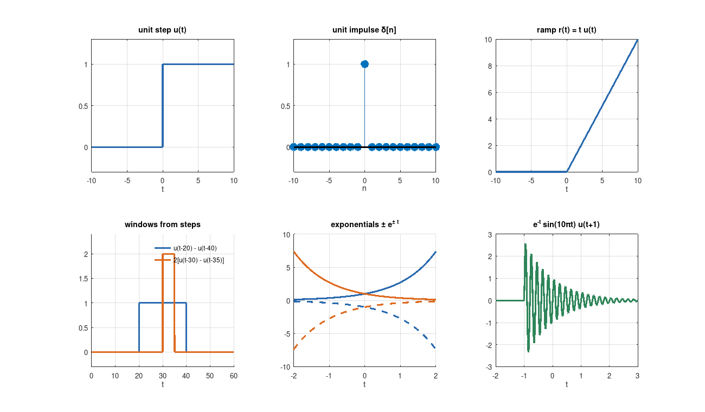
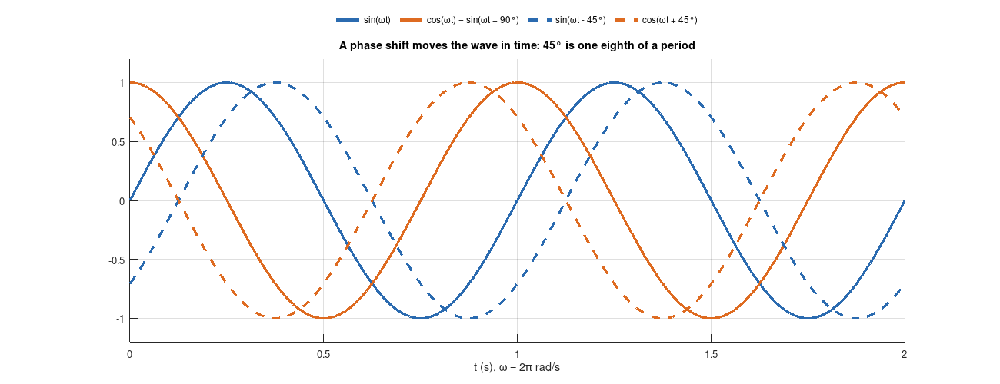
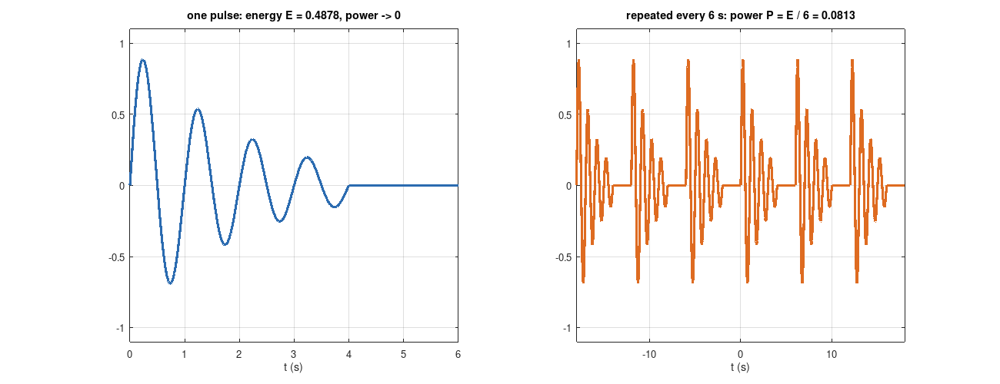

# Elementary Signals: Steps, Impulses, Ramps, Sinusoids, Energy and Power


The first exercises of a Signals and Systems course, rewritten as small tested functions: the
unit step, the unit impulse and the ramp, windows built from shifted steps, exponentials, a
damped sinusoid, sinusoids with phase shifts, and the energy and power of a pulse and of its
periodic repetition.

**Highlights**
- `unit_step`, `unit_impulse`, `ramp`, `energy_power` and `periodic_extension` as reusable
  functions
- Windows from steps, u(t − 20) − u(t − 40), and signals as sums of shifted impulses
- Phase shifts in degrees done right: cos(ωt) = sin(ωt + 90°)
- Energy of e⁻ᵗu(t) = ½, power of a unit sine = ½, and the course example: a pulse with energy
  0.4878 repeated every 6 s has power E/6 = 0.0813
- 13 checks in MATLAB and Octave on every push

---

<details>
<summary><h2>📘 More Explanation for Students (click to expand)</h2></summary>

**Why these signals?** The unit step (off, then on for ever), the unit impulse (a single
instant) and the ramp (the step's running total) are the alphabet of signals. Switching
something on is a step; a short knock is an impulse; a steadily rising voltage is a ramp.
Shifting, scaling and adding them builds almost everything else: a rectangular window is one
step minus a later one, and any sampled signal is a row of scaled impulses.

**Sinusoids and phase.** A sinusoid is fixed by its amplitude, frequency and phase. The phase
says where in its cycle the wave starts; 360° is one whole period, so 45° moves the wave by
one eighth of a period. Cosine is simply sine started a quarter-period (90°) earlier. A common
mistake, made in the first version of this exercise, is to subtract 45 directly from an angle
in radians, which shifts the wave by about seven whole cycles instead.

**Energy or power?** The energy of a signal is the area under its square: a single pulse has a
finite energy. A signal that goes on for ever, such as a sine wave or a repeating pulse, has
infinite energy, so we describe it by its power instead: the energy per second, averaged over
time. For a repeating signal the power is the energy of one period divided by the period, which
is exactly what the third figure shows.

</details>

---

## Results



*The building blocks: step, discrete impulse, ramp, windows made of shifted steps, rising and
decaying exponentials, and the damped sinusoid e⁻ᵗ sin(10πt) u(t + 1).*



*Phase shifts of 45° and 90°: each moves the wave along the time axis by that fraction of a
period.*



*Left: x(t) = e^(−|t|/2) sin(2πt) [u(t) − u(t − 4)], energy 0.4878. Right: the same pulse every
6 s, a power signal with P = E/6 = 0.0813.*

## Files

| File | Role |
|---|---|
| `src/unit_step.m`, `src/unit_impulse.m`, `src/ramp.m` | Elementary signals |
| `src/energy_power.m` | Energy and average power of a sampled signal |
| `src/periodic_extension.m` | Repeat one period (replaces a loop that grew arrays) |
| `tests/run_tests.m` | 13 checks |
| `examples/make_figures.m` | The figures above |

## Run it

```matlab
cd matlab/signal-basics
addpath tests;    run_tests
addpath examples; make_figures
```

## Revision history

Refined from the original course scripts, which remain viewable in the
[repository history](https://github.com/FaizanSSDQ/Automation-and-Signal-Processing-Projects/tree/b11b1e1/matlab/signal-basics).
Eleven loose scripts became five documented functions with tests. Fixed on the way: the impulse
function's name did not match its file (`UnitImpluse` in `UnitImpulse.m`), the phase shifts
subtracted 45 from radians, a tangent curve made the sinusoid plot unreadable, and the
energy/power script (copied into three folders) had a syntax error (`t=[0*:Dt:T-Dt]`). The
MATLAB syntax practice files (`add1.m`, `matrixPractice.m`) were removed.

---
## 👤 About the Author

**Faizan Saleem Siddiqui**, Embedded Firmware Engineer | Visiting Faculty | Research Scholar

Electronics engineer with 2+ years of experience in embedded systems and firmware development.
I build firmware for **BLE wearables** and **Bluetooth TWS audio devices** on Nordic nRF52 (Zephyr /
nRF Connect SDK), including **secure OTA updates (MCUboot, signed images)**, **low-power battery
management** and **charging-case firmware**. My background also covers STM32 and ESP32 with
FreeRTOS, real-time data acquisition, digital signal processing, industrial IoT, and Python tooling
for data, automation and machine learning.

- 🎓 MS Electronics, Quaid-i-Azam University, Islamabad (BS Electronics: 1st position, merit scholar)
- 🧑‍🏫 Visiting Faculty Member, Quaid-i-Azam University: teaching Real-Time Systems (STM32, FreeRTOS),
  Microcontroller Interfacing (ESP32) and AI/ML on Embedded Devices (TinyML)
- 🔬 Former Research Assistant, Autonomous Vehicle Engineering (COMSIP Lab, QAU)
- 🌍 Open to embedded / firmware engineering opportunities worldwide

[](https://www.linkedin.com/in/faizan-saleem-siddiqui-4411bb247/)
[](https://github.com/FaizanSSDQ)
[](mailto:faizansaleemsdq@yahoo.com)

Application code licensed under the [MIT License](../../LICENSE).
