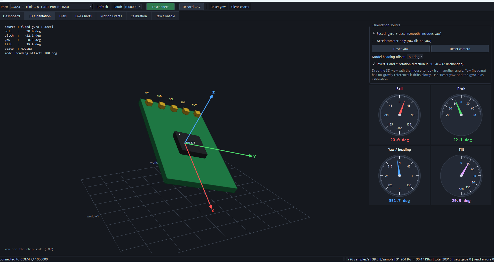
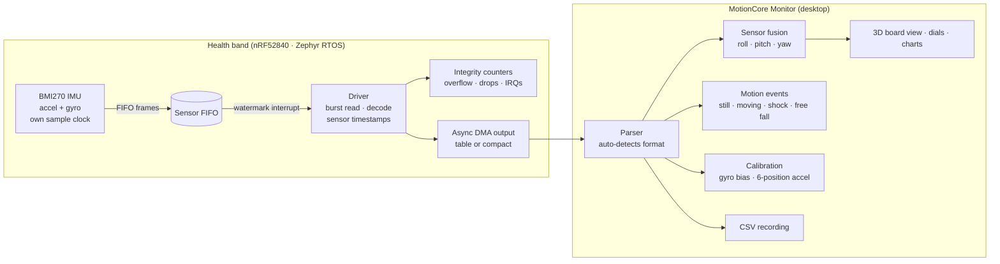
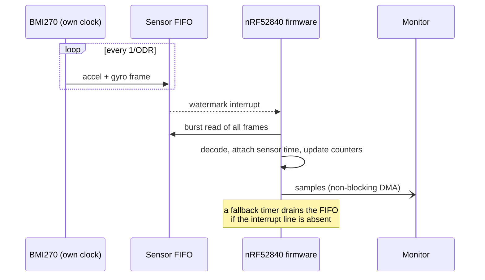
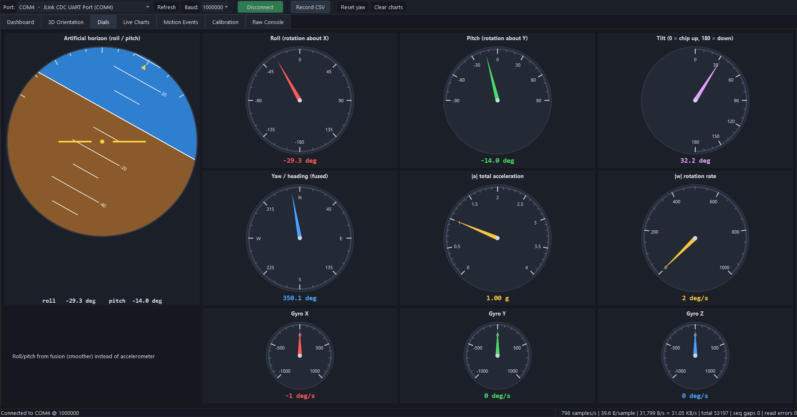

# MotionCore: IMU for HealthBand

**Motion-sensing engine for a wrist-worn health band: a 6-axis IMU sampled at up to 1600 Hz on
an nRF52840 with Zephyr RTOS, delivered with exact sensor timestamps and analysed live in a
purpose-built desktop monitor.**


> 🔒 **Code hidden by the author.** This project was designed for a health band product.
> Request access at **[faizansaleemsdq@yahoo.com](mailto:faizansaleemsdq@yahoo.com)**.

---



*The MotionCore Monitor connected to the band electronics at 1 Mbaud: the 3D model of the sensor
board follows the device in real time using fused gyroscope and accelerometer data, with roll,
pitch, heading and tilt dials. The status bar shows about 800 samples per second with zero
sequence gaps and zero read errors.*

## Why motion matters in a health band

Almost every feature of a health band starts with the motion sensor. Knowing how the wrist is
oriented and how it moves decides when the screen wakes, separates rest from activity, flags a
fall or a hard impact, and tells the optical sensors when the wearer is still enough for a
clean heart-rate or SpO₂ reading. MotionCore is that foundation: it turns the Bosch **BMI270**,
an ultra-low-power IMU designed for wearables, into a dependable, precisely timed stream of
acceleration and rotation data, and gives the team a tool to see, measure and calibrate it.

## Highlights

- **Up to 1600 samples per second, without losing one.** The sensor samples on its own clock
  into its hardware FIFO; an interrupt at the FIFO watermark wakes the firmware, which drains
  every frame. Six selectable rates: 50, 100, 200, 400, 800 and 1600 Hz.
- **Exact timestamps from the sensor itself.** Every sample carries the IMU's own time base,
  so samples sit exactly on the sampling grid, independent of radio or CPU load.
- **Self-monitoring data path.** The firmware counts FIFO overflows, dropped output lines and
  watermark interrupts, and reports them live, so data integrity is measured, not assumed.
- **Robust bring-up.** Bus scan and sensor identification at power-up, clear status reporting,
  and a fallback timer that keeps data flowing even if the interrupt line is not connected.
- **Non-blocking output.** Asynchronous, DMA-driven transmission with a compact binary-friendly
  format at high rates and a human-readable table at low rates.
- **Desktop monitor with 3D visualisation**, motion-event detection, sensor fusion,
  calibration and recording (below).

## System overview



### From sensor to sample



## The MotionCore Monitor

A desktop application built alongside the firmware to make the sensor's behaviour visible and
measurable during development and testing.

| View | What it gives the engineer |
|---|---|
| **Dashboard** | All six axes, total acceleration, rotation rate, roll / pitch / tilt, fused heading, motion state and which face is up |
| **3D orientation** | A model of the sensor board rotating live with the device, plus attitude dials |
| **Instruments** | Artificial horizon, compass, acceleration and rotation gauges |
| **Live charts** | Acceleration, angular rate and angles over adjustable windows, drawn efficiently even at 1600 Hz |
| **Motion events** | Still, moving, rotating, shaking, shock and free-fall detectors with counters, an event log and adjustable thresholds |
| **Calibration** | Gyroscope bias capture and six-position accelerometer offset and gain calibration, saved and reloaded |
| **Recording** | Every sample with raw values, angles, fused orientation and motion state, for offline analysis |
| **Demo mode** | A scripted simulated sensor (flips, spins, shakes, taps, free fall) for testing without hardware |



*Instrument view: artificial horizon, roll, pitch, tilt, fused heading, total acceleration
(1.00 g at rest), rotation rate and the three gyroscope axes.*

Orientation comes from a complementary **Mahony filter**: gyroscope integration corrected by
gravity, so roll and pitch stay drift-free while heading is tracked between resets.

## Engineering decisions

| Decision | Reason |
|---|---|
| Sample on the sensor's clock and buffer in its FIFO | The MCU can sleep between bursts and no sample depends on interrupt latency, which is essential for low power and for exact timing |
| Use the sensor's own timestamps | Time stays correct even when the link or CPU is busy; analysis algorithms get a perfectly regular time base |
| Count every loss explicitly | At high rates the question is not "does it work" but "is every sample there"; the counters answer it in real time |
| Only official output data rates | Avoids resampling artefacts and keeps the data valid for filtering and feature extraction |
| Readable format at low rates, compact at high rates | Easy debugging during bring-up, full throughput when it matters |

## Technology

**Firmware:** Embedded C · Zephyr RTOS / nRF Connect SDK · nRF52840 · I²C · GPIO interrupts ·
asynchronous DMA UART · devicetree configuration · sensor FIFO management
**Tools:** Python desktop application · real-time plotting · 3D rendering · sensor fusion ·
calibration · CSV data logging

## Role

Designed and implemented end to end by the author for a health band project: sensor
integration and firmware architecture, the timing and integrity scheme, and the desktop
monitoring and calibration tool.

## Repository layout

```
motioncore-imu-healthband/
├── firmware/                 nRF52840 · Zephyr RTOS
│   ├── CMakeLists.txt  prj.conf  app.overlay  sample.yaml
│   └── src/  main.c  bmi270_fifo.c  bmi270_fifo.h
├── monitor/                  MotionCore Monitor (Python desktop app)
│   ├── run_gui.py  requirements.txt
│   └── imu_gui/  main_window  protocol  sources  fusion  motion  calibration  recording
│                 widgets/  board3d  dials
└── docs/                     screenshots
```

## Source code

> 🔒 **Code hidden by the author.** Every source file above is published as a stub: its first
> two and last two lines, with the rest hidden. Request full access at
> **[faizansaleemsdq@yahoo.com](mailto:faizansaleemsdq@yahoo.com)**.

---
## 👤 About the Author

**Faizan Saleem Siddiqui**, Embedded Firmware Engineer | Visiting Faculty | Research Scholar

Electronics engineer with 2+ years of experience in embedded systems and firmware development.
I build firmware for **BLE wearables** and **Bluetooth TWS audio devices** on Nordic nRF52 (Zephyr /
nRF Connect SDK), including **secure OTA updates (MCUboot, signed images)**, **low-power battery
management** and **charging-case firmware**. My background also covers STM32 and ESP32 with
FreeRTOS, real-time data acquisition, digital signal processing, industrial IoT, and Python tooling
for data, automation and machine learning.

- 🎓 MS Electronics, Quaid-i-Azam University, Islamabad (BS Electronics: 1st position, merit scholar)
- 🧑‍🏫 Visiting Faculty Member, Quaid-i-Azam University: teaching Real-Time Systems (STM32, FreeRTOS),
  Microcontroller Interfacing (ESP32) and AI/ML on Embedded Devices (TinyML)
- 🔬 Former Research Assistant, Autonomous Vehicle Engineering (COMSIP Lab, QAU)
- 🌍 Open to embedded / firmware engineering opportunities worldwide

[](https://www.linkedin.com/in/faizan-saleem-siddiqui-4411bb247/)
[](https://github.com/FaizanSSDQ)
[](mailto:faizansaleemsdq@yahoo.com)

© Faizan Saleem Siddiqui. All rights reserved. The source code of these projects is not published.
