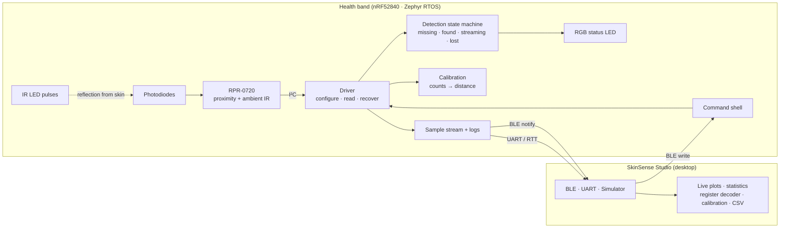
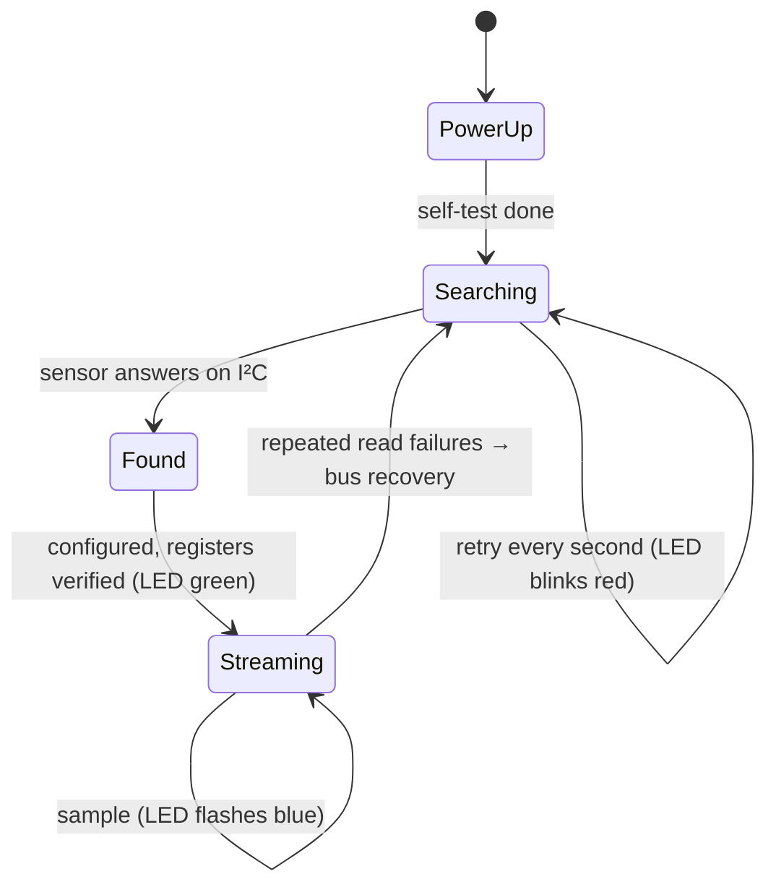

# SkinSense: Optical Proximity and Wear Detection in HealthBands

**Infrared proximity sensing for a health band: knows when the band is on the wrist and how
well it sits on the skin, controlled and streamed over Bluetooth Low Energy from an nRF52840
running Zephyr RTOS.**


> 🔒 **Code hidden by the author.** This project was designed for a health band project.
> Request access at **[faizansaleemsdq@yahoo.com](mailto:faizansaleemsdq@yahoo.com)**.

---

## Why wear detection matters

A health band's optical sensors only produce trustworthy readings when the band is actually on
the wrist and sitting close to the skin. SkinSense provides that knowledge. A small infrared LED
sends short pulses of light; a photodiode measures how much is reflected back. Skin close to the
sensor reflects strongly, an empty band on a table reflects almost nothing. From this signal the
band can:

- **detect on-wrist and off-wrist**, so measurements and notifications run only while it is worn;
- **save battery** by pausing power-hungry optical measurements when the band is off;
- **judge contact quality**, warning when the band is too loose for reliable optical health
  measurements;
- **estimate distance** to the skin from a calibration curve.

## Highlights

- **Complete sensor driver** for the ROHM **RPR-0720** infrared proximity sensor: LED drive
  current, pulse width, measurement period, gain, photodiode selection, offset cancellation
  and high/low thresholds, all adjustable at run time.
- **Bluetooth LE control and streaming.** A custom GATT service streams measurements and logs
  to a phone or PC and accepts commands back, with MTU negotiation for efficient transfer.
- **One command set, three links.** The same commands work over BLE, a UART terminal and
  the debugger's RTT channel, with tab completion in the terminal.
- **Self-healing hardware link.** The sensor is detected continuously and may be connected at
  any time; repeated read failures trigger I²C bus recovery and re-detection.
- **At-a-glance status.** An RGB LED state machine shows power-up, sensor missing, sensor found
  and live sampling.
- **Distance calibration.** Reference points recorded at known distances form a piecewise-linear
  calibration curve that converts raw counts to millimetres.
- **Prototype to product.** First proven on an ESP32-S3 prototype, then ported to the nRF52840
  and Zephyr for the low-power BLE platform.

## System overview



### Sensor life cycle



## SkinSense Studio

A desktop application developed alongside the firmware for characterisation and testing. It
connects over **Bluetooth LE**, a **serial port** or a built-in **simulator** that reproduces the
firmware's output exactly.

| Area | What it shows |
|---|---|
| **Status cards** | Current proximity value, sample count and rate, estimated distance, ambient IR, min/max, mean ± standard deviation, error counters, link uptime |
| **Proximity bar** | Live level against the high/low thresholds with peak hold |
| **Live data** | Proximity with moving average, threshold lines and ambient-light markers; distance plot; zoom, pan and export |
| **Statistics** | Histogram, sample-interval analysis of the link, noise and percentile table |
| **Registers** | Every sensor register in hex and binary with its decoded meaning |
| **Calibration** | Recorded calibration points and the resulting distance curve |
| **Device console** | Full log with filtering, command line with history; every control maps to a firmware command |
| **Recording** | CSV with host and device time, raw counts, ambient IR, interrupt state and distance |

## Engineering decisions

| Decision | Reason |
|---|---|
| Expose the sensor's analog settings at run time | LED current, pulse width, gain and period trade range, noise and battery life; tuning them live on the real enclosure is far faster than rebuilding firmware |
| Continuous detection with bus recovery | Flex cables and connectors in wearables fail intermittently; the firmware recovers instead of hanging |
| Same commands over BLE, UART and RTT | Lab benches, phones and sealed devices can all be tested the same way |
| Piecewise-linear calibration from measured points | Reflection depends on skin tone, window material and geometry; measured points capture the real curve better than a fixed formula |
| Prototype on ESP32-S3, product on nRF52840 | Fast algorithm work first, then the low-power BLE platform used by the band |

## Technology

**Firmware:** Embedded C · Zephyr RTOS / nRF Connect SDK · nRF52840 · Bluetooth LE GATT ·
Zephyr shell over BLE, UART and RTT · I²C with bus recovery · devicetree bindings · state
machines · ESP32-S3 (prototype)
**Tools:** Python desktop application · BLE and serial transports · real-time plotting ·
statistics · calibration · CSV data logging

## Role

Designed and implemented end to end by the author for a health band project: sensor driver,
BLE service and command interface, detection and calibration logic, the ESP32-S3 prototype and
its port to Zephyr, and the desktop characterisation tool.

## Repository layout

```
skinsense-optical-wear-detection/
├── firmware/                 nRF52840 · Zephyr RTOS
│   ├── CMakeLists.txt  prj.conf  sample.yaml
│   ├── boards/nrf52840dk_nrf52840.overlay
│   ├── dts/bindings/rohm,rpr0720.yaml        custom devicetree binding
│   └── src/  main.c  rpr0720.c/.h  ble_shell.c/.h  commands.c
│             calibration.c/.h  status_led.c/.h
├── prototype-esp32s3/        first prototype (Arduino)
└── studio/                   SkinSense Studio (Python desktop app)
    ├── main.py  run_gui.bat  requirements.txt
    └── rpr_gui/  main_window  protocol  transports  widgets  theme
```

## Source code

> 🔒 **Code hidden by the author.** Every source file above is published as a stub: its first
> two and last two lines, with the rest hidden. Request full access at
> **[faizansaleemsdq@yahoo.com](mailto:faizansaleemsdq@yahoo.com)**.

---
## 👤 About the Author

**Faizan Saleem Siddiqui**, Embedded Firmware Engineer | Visiting Faculty | Research Scholar

Electronics engineer with 2+ years of experience in embedded systems and firmware development.
I build firmware for **BLE wearables** and **Bluetooth TWS audio devices** on Nordic nRF52 (Zephyr /
nRF Connect SDK), including **secure OTA updates (MCUboot, signed images)**, **low-power battery
management** and **charging-case firmware**. My background also covers STM32 and ESP32 with
FreeRTOS, real-time data acquisition, digital signal processing, industrial IoT, and Python tooling
for data, automation and machine learning.

- 🎓 MS Electronics, Quaid-i-Azam University, Islamabad (BS Electronics: 1st position, merit scholar)
- 🧑‍🏫 Visiting Faculty Member, Quaid-i-Azam University: teaching Real-Time Systems (STM32, FreeRTOS),
  Microcontroller Interfacing (ESP32) and AI/ML on Embedded Devices (TinyML)
- 🔬 Former Research Assistant, Autonomous Vehicle Engineering (COMSIP Lab, QAU)
- 🌍 Open to embedded / firmware engineering opportunities worldwide

[](https://www.linkedin.com/in/faizan-saleem-siddiqui-4411bb247/)
[](https://github.com/FaizanSSDQ)
[](mailto:faizansaleemsdq@yahoo.com)

© Faizan Saleem Siddiqui. All rights reserved. The source code of these projects is not published.
