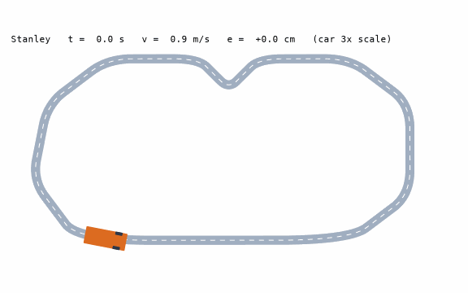
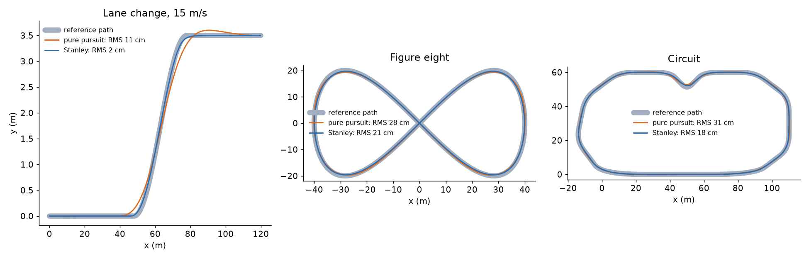
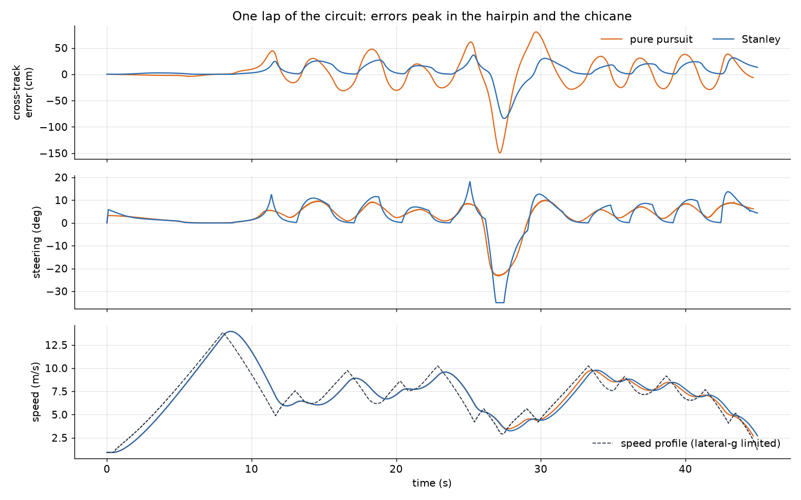
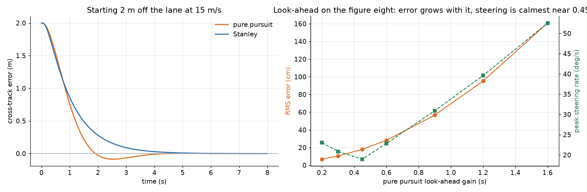
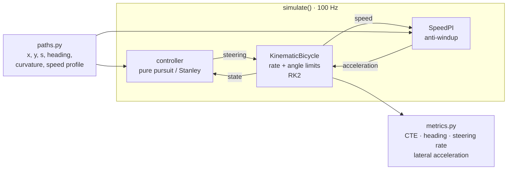

# Autonomous Path Tracking: Pure Pursuit vs Stanley on a Kinematic Bicycle Model




How a self-driving car follows a planned path. A kinematic bicycle model with realistic steering
limits drives three reference paths (a highway lane change, a figure eight and a 324 m circuit)
under the two classic geometric path-tracking controllers, **pure pursuit** and **Stanley**, with
a curvature-aware speed profile and a PI speed controller. Every run is measured: cross-track
error, heading error, steering effort and lateral acceleration.

**Highlights**
- Kinematic bicycle model (rear-axle reference, RK2 integration) with steering-angle and
  steering-rate limits, and acceleration and braking limits
- Reference paths with arc length, heading and curvature; speed profile limited to 3 m/s²
  lateral and 2 m/s² longitudinal acceleration, with a backward pass so the car brakes *before*
  the bend
- Pure pursuit with speed-scaled look-ahead; Stanley at the front axle with low-speed softening
  and interpolated path heading (no steering chatter)
- **Stanley tracks 1.4–5× tighter than pure pursuit**: 2 cm vs 11 cm RMS on the lane change, 18 cm
  vs 31 cm on the circuit
- A measured design lesson: adding curvature feed-forward to kinematic Stanley double-counts the
  bend and makes tracking **5× worse** (21 cm → 1.1 m RMS)
- 19 pytest tests: model geometry (circle radius = L/tan δ), limits, speed profile, convergence
  from an offset, the look-ahead trade-off, determinism

---

<details>
<summary><h2>📘 More Explanation for Students (click to expand)</h2></summary>

**What is path tracking?** A self-driving car's planner draws the line it wants to drive; the
path-tracking controller turns that line into steering commands, many times per second. It
looks at where the car is, compares it with the path and decides how much to steer. The
quality is measured by the cross-track error: the sideways distance between the car and the
path.

**The bicycle model.** For steering, a car behaves almost exactly like a bicycle: the two front
wheels act as one steerable wheel, the two rear wheels as one fixed wheel. With the wheelbase L
and the steering angle δ, the car drives on a circle of radius L/tan δ. This "kinematic" model
ignores tyre slip, which is accurate for normal driving below about 0.4 g of sideways
acceleration. The steering motor cannot turn the wheels instantly, so the model limits how fast
the steering angle may change.

**Pure pursuit.** Imagine holding a stick of fixed length in front of the car and touching the
path with its tip: that is the look-ahead point. Pure pursuit steers along the circular arc that
passes through it. It is smooth and robust, but it cuts corners, because the look-ahead point is
already round the bend. A longer stick gives calmer steering and bigger corner cutting; the
fourth figure measures that trade-off.

**Stanley.** Developed by Stanford for their car that won the 2005 DARPA Grand Challenge, Stanley
looks at the front axle and corrects two things at once: the difference in heading between the
car and the path, and the sideways distance. It pulls the car back onto the path exponentially
and tracks tightly, at the cost of more steering activity. Near standstill the distance term
would become very sharp, so a small constant in the denominator softens it.

</details>

---

## Results



*Both controllers on all three paths. Pure pursuit overshoots the lane change and cuts the
corners; Stanley stays on the line.*

| Path | Controller | RMS error | Max error | Peak steering rate | Peak lateral acc. |
|---|---|---|---|---|---|
| Lane change 3.5 m, 15 m/s | pure pursuit | 11.1 cm | 30.0 cm | 5 °/s | 1.7 m/s² |
| | **Stanley** | **2.1 cm** | **5.9 cm** | 15 °/s | 3.2 m/s² |
| Figure eight, 244 m | pure pursuit | 28.2 cm | 65.9 cm | 23 °/s | 5.0 m/s² |
| | **Stanley** | **20.8 cm** | **40.2 cm** | 13 °/s | 5.5 m/s² |
| Circuit, 324 m | pure pursuit | 31.2 cm | 149.5 cm | 60 °/s (limit) | 3.7 m/s² |
| | **Stanley** | **18.2 cm** | **83.9 cm** | 60 °/s (limit) | 5.9 m/s² |



*One lap of the circuit: cross-track error, steering angle and speed against the speed profile.
The largest errors are in the hairpin, where Stanley reaches the 35° steering limit.*



*Left: starting 2 m off the lane at 15 m/s. Pure pursuit returns faster but overshoots; Stanley
converges without overshoot. Right: pure pursuit's look-ahead gain on the figure eight. The error
grows steadily with look-ahead, while the steering is calmest around 0.45 s.*

## Architecture



| Controller | Steering law | Reference point |
|---|---|---|
| Pure pursuit | δ = atan(2L sin α / L_d), with L_d = 0.6 s · v + 3 m | rear axle |
| Stanley | δ = ψₑ + atan(k e / (k_soft + v)), k = 1.2, k_soft = 1 m/s | front axle |

## Files

| File | Role |
|---|---|
| `pathtrack/vehicle.py` | Kinematic bicycle model with actuator limits |
| `pathtrack/paths.py` | Lane change, figure eight and circuit; heading, curvature, speed profile |
| `pathtrack/controllers.py` | Pure pursuit, Stanley, PI speed controller |
| `pathtrack/simulate.py` | Closed-loop simulation and logging |
| `pathtrack/metrics.py` | Tracking quality figures |
| `tests/test_pathtrack.py` | 19 tests |
| `tools/make_figures.py` | Figures and the animation |

## Run it

```bash
cd python/autonomous-path-tracking
pip install numpy matplotlib pillow pytest
python -m pytest -q                 # 19 tests
python tools/make_figures.py        # docs/*.png and the GIF
```

```python
from pathtrack import Stanley, racetrack, simulate, tracking_metrics
r = simulate(racetrack(), Stanley())
print(tracking_metrics(r))
```

## Revision history

This project began as a bicycle-model class from the Self-Driving Cars Specialization
(University of Toronto), which only held the vehicle parameters. It has been rewritten as an
independent project: the vehicle model, paths, both controllers, speed planning, simulation,
metrics, tests and figures are new.

---
## 👤 About the Author

**Faizan Saleem Siddiqui**, Embedded Firmware Engineer | Visiting Faculty | Research Scholar

Electronics engineer with 2+ years of experience in embedded systems and firmware development.
I build firmware for **BLE wearables** and **Bluetooth TWS audio devices** on Nordic nRF52 (Zephyr /
nRF Connect SDK), including **secure OTA updates (MCUboot, signed images)**, **low-power battery
management** and **charging-case firmware**. My background also covers STM32 and ESP32 with
FreeRTOS, real-time data acquisition, digital signal processing, industrial IoT, and Python tooling
for data, automation and machine learning.

- 🎓 MS Electronics, Quaid-i-Azam University, Islamabad (BS Electronics: 1st position, merit scholar)
- 🧑‍🏫 Visiting Faculty Member, Quaid-i-Azam University: teaching Real-Time Systems (STM32, FreeRTOS),
  Microcontroller Interfacing (ESP32) and AI/ML on Embedded Devices (TinyML)
- 🔬 Former Research Assistant, Autonomous Vehicle Engineering (COMSIP Lab, QAU)
- 🌍 Open to embedded / firmware engineering opportunities worldwide

[](https://www.linkedin.com/in/faizan-saleem-siddiqui-4411bb247/)
[](https://github.com/FaizanSSDQ)
[](mailto:faizansaleemsdq@yahoo.com)

Application code licensed under the [MIT License](../../LICENSE).
