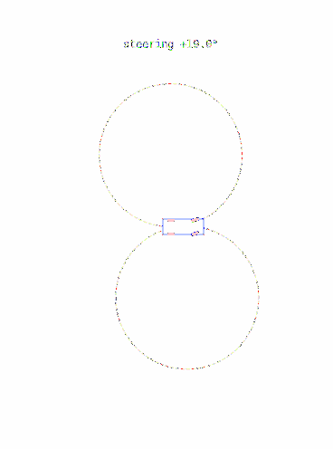
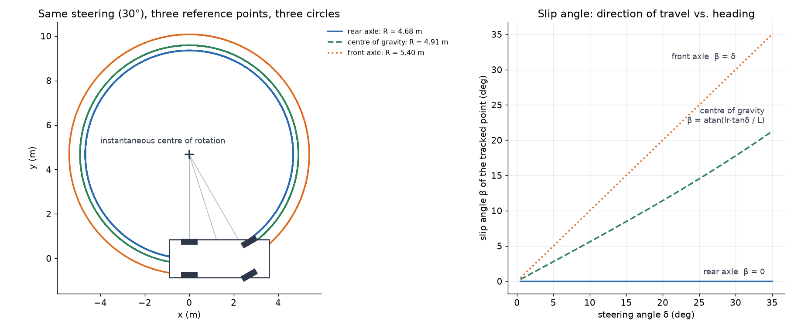
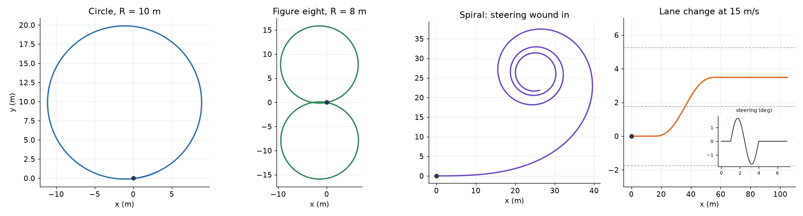
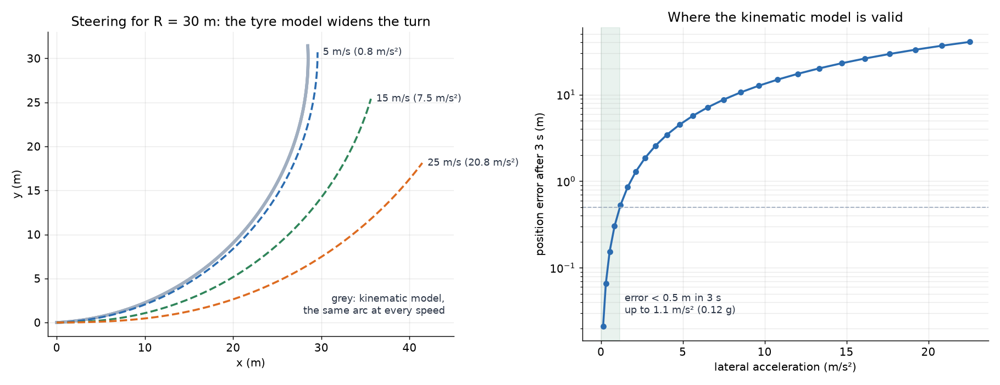
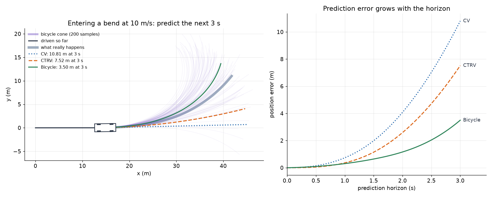
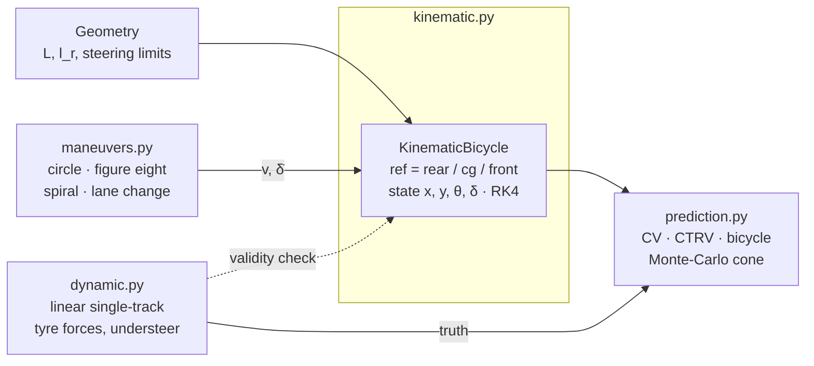

# Bicycle Kinematic Model for Path Prediction




The kinematic bicycle model is the vehicle model that motion planning, path tracking and
trajectory prediction in autonomous driving are built on. This project implements it completely,
for all three reference points (rear axle, centre of gravity, front axle), drives it through the
classic manoeuvres from steering inputs alone, **measures where it stops being valid** against a
dynamic tyre model, and uses it to **predict where a car will be in the next 3 seconds**, with
a Monte-Carlo prediction cone.

**Highlights**
- Kinematic bicycle model with a selectable reference point, the slip angle β = atan(l_r·tanδ / L),
  steering angle as a state driven by a rate-limited steering input, RK4 integration
- **Exact geometry, verified**: every reference point traces its requested circle to within 1 µm, and
  with the same steering the three points trace concentric circles about one instantaneous centre
  of rotation
- Steering programmes for a circle, figure eight (closes to within 4 cm after 100 m), inward spiral
  and a 3.5 m motorway lane change at 15 m/s (ends 1 cm off target, heading 0.00°)
- **Validity range measured** against a linear dynamic single-track model: 0.3 m error after 3 s at
  0.8 m/s² lateral acceleration, 36.7 m at 20.8 m/s². The error stays below 0.5 m up to
  1.1 m/s² (0.12 g)
- **Path prediction**: entering a bend at 10 m/s, the bicycle predictor misses by 3.5 m after 3 s,
  against 7.5 m for constant turn rate (CTRV) and 10.8 m for constant velocity (CV)
- 19 pytest tests: circle radii, concentric circles, slip angle, limits, manoeuvre closure,
  dynamic-model agreement and divergence, understeer gradient, predictor ranking

---

<details>
<summary><h2>📘 More Explanation for Students (click to expand)</h2></summary>

**Why a bicycle?** A car has four wheels, but for steering it behaves almost exactly like a
bicycle: the two front wheels act as one steerable wheel and the two rear wheels as one fixed
wheel. Draw a line through each wheel's axle; the lines meet at one point, the *instantaneous
centre of rotation*, and the whole car turns around it. With the wheelbase L and the steering
angle δ, the rear axle drives on a circle of radius L / tan δ.

**Which point do we track?** Every point of the car moves on its own circle around that centre.
The rear axle moves straight ahead (its slip angle β is zero). The front axle moves in the
direction the front wheel points (β = δ). The centre of gravity is in between: β = atan(l_r tan δ / L).
The first figure shows all three. The choice matters: a path-tracking controller, a planner and a
localisation filter have to agree on which point "the car's position" means.

**Why is the steering angle a state?** A driver cannot turn the steering wheel instantly, and
nor can an automated steering motor. The model takes the steering *rate* as its input and limits
it, so the steering angle changes smoothly. The manoeuvres are therefore programmes of
steering-wheel movements, just as a driver would make them.

**"Kinematic" means no tyre slip.** The model assumes each tyre rolls exactly where it points.
Real tyres need a small slip angle to produce the sideways force that makes the car turn. At
low sideways acceleration that slip is tiny; at higher speed the car turns less than the
kinematic model says (understeer). The third figure measures this by comparing it with a dynamic
model that includes tyre forces, mass and inertia.

**Path prediction.** A self-driving car has to guess where other road users will be in the next
seconds to avoid them. The simplest guess is a straight line (CV). The next is an arc with the
current turn rate (CTRV). The bicycle model goes further: it knows the steering angle and how fast
it is changing, so it predicts a car that is *still turning in*. Uncertainty is shown by running
200 predictions with slightly different speeds and steering inputs: the prediction cone.

</details>

---

## Results

### The model: three reference points



*Left: the same 30° steering, tracked at three points of the same car. All three circles share
the instantaneous centre of rotation; the radii are L/tanδ, √(R² + l_r²) and √(R² + L²). Right:
the slip angle of each tracked point against the steering angle.*

| Reference point | Steering for R = 10 m | Slip angle β | Yaw rate |
|---|---|---|---|
| Rear axle | 15.11° | 0 | v tanδ / L |
| Centre of gravity | 15.27° | atan(l_r tanδ / L) | v cosβ tanδ / L |
| Front axle | 15.66° | δ | v sinδ / L |

### Manoeuvres from steering inputs



*Circle (steering ramped in, then held), figure eight (steering swept through to the opposite
lock at the crossing), spiral (steering wound in at a constant rate) and the 15 m/s lane change
with its steering trace (peak 1.7°).*

| Manoeuvre | Result |
|---|---|
| Circle, R = 10 m | Least-squares radius 10.000 m |
| Figure eight, 2 × R = 8 m | Returns to within 4 cm of the start after 100 m, y range ±15.9 m |
| Lane change 3.5 m at 15 m/s | Final offset 3.49 m, heading 0.00° |

### Validity: kinematic vs. dynamic



*Left: steering set for a 30 m circle. The kinematic model drives the same arc at any speed; the
dynamic model with tyre forces understeers more and more. Right: position error after 3 s against
lateral acceleration.*

| Speed on R = 30 m | Lateral acc. | Position error after 3 s |
|---|---|---|
| 5 m/s | 0.8 m/s² | 0.30 m |
| 10 m/s | 3.3 m/s² | 2.57 m |
| 15 m/s | 7.5 m/s² | 8.78 m |
| 20 m/s | 13.3 m/s² | 20.1 m |
| 25 m/s | 20.8 m/s² | 36.7 m |

Dynamic reference: 1500 kg, I_z 2250 kg·m², l_f 1.2 m, l_r 1.5 m, cornering stiffness 80 kN/rad per
axle. Understeer gradient K = 0.0021 rad/(m/s²), verified in the tests against the steady-state
yaw rate.

### Path prediction



*A car (dynamic model) turns into a left bend at 10 m/s. At t = 1.5 s, halfway through
turning the wheel, three predictors forecast the next 3 s. Purple: 200 bicycle predictions
with σ = 0.5 m/s speed, 1° steering and 2 °/s steering-rate uncertainty.*

| Predictor | Error at 1 s | Error at 3 s |
|---|---|---|
| Constant velocity (CV) | 0.74 m | 10.8 m |
| Constant turn rate and velocity (CTRV) | 0.36 m | 7.5 m |
| **Kinematic bicycle** | **0.30 m** | **3.5 m** |

The bicycle predictor's remaining error has two honest sources, both visible in the figure: it
assumes the driver keeps turning the wheel at the same rate (the real driver stops at 6°), and
it has no tyre slip, so at 3.9 m/s² it turns tighter than the real car.

## Architecture



| Model | Equations (centre of gravity) |
|---|---|
| Kinematic | ẋ = v cos(θ+β), ẏ = v sin(θ+β), θ̇ = v cosβ tanδ / L, δ̇ = ω (limited to 70 °/s, \|δ\| ≤ 35°) |
| Dynamic | m(v̇_y + v_x r) = F_f + F_r, I_z ṙ = l_f F_f − l_r F_r, F = C·α (linear tyres) |

## Files

| File | Role |
|---|---|
| `bicycle/kinematic.py` | Kinematic bicycle model, three reference points, `steer_for_radius` |
| `bicycle/dynamic.py` | Linear dynamic single-track model and understeer gradient |
| `bicycle/maneuvers.py` | Steering-rate programmes: circle, figure eight, spiral, lane change |
| `bicycle/prediction.py` | CV, CTRV and bicycle predictors, Monte-Carlo prediction cone |
| `tests/test_bicycle.py` | 19 tests |
| `tools/make_figures.py` | Figures and the animation |

## Run it

```bash
cd python/bicycle-kinematic-model
pip install numpy matplotlib pillow pytest
python -m pytest -q                 # 19 tests
python tools/make_figures.py        # docs/*.png and the GIF
```

```python
import numpy as np
from bicycle import KinematicBicycle, predict_bicycle

car = KinematicBicycle(ref="cg", state=(0, 0, 0, np.radians(10)))
states = car.run(np.full(300, 8.0), 0.0, 0.01)       # 3 s at 8 m/s, steering held
future = predict_bicycle(*states[-1, :3], 8.0, states[-1, 3], horizon=3.0, dt=0.1)
```

## Revision history

This project grew from the kinematic bicycle model exercise in the Self-Driving Cars
Specialization (University of Toronto). It is an independent implementation: the three reference
points, the manoeuvre programmes, the dynamic-model validation, the predictors, the tests and the
figures are new, and no course code or data is included.

---
## 👤 About the Author

**Faizan Saleem Siddiqui**, Embedded Firmware Engineer | Visiting Faculty | Research Scholar

Electronics engineer with 2+ years of experience in embedded systems and firmware development.
I build firmware for **BLE wearables** and **Bluetooth TWS audio devices** on Nordic nRF52 (Zephyr /
nRF Connect SDK), including **secure OTA updates (MCUboot, signed images)**, **low-power battery
management** and **charging-case firmware**. My background also covers STM32 and ESP32 with
FreeRTOS, real-time data acquisition, digital signal processing, industrial IoT, and Python tooling
for data, automation and machine learning.

- 🎓 MS Electronics, Quaid-i-Azam University, Islamabad (BS Electronics: 1st position, merit scholar)
- 🧑‍🏫 Visiting Faculty Member, Quaid-i-Azam University: teaching Real-Time Systems (STM32, FreeRTOS),
  Microcontroller Interfacing (ESP32) and AI/ML on Embedded Devices (TinyML)
- 🔬 Former Research Assistant, Autonomous Vehicle Engineering (COMSIP Lab, QAU)
- 🌍 Open to embedded / firmware engineering opportunities worldwide

[](https://www.linkedin.com/in/faizan-saleem-siddiqui-4411bb247/)
[](https://github.com/FaizanSSDQ)
[](mailto:faizansaleemsdq@yahoo.com)

Application code licensed under the [MIT License](../../LICENSE).
