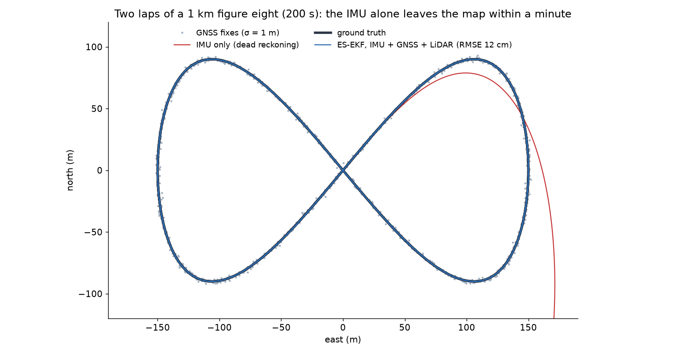
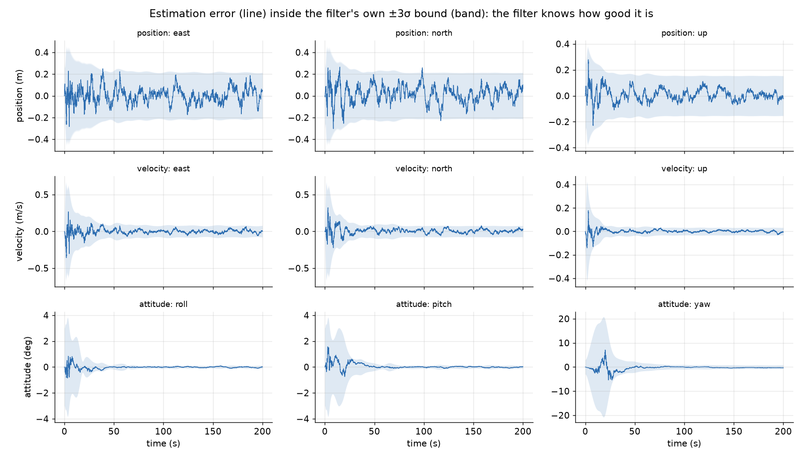
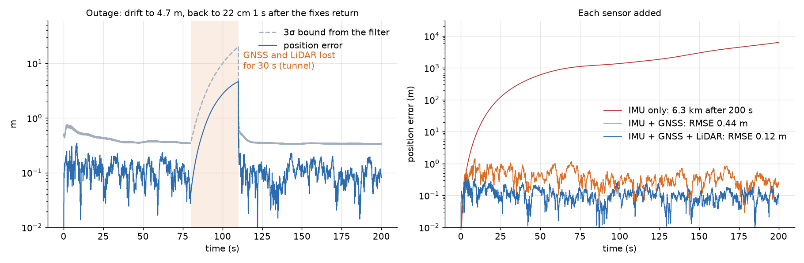
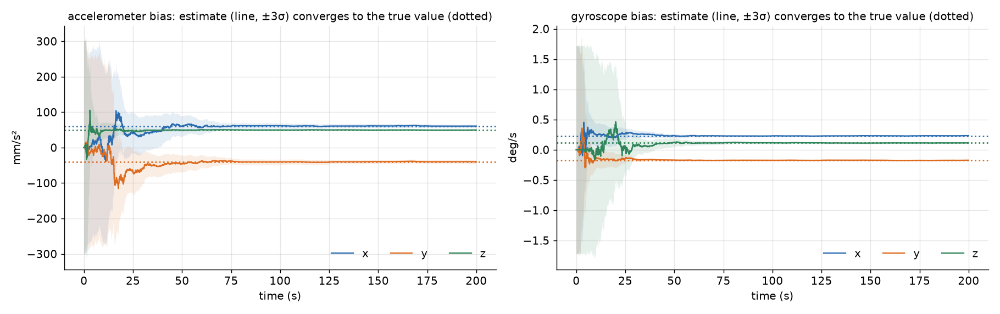
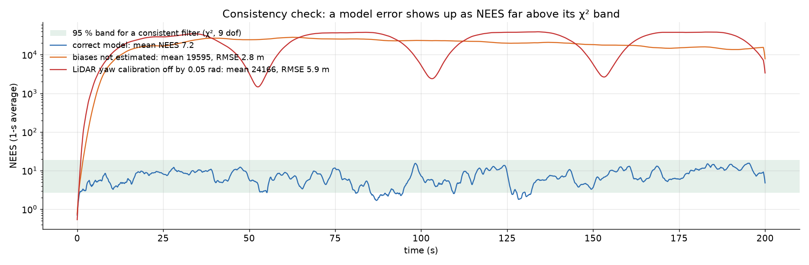
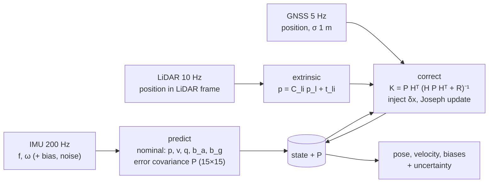

# Vehicle Localisation with a 15-State Error-State EKF: IMU + GNSS + LiDAR Fusion




Where is the car, which way is it pointing and how fast is it going, to the centimetre, 200 times a
second? This project answers that with the estimator used in real vehicles: an **error-state
extended Kalman filter** that integrates a 200 Hz IMU and corrects it with 5 Hz GNSS and 10 Hz
LiDAR position fixes. It also **estimates the IMU's own biases**, survives a 30-second outage of
both position sensors, and uses a statistical consistency test that exposes a wrong LiDAR
calibration. Everything runs on a simulated drive with exact ground truth, so every error can be
measured.

**Highlights**
- 15-state ES-EKF: position, velocity, orientation (quaternion), accelerometer bias and gyroscope
  bias; error states with right-multiplied rotation errors and the Joseph-form update
- Realistic simulation: a 1 km figure eight with hills, an IMU with constant biases and noise, GNSS
  with 1 m noise, LiDAR fixes in the LiDAR's own frame through an extrinsic calibration
- **12 cm position RMSE** with all sensors, against 44 cm with GNSS alone and 6.3 km of drift
  with the IMU alone after 200 s
- Biases recovered to **under 1 mm/s²** and **0.0001 rad/s** of their true values
- **Consistent**: mean NEES 7.2 for 9 degrees of freedom, and 99.8 % of position errors inside the
  filter's own 3σ bound
- 30-second outage: the drift (4.7 m) stays inside the growing uncertainty, and the error is back
  to 22 cm one second after the fixes return
- A 0.05 rad LiDAR yaw miscalibration costs 5.9 m of accuracy and multiplies NEES by 3 000, so
  the fault is easy to detect
- 13 pytest tests, NumPy only

---

<details>
<summary><h2>📘 More Explanation for Students (click to expand)</h2></summary>

**Why combine sensors?** An IMU (accelerometers and gyroscopes) measures how the car accelerates
and turns, hundreds of times per second, with no outside help. Adding up those measurements gives
position, but every tiny sensor error is added up too, so the estimate drifts away quickly: by
6 km in this simulation. GNSS (GPS) gives an absolute position that never drifts but is noisy
(about a metre), slow (5 times per second) and lost in tunnels. LiDAR matched against a map gives
precise positions, but in its own coordinate frame. A Kalman filter combines them: the IMU fills
in the motion between fixes, and each fix pulls the estimate back to the truth.

**What does "error-state" mean?** The car's full state, especially its orientation, behaves
non-linearly, and a Kalman filter only handles linear problems well. The error-state filter splits
the problem in two. The nominal state is integrated from the IMU with the exact non-linear
equations. Next to it, the filter tracks the small error of that nominal state, and small errors
behave almost linearly. When a GNSS or LiDAR fix arrives, the filter estimates the error, adds it
to the nominal state and starts again from zero error.

**Estimating the sensor biases.** Every accelerometer and gyroscope has a small constant offset,
its bias, and the gyroscope's bias alone would turn the car's heading by about 0.2° every second.
By adding the biases to the state, the filter learns them from the way the fixes disagree with the
IMU, and then subtracts them. The fourth figure shows the estimates converging to the true values.

**How do we know the filter is honest?** The filter reports not only an estimate but also its
uncertainty (the covariance). If the model is right, the true error should usually lie inside the
reported uncertainty, and a quantity called NEES should average about the number of states (9).
If NEES is far larger, the filter is over-confident: its model is wrong somewhere. That is how a
wrongly calibrated LiDAR mount, or forgetting the biases, is caught automatically.

</details>

---

## Results



*The error of each of the nine navigation states (line) inside the filter's own ±3σ bound (band).
Yaw is only weakly observable from position fixes, so its uncertainty is large at first and
shrinks as the car turns.*



*Left: a 30-second loss of GNSS and LiDAR. The IMU carries the estimate alone and drifts to
4.7 m; the filter's uncertainty grows faster than the error, so it never claims more accuracy
than it has. Right: what each sensor contributes.*



*Accelerometer and gyroscope bias estimates (lines, ±3σ) converge to the true values (dotted)
within about a minute of driving.*



*NEES over time. The correct model stays inside the χ² band; ignoring the biases or using a LiDAR
calibration that is off by 0.05 rad in yaw sends NEES up by more than three orders of magnitude.*

| Scenario | Position RMSE | Mean NEES (9 dof) |
|---|---|---|
| IMU + GNSS + LiDAR, 15-state | **0.12 m** | 7.2 |
| IMU + GNSS | 0.44 m | 6.1 |
| IMU only | 6.3 km after 200 s | n/a |
| Biases not estimated (9-state) | 2.8 m | 19 595 |
| LiDAR yaw calibration off by 0.05 rad | 5.9 m | 24 166 |

## The filter



Error-state dynamics (right-multiplied orientation error, q_true = q ⊗ exp(δθ)):

```
δṗ = δv
δv̇ = −R [f − b_a]× δθ − R δb_a + noise
δθ̇ = −[ω − b_g]× δθ − δb_g + noise
δḃ_a, δḃ_g = random walk
```

## Files

| File | Role |
|---|---|
| `esekf/filter.py` | The 15-state ES-EKF: prediction, Jacobians, correction, error injection |
| `esekf/rotations.py` | Quaternions, exponential and logarithm maps, rotation matrices |
| `esekf/trajectory.py` | Analytic ground-truth drive: position, velocity, acceleration, attitude, body rates, specific force |
| `esekf/sensors.py` | IMU, GNSS and LiDAR models, outages, extrinsic calibration |
| `esekf/run.py` | Runs the filter over a drive and scores it (errors, σ, NEES) |
| `tests/test_esekf.py` | 13 tests |
| `tools/make_figures.py` | The figures above |

## Run it

```bash
cd python/vehicle-localization-es-ekf
pip install numpy matplotlib pytest
python -m pytest -q                 # 13 tests
python tools/make_figures.py
```

```python
from esekf import make_truth, simulate_sensors, run_filter, rmse
truth = make_truth(200.0)
result = run_filter(truth, simulate_sensors(truth))
print(rmse(result.err[:, :3]), result.nees.mean())
```

## Revision history

This project grew out of the state-estimation final project of the Self-Driving Cars
Specialization (University of Toronto), which provided starter code and recorded data for a
9-state filter. To respect the course's honour code, that material is no longer published here.
This version is an independent implementation with its own simulator and ground truth. It extends
the filter to 15 states with bias estimation, and adds consistency analysis, outage handling,
the calibration study and tests.

---
## 👤 About the Author

**Faizan Saleem Siddiqui**, Embedded Firmware Engineer | Visiting Faculty | Research Scholar

Electronics engineer with 2+ years of experience in embedded systems and firmware development.
I build firmware for **BLE wearables** and **Bluetooth TWS audio devices** on Nordic nRF52 (Zephyr /
nRF Connect SDK), including **secure OTA updates (MCUboot, signed images)**, **low-power battery
management** and **charging-case firmware**. My background also covers STM32 and ESP32 with
FreeRTOS, real-time data acquisition, digital signal processing, industrial IoT, and Python tooling
for data, automation and machine learning.

- 🎓 MS Electronics, Quaid-i-Azam University, Islamabad (BS Electronics: 1st position, merit scholar)
- 🧑‍🏫 Visiting Faculty Member, Quaid-i-Azam University: teaching Real-Time Systems (STM32, FreeRTOS),
  Microcontroller Interfacing (ESP32) and AI/ML on Embedded Devices (TinyML)
- 🔬 Former Research Assistant, Autonomous Vehicle Engineering (COMSIP Lab, QAU)
- 🌍 Open to embedded / firmware engineering opportunities worldwide

[](https://www.linkedin.com/in/faizan-saleem-siddiqui-4411bb247/)
[](https://github.com/FaizanSSDQ)
[](mailto:faizansaleemsdq@yahoo.com)

Application code licensed under the [MIT License](../../LICENSE).
