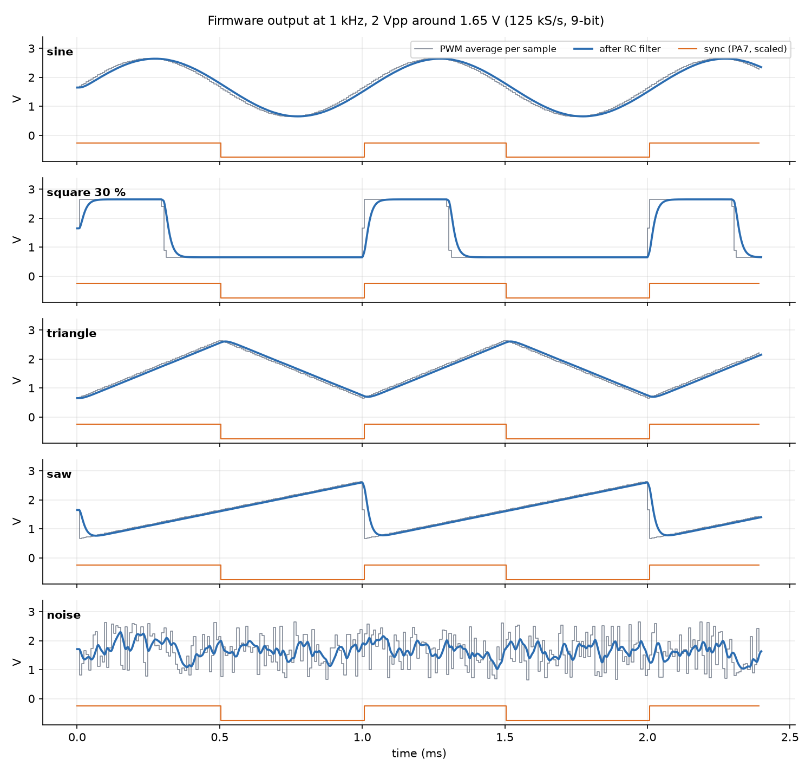
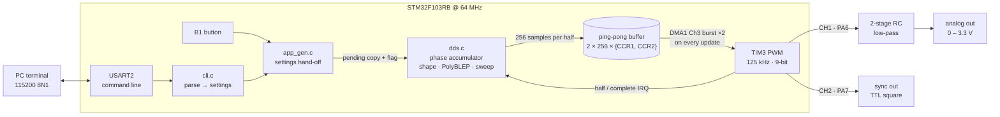
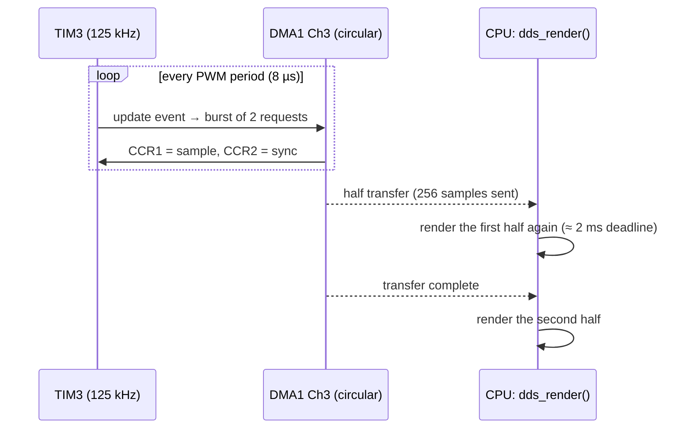
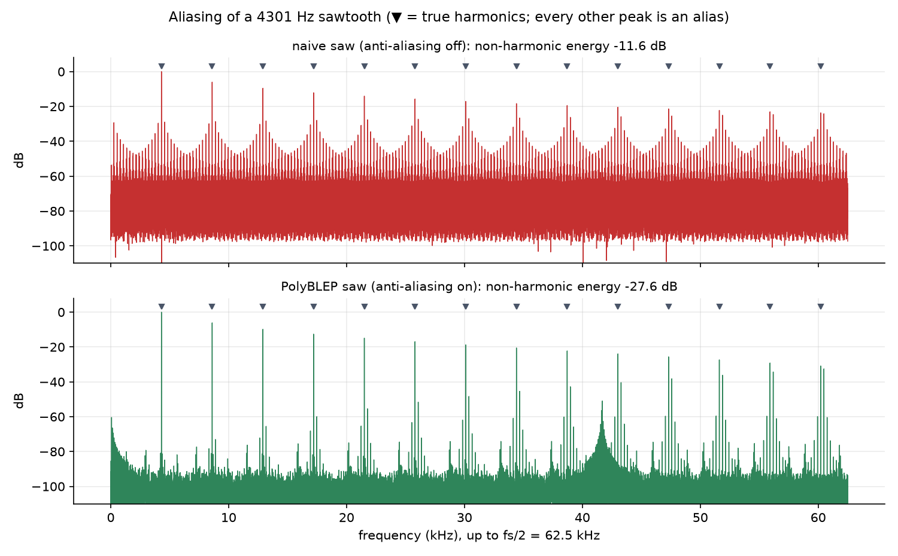
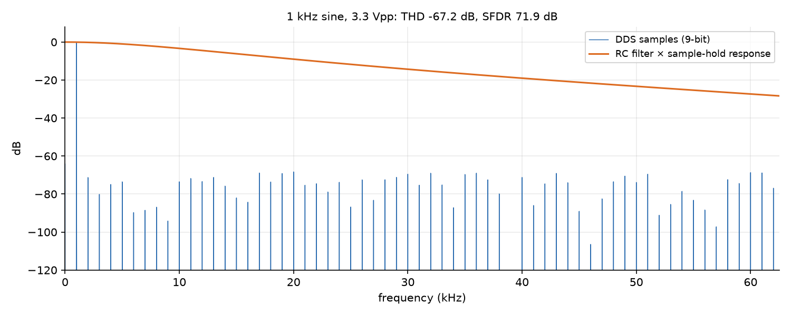
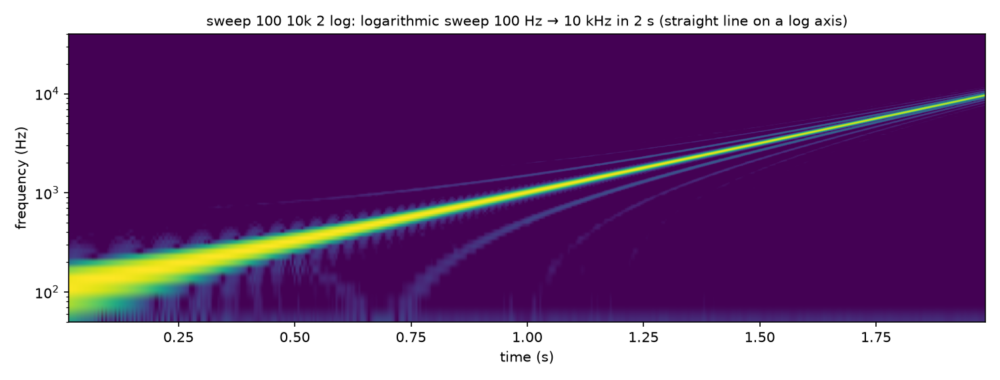
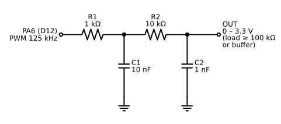
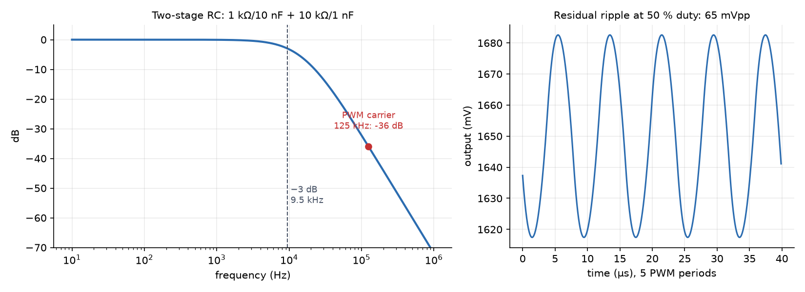

# DDS Waveform Generator on STM32: PWM DAC with Anti-Aliased Synthesis

-03234B?logo=stmicroelectronics&logoColor=white)


A function generator built on a microcontroller that has no DAC. A **direct digital synthesis
(DDS)** core produces sine, square, triangle, sawtooth and noise waveforms at 125 kS/s. A timer's
**PWM output acts as the DAC**: a **DMA burst** loads each new sample into the timer with no CPU
involvement, and a two-stage RC filter turns the PWM into a smooth analog signal. Frequency,
amplitude, offset, duty cycle and sweeps are set from a serial terminal.

**Highlights**
- 32-bit phase accumulator: **0.01 Hz to 20 kHz** with 29 µHz resolution; frequency changes
  never break the phase
- 9-bit PWM at 125 kHz on PA6, plus a **sync output** on PA7 locked to the waveform phase
- TIM3 DMA **burst mode** updates both compare registers on every PWM period from a
  ping-pong buffer; the render load is measured on target with the cycle counter
- **PolyBLEP anti-aliasing** on square and saw edges: aliasing **15–16 dB lower**
- Linear and logarithmic **frequency sweeps**, adjustable duty cycle, amplitude and offset in volts
- 1 kHz sine: **THD −67 dB, SFDR 72 dB** at full scale
- Portable core with 86 host test checks; every spectrum and figure here comes from the
  firmware's own code through a sample-dump tool, with 10 Python tests in CI

---

<details>
<summary><h2>📘 More Explanation for Students (click to expand)</h2></summary>

**What is a function generator?** It is a bench instrument that produces test signals: a sine
wave for testing an amplifier or filter, a square wave for a digital input, a triangle or
sawtooth for sweeping something slowly up and down. You choose the shape, how fast it repeats
(frequency, in hertz), how big it is (amplitude) and where it is centred (offset). This project
builds one in firmware, so a microcontroller board becomes a small signal source that you
control by typing commands such as `freq 1k` or `wave square`.

**What is DDS?** **Direct Digital Synthesis** creates a waveform from numbers. A 32-bit counter
called the **phase accumulator** represents "how far through one cycle" we are: 0 is the start
of the cycle and 2³² would be the end. On every sample a fixed step (the **tuning word**) is
added to it. A bigger step means the cycle finishes sooner, so the frequency is higher. The
step is calculated as `frequency × 2³² / sample rate`. Because the counter is so large, the
frequency can be set extremely precisely (to about 0.00003 Hz here). The top bits of the phase
then select the output value: they index a table of sine values for a sine wave, or are used
directly to make a ramp (sawtooth) or a triangle.

**How can a chip without a DAC output a voltage?** The STM32F103 has no digital-to-analog
converter, but its timers can make **PWM**: a pin that switches on and off very quickly, here
125 000 times per second. If the pin is high for 30 % of each period, its *average* voltage is
30 % of 3.3 V. Changing that percentage on every period, according to the DDS samples, changes
the average voltage the way the waveform should change. An **RC low-pass filter** (resistors and
capacitors) removes the fast switching and keeps the slowly changing average, which is the
waveform. A **DMA** channel copies each new sample into the timer at exactly the right moment, so
the CPU only has to calculate new samples in batches of 256.

**What is aliasing, and what does PolyBLEP do?** A perfect square or sawtooth wave has an
instant jump, which contains harmonics at ever-higher frequencies. A sampled system cannot
represent frequencies above half its sample rate, so those high harmonics "fold back" and appear
as wrong, unrelated tones called **aliases**, which you would hear as a harsh, dirty sound in
audio. **PolyBLEP** (polynomial band-limited step) is a small correction applied only to the one
or two samples around each jump. It rounds the jump in a precise way that removes most of those
aliases, while the rest of the waveform is untouched. The spectrum figure below shows the
difference.

</details>

---

## Try it

1. Build the filter below on PA6 (D12) and connect a scope or the
   [logic analyzer](../sump-logic-analyzer) (sync on PA7) to its output.
2. Open a serial terminal on the ST-LINK virtual COM port at **115200 baud, 8N1**.
3. Type commands. **B1** cycles through the waveforms; LD2 shows that the output is on.

```text
DDS waveform generator 1.0.0: 125 kS/s, 9-bit PWM on PA6, sync on PA7
sine 1000.000 Hz, 2.000 Vpp, offset 1.650 V, anti-alias on, output on
type 'help' for commands, B1 cycles the waveform
> freq 1.5k
ok: sine 1500.000 Hz, 2.000 Vpp, offset 1.650 V, anti-alias on, output on
> wave square
ok: square 1500.000 Hz, 2.000 Vpp, offset 1.650 V, duty 50 %, anti-alias on, output on
> duty 25
ok: square 1500.000 Hz, 2.000 Vpp, offset 1.650 V, duty 25 %, anti-alias on, output on
> sweep 100 10k 2 log
ok: square, 2.000 Vpp, offset 1.650 V, duty 25 %, log sweep 100.00 -> 10000.00 Hz in 2.000 s, anti-alias on, output on
> freq 30k
error: freq 0.01 .. 20k
```

| Command | Effect |
|---|---|
| `wave sine\|square\|triangle\|saw\|noise` | Waveform (`squ`, `tri` also work) |
| `freq 1500`, `freq 2.5k` | Frequency, 0.01 Hz … 20 kHz (ends a sweep) |
| `amp 2.0` / `offset 1.65` | Peak-to-peak amplitude / centre, in volts (0 … 3.3) |
| `duty 25` | Square-wave high time, 1 … 99 % |
| `sweep 100 10k 2 log` | Repeating sweep: start Hz, stop Hz, seconds, `lin` or `log`; `sweep off` |
| `aa on\|off` | PolyBLEP anti-aliasing for square and saw |
| `on` / `off` | Output enable |
| `status` | Settings plus the measured render load |



*Every trace is the firmware's own output: the DDS core and command parser run on the PC through
`build/dump_wave`, and the RC filter is simulated.*

---

## System overview



### Output path

TIM3 counts 512 ticks of 64 MHz per period: **125 kHz PWM with 512 levels (9 bits)**. With the
timer's DMA burst feature (`DCR`: base `CCR1`, length 2), each update event raises two DMA
requests. DMA1 Channel 3 writes the next pair of buffer entries into `TIM3->DMAR`, and the timer
routes them to **CCR1** (waveform) and **CCR2** (sync). Compare preload is on, so new values take
effect cleanly at the start of the next period.



Settings from the terminal never touch the renderer directly. The main loop writes a *pending*
copy and raises a flag; the DMA interrupt applies it at the start of its next block. A frequency
change keeps the phase, so the waveform continues without a glitch.

## Synthesis

| Waveform | How it is computed from the phase φ (32 bit) |
|---|---|
| Sine | 256-entry Q15 table, linear interpolation on the next 16 bits (error < 4 LSB of Q15) |
| Square | +1 while φ < duty, else −1; PolyBLEP at both edges |
| Triangle | Rising from −1 to +1 over the first half cycle, falling over the second |
| Saw | φ / 2³² mapped to −1 … +1; PolyBLEP at the wrap |
| Noise | xorshift32 generator (period 2³² − 1), uniform |

Output code = `offset + w × amplitude / 2`, clamped to 0 … 512. The status line warns when
amplitude and offset together would clip at 0 V or 3.3 V.

### Anti-aliasing



For the step at each edge, PolyBLEP adds `−(1 − t/Δ)²` to the sample just after it and
`+(1 − (1−t)/Δ)²` to the one just before it (Δ = phase step per sample, t = phase since the
edge). The divisions only run for those one or two samples per edge. Measured on the firmware
output at 4301 Hz, the energy that is not a true harmonic drops from **−11.6 dB to −27.6 dB** for
the saw and from **−14.5 dB to −29.8 dB** for the square.

### Sine purity



At 3.3 Vpp the 1 kHz sine reaches **THD −67.2 dB and SFDR 71.9 dB**, limited by the 9-bit output
resolution (−60.7 dB at 2 Vpp, where fewer levels are used). The orange curve shows how much the
RC filter and the sample-and-hold further attenuate everything above the signal.

### Sweeps



The tuning word is updated once per 256-sample block (every 2.05 ms): linearly for `lin`, and as
`start × (stop/start)^(t/T)` for `log`. The exponential runs in floating point only once per
block, so it costs nothing measurable.

---

## Hardware

| Pin | Nucleo header | Function |
|---|---|---|
| PA6 | D12 | TIM3_CH1: waveform PWM → RC filter |
| PA7 | D11 | TIM3_CH2: sync, high for the first half of every cycle |
| PA2 / PA3 | ST-LINK VCP | USART2 command line, 115200 baud 8N1 |
| PC13 | B1 | Cycle the waveform |
| PA5 | LD2 | On while the output is enabled |





| Filter property | Value |
|---|---|
| −3 dB frequency | 9.5 kHz (flat within 1 dB to 5 kHz) |
| PWM carrier at 125 kHz | −36 dB |
| Residual ripple | 65 mVpp at 50 % duty (worst case), ≈ 2 % of full scale |
| Load | ≥ 100 kΩ, or add a voltage follower (e.g. MCP6001) |

For a cleaner output, replace the passive filter with a 2nd- or 4th-order Sallen-Key low-pass on
an op-amp; the same firmware works unchanged.

## Timing and resources

| Item | Value |
|---|---|
| SYSCLK, TIM3 clock | HSI 8 MHz ÷ 2 × 16 = 64 MHz |
| Sample rate | 64 MHz ÷ 512 = 125 kHz (= PWM frequency) |
| Frequency resolution | 125 kHz ÷ 2³² = 29 µHz |
| Refill deadline | 256 samples = 2.048 ms per half buffer |
| Render load | Measured on target with the DWT cycle counter; `status` prints it |
| Memory (from the build) | 21.2 KB flash · 4.5 KB RAM |

---

## Firmware structure

| File | Role |
|---|---|
| `Core/Src/dds.c` | Phase accumulator, waveform shapes, PolyBLEP, sweeps, output scaling (portable, tested) |
| `Core/Src/dds_tables.c` | Sine table, generated by `tools/gen_tables.py` |
| `Core/Src/cli.c` | Command parser in integer milli-units, status formatting (portable, tested) |
| `Core/Src/app_gen.c` | Hardware glue: DMA burst setup, refill interrupts, settings hand-off, terminal, button, load measurement |
| `Core/Src/main.c`, `*_msp.c`, `*_it.c` | STM32CubeMX-generated setup; application hooks only in `USER CODE` blocks |
| `DDS_Generator.ioc` | CubeMX configuration (TIM3 PWM + DMA, USART2, B1 EXTI) |
| `tests/test_main.c` | 86 host checks: tuning words, every shape, PolyBLEP, scaling and clipping, sync, sweeps, commands |
| `tests/dump_wave.c` | Runs commands through the firmware core and writes the PWM values it would output |
| `tools/dds_analysis.py` | Spectra, THD/SFDR, aliasing, frequency measurement, RC filter model |
| `tools/test_dds_analysis.py` | 10 tests on the firmware output and the filter design |
| `docs/generate_figures.py` | Regenerates every figure in this README |

## Design decisions

- **PWM as the DAC.** The F103 has no DAC; a 9-bit, 125 kHz PWM is a good balance between
  resolution and carrier frequency (more bits would lower the carrier and require a slower filter).
- **DMA burst to two compare registers.** One DMA channel updates the waveform and the sync
  output in the same period, so the sync is exactly aligned with no extra timer or CPU work.
- **Block rendering in the DMA interrupts.** The DDS core runs on 256-sample blocks with a 2 ms
  deadline, instead of an interrupt per sample (125 000 per second).
- **PolyBLEP instead of wavetables.** Band-limited wavetables need a table per octave; PolyBLEP
  needs no memory and adapts to any frequency.
- **Integer everywhere per sample.** Phase, interpolation, PolyBLEP and scaling are fixed-point.
  Floating point is used only once per block for log sweeps.
- **Testable core.** The same `dds.c` and `cli.c` run on the PC, so the spectra in this README are
  measurements of the real firmware output, not of a separate model.

## Revision history

The original university project was a CubeMX skeleton with a 128-point sine table that was never
output (and PA13, the SWD data pin, configured as a GPIO). The generator was written from scratch
on the same board.

---

## Build, test and flash

```bash
make              # build/dds_generator.elf / .hex / .bin (any arm-none-eabi-gcc)
make test         # 86 host checks + builds the sample-dump tool (host C compiler)
python -m pytest tools                 # output quality and filter tests
python tools/dds_analysis.py "wave saw" "freq 4301" "aa off"    # analyse any setting
python docs/generate_figures.py        # regenerate the figures
```
In **STM32CubeIDE**: *File → Import → Existing Projects into Workspace*, select this folder.
Flash `build/dds_generator.bin` by drag-and-drop onto the NUCLEO drive or with STM32CubeProgrammer.

## Bring-up checklist

1. Terminal shows the banner; `status` prints the settings and a render load well under 100 %.
2. Scope on PA6 (before the filter): 125 kHz PWM whose duty cycle follows the waveform.
3. Scope after the filter: a 1 kHz sine of 2 Vpp around 1.65 V; ripple a few tens of mV.
4. PA7: 1 kHz square, rising where the sine crosses mid-scale going up.
5. `freq 1234.567`: the scope frequency counter reads 1234.57 Hz.
6. `wave saw`, `aa off` then `aa on` at 4 kHz with an FFT on the scope: the aliases between
   harmonics drop.
7. `sweep 100 10k 2 log`: the frequency glides up every 2 s.
8. Press B1: the waveform changes and the terminal reports it.

---
## 👤 About the Author

**Faizan Saleem Siddiqui**, Embedded Firmware Engineer | Visiting Faculty | Research Scholar

Electronics engineer with 2+ years of experience in embedded systems and firmware development.
I build firmware for **BLE wearables** and **Bluetooth TWS audio devices** on Nordic nRF52 (Zephyr /
nRF Connect SDK), including **secure OTA updates (MCUboot, signed images)**, **low-power battery
management** and **charging-case firmware**. My background also covers STM32 and ESP32 with
FreeRTOS, real-time data acquisition, digital signal processing, industrial IoT, and Python tooling
for data, automation and machine learning.

- 🎓 MS Electronics, Quaid-i-Azam University, Islamabad (BS Electronics: 1st position, merit scholar)
- 🧑‍🏫 Visiting Faculty Member, Quaid-i-Azam University: teaching Real-Time Systems (STM32, FreeRTOS),
  Microcontroller Interfacing (ESP32) and AI/ML on Embedded Devices (TinyML)
- 🔬 Former Research Assistant, Autonomous Vehicle Engineering (COMSIP Lab, QAU)
- 🌍 Open to embedded / firmware engineering opportunities worldwide

[](https://www.linkedin.com/in/faizan-saleem-siddiqui-4411bb247/)
[](https://github.com/FaizanSSDQ)
[](mailto:faizansaleemsdq@yahoo.com)

Application code licensed under the [MIT License](../../LICENSE). STM32 HAL and CMSIS files in
`Drivers/` are © STMicroelectronics and Arm under their own licenses.
