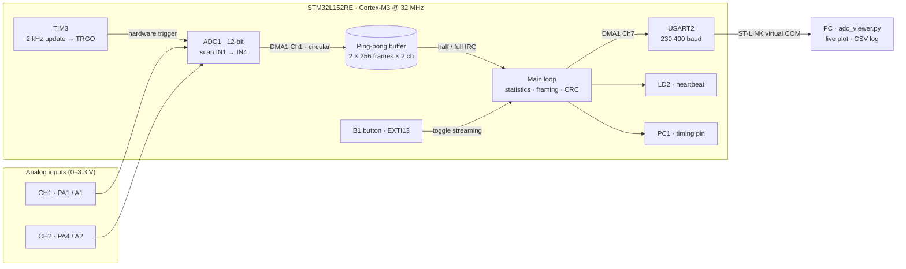
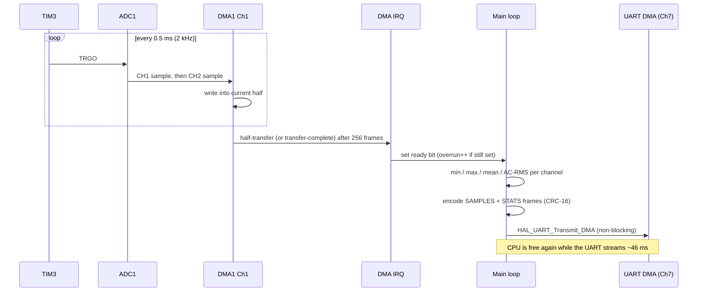
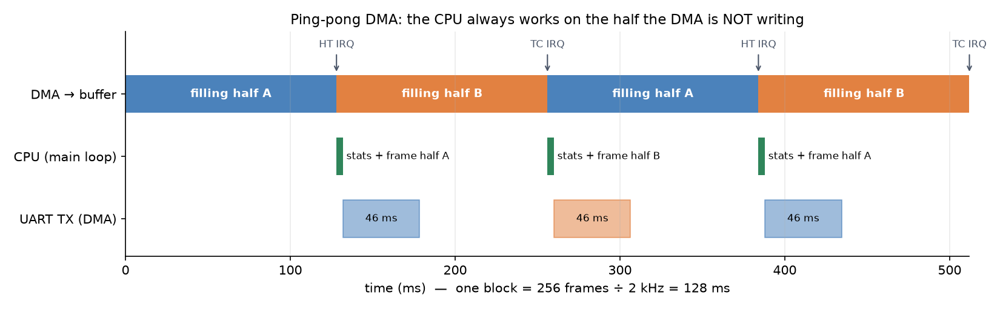
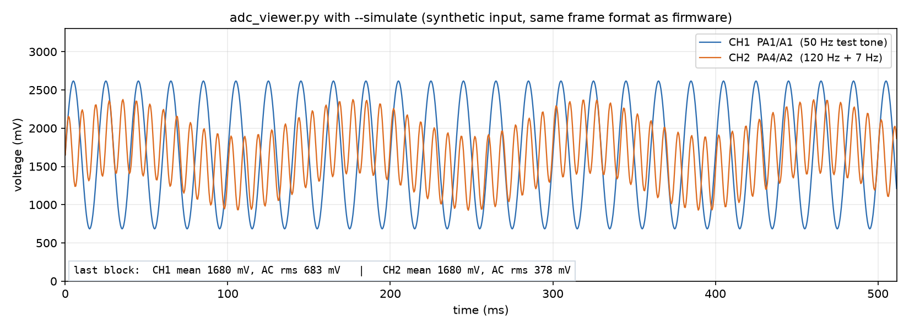

# Dual-Channel ADC Sampler with Ping-Pong DMA (STM32L152RE)

-03234B?logo=stmicroelectronics&logoColor=white)


Continuous, timer-triggered acquisition of two analog channels at **2 kHz per channel** using
**ADC scan mode + circular DMA**, processed block-by-block in a **ping-pong buffer** with zero
sample loss. Each 128 ms block produces min / max / mean / AC-RMS per channel and is streamed to a
PC as **CRC-protected binary frames** over a **non-blocking UART DMA** link, where a Python tool
plots both channels live.

**Highlights**
- Hardware-timed sampling: TIM3 TRGO → ADC, no software jitter
- CPU never touches a buffer half the DMA is writing; overruns are detected and reported
- Integer-only statistics (no FPU on Cortex-M3), unit-tested on the host
- Self-describing telemetry protocol with sync word, sequence number and CRC-16
- CPU load measured on target with the DWT cycle counter and reported in every block

---

## System overview



### What happens in one block



### Ping-pong timing



The DMA fills one half of the buffer while the CPU processes the other. A block lasts 128 ms;
the worst-case UART transfer (statistics + raw samples) takes about 46 ms, leaving a 64 % margin.
The width of the green CPU bars is illustrative: the real processing time is measured on the
target with the DWT cycle counter and reported in every STATS frame (`cpu_cycles`), and can also be
seen on an oscilloscope at **PC1**.

---

## Hardware

| Item | Notes |
|---|---|
| NUCLEO-L152RE | STM32L152RET6, on-board ST-LINK/V2-1 with virtual COM port |
| Signal source(s) | Function generator, potentiometer, sensor, or audio signal through the front-end below |
| Optional | Oscilloscope on PC1 to measure processing time |

### Pin map (from `Dual_DMA_ADC.ioc`)

| Pin | Nucleo header | Function | Configuration |
|---|---|---|---|
| PA1 | A1 | ADC_IN1 · channel 1 | analog, rank 1, 48-cycle sampling |
| PA4 | A2 | ADC_IN4 · channel 2 | analog, rank 2, 48-cycle sampling |
| PA2 / PA3 | ST-LINK VCP | USART2 TX / RX | 230 400 baud 8N1, TX via DMA1 Ch7 |
| PC13 | B1 (blue button) | EXTI13 | falling edge, toggles raw-sample streaming |
| PA5 | LD2 (green LED) | GPIO out | toggles every processed block (4 Hz blink) |
| PC1 | A4 | GPIO out | high while a block is processed (timing probe) |

### Recommended analog front-end (per channel)


For AC signals, R1/R2 bias the input to mid-scale so negative half-cycles are not clipped, and
R3/C2 form an anti-aliasing low-pass filter near the Nyquist frequency (1 kHz). For DC signals
already in 0–3.3 V (potentiometers, sensors), only R3/C2 are needed.

---

## Clocks and timing

| Quantity | Derivation | Value |
|---|---|---|
| SYSCLK | HSI 16 MHz × 6 ÷ 3 (PLL) | 32 MHz |
| TIM3 tick | 32 MHz ÷ (PSC 31 + 1) | 1 MHz |
| Sample rate per channel | 1 MHz ÷ (ARR 499 + 1) | **2 kHz** |
| ADC conversion | (48 + 12) cycles of 16 MHz ADC clock | 3.75 µs per channel |
| Block length | 256 frames ÷ 2 kHz | 128 ms |
| UART payload per block | 37 B stats + 1033 B samples | 1070 B ≈ 46 ms at 230 400 baud |
| Memory (measured from the build) | `arm-none-eabi-size` | 10.2 KB flash · 5.0 KB RAM |

---

## Telemetry protocol

Every frame (little-endian):

| Offset | Size | Field | Notes |
|---|---|---|---|
| 0 | 2 | sync | `0xA5 0x5A` |
| 2 | 1 | type | `0x01` STATS · `0x02` SAMPLES |
| 3 | 2 | seq | block counter, wraps at 65 535 |
| 5 | 2 | len | payload length |
| 7 | len | payload | see below |
| 7 + len | 2 | crc | CRC-16/CCITT-FALSE over type … payload |

**STATS payload (28 bytes):** `u16 sample_rate_hz`, `u16 frames`, then per channel
`u16 min, u16 max, u16 mean, u16 ac_rms` (raw 12-bit counts), `u16 overruns`, `u16 tx_drops`,
`u32 cpu_cycles`.
**SAMPLES payload (1024 bytes):** 256 interleaved frames `[ch1, ch2]` as `u16`.

The host parser resynchronises on the sync word after noise or a mid-stream connect, and rejects any
frame with a bad CRC.

---

## Firmware structure

| File | Role |
|---|---|
| `Core/Src/app_sampler.c` | Application: DMA callbacks, ping-pong handling, overrun and TX-drop accounting, telemetry |
| `Core/Src/signal_stats.c` | Integer min / max / mean / AC-RMS for interleaved data (portable, unit-tested) |
| `Core/Src/frame.c` | Frame encoder and CRC-16 (portable, unit-tested) |
| `Core/Src/main.c`, `*_msp.c`, `*_it.c` | STM32CubeMX-generated peripheral setup; application hooks only in `USER CODE` blocks |
| `Dual_DMA_ADC.ioc` | CubeMX configuration: regenerate code without losing the application |
| `tests/test_main.c` | Host unit tests (41 checks) |
| `tools/adc_viewer.py` | Live plot, CSV logger and hardware-free simulator |
| `docs/generate_figures.py` | Regenerates the figures in this README |

## Design decisions

- **Timer-triggered ADC instead of software start or continuous mode.** Signal processing needs a
  precisely known sample rate; TIM3's TRGO gives a hardware-timed 2 kHz clock with no jitter from
  interrupts or the main loop.
- **Circular DMA with half/full callbacks (ping-pong).** Acquisition never stops, and the CPU only
  reads the half that is not being written. If the main loop ever falls behind, the ISR sees the
  half's ready bit still set and counts an **overrun** instead of silently corrupting data.
- **ISRs only set flags.** Statistics, framing and CRC run in the main loop, so interrupt latency
  stays minimal; the shared flags are `volatile` and cleared inside a short critical section.
- **Integer arithmetic.** The Cortex-M3 has no FPU. Variance uses the exact identity
  `var = (n·Σx² − (Σx)²) / n²` in 64-bit integers, followed by an integer square root.
- **Binary frames over DMA instead of `printf`.** Text output of every sample at 115 200 baud would
  cap the rate at about 19 k samples/s and block the CPU. Binary frames are 3× smaller, carry a
  CRC, and the DMA sends them while the CPU continues working. If the UART is still busy, the block
  is dropped and counted (`tx_drops`), never blocking acquisition.
- **Measured, not assumed, CPU load.** The DWT cycle counter times every block; the PC1 pin allows
  the same measurement on an oscilloscope.

## Revision history

The first version of this project (2023) sampled a single channel with software triggering in
DMA normal mode and printed every sample with blocking `sprintf` + `HAL_UART_Transmit`. Because
continuous mode was off, the DMA buffer never filled, and printing could not keep up with sampling.
The current design fixes these issues with the architecture described above.

---

## Build and flash

**STM32CubeIDE:** *File → Import → Existing Projects into Workspace*, select this folder, build,
then *Run → Debug*. Open `Dual_DMA_ADC.ioc` to view or change the peripheral configuration.

**Command line** (any `arm-none-eabi-gcc`, including the one bundled with STM32CubeIDE):
```bash
make            # → build/adc_dma_sampler.elf / .hex / .bin
make test       # host unit tests (needs a host C compiler)
```
Flash `build/adc_dma_sampler.bin` by drag-and-drop onto the NUCLEO's USB drive, or with
STM32CubeProgrammer.

## Run the viewer

```bash
pip install pyserial matplotlib
python tools/adc_viewer.py --port COM5          # Windows (check Device Manager)
python tools/adc_viewer.py --port /dev/ttyACM0  # Linux
python tools/adc_viewer.py --simulate           # no board needed
python tools/adc_viewer.py --port COM5 --no-plot --log stats.csv
```
Statistics stream continuously; press the **blue button** to add raw samples to the plot.



*Screenshot produced with `--simulate`, which generates synthetic signals in exactly the firmware's
frame format.*

## Bring-up checklist

1. LD2 blinks at about 4 Hz → TIM3, ADC, DMA and the main loop are running.
2. Viewer shows `seq` increasing with `crc-err 0` → UART DMA and framing are correct.
3. With A1 tied to GND and A2 to 3V3: CH1 mean ≈ 0 mV, CH2 mean ≈ 3300 mV.
4. Apply a 50 Hz, 1 Vpp sine through the front-end: CH1 AC RMS ≈ 354 mV.
5. Press B1: raw waveforms appear; `drops` stays 0 at the default settings.
6. Oscilloscope on PC1: pulse every 128 ms; its width is the processing time.

---
## 👤 About the Author

**Faizan Saleem Siddiqui**, Embedded Firmware Engineer | Visiting Faculty | Research Scholar

Electronics engineer with 2+ years of experience in embedded systems and firmware development.
I build production firmware for **BLE wearables and biosignal devices** on Nordic nRF52 (Zephyr / nRF
Connect SDK), including **secure OTA updates (MCUboot, signed images)**, **low-power battery
management** and **true-wireless Bluetooth audio**. My background also covers STM32 and ESP32 with
FreeRTOS, real-time data acquisition, digital signal processing, industrial IoT, and Python tooling
for data, automation and machine learning.

- 🎓 MS Electronics, Quaid-i-Azam University, Islamabad (BS Electronics: 1st position, merit scholar)
- 🧑‍🏫 Visiting Faculty Member, Quaid-i-Azam University: teaching Real-Time Systems (STM32, FreeRTOS),
  Microcontroller Interfacing (ESP32) and AI/ML on Embedded Devices (TinyML)
- 🔬 Former Research Assistant, Autonomous Vehicle Engineering (COMSIP Lab, QAU)
- 🌍 Open to embedded / firmware engineering opportunities worldwide

[](https://www.linkedin.com/in/faizan-saleem-siddiqui-4411bb247/)
[](https://github.com/FaizanSSDQ)
[](mailto:faizansaleemsdq@gmail.com)

Application code licensed under the [MIT License](../../LICENSE). STM32 HAL and CMSIS files in
`Drivers/` are © STMicroelectronics and Arm under their own licenses.
