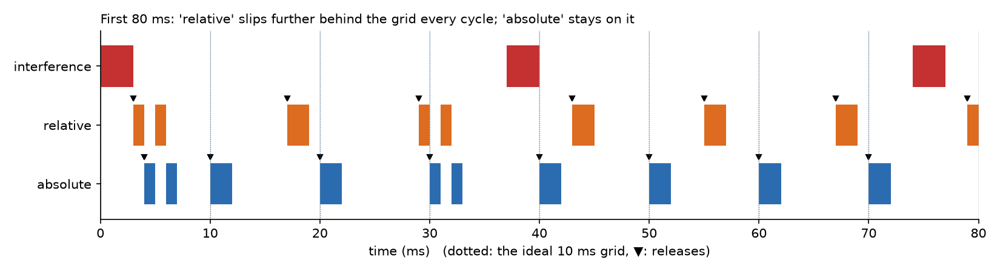
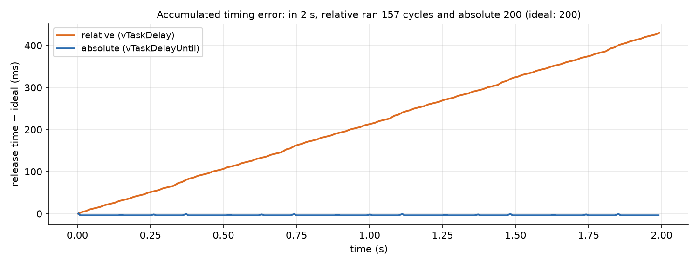
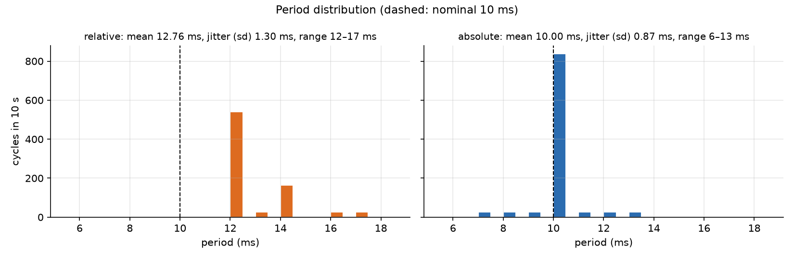
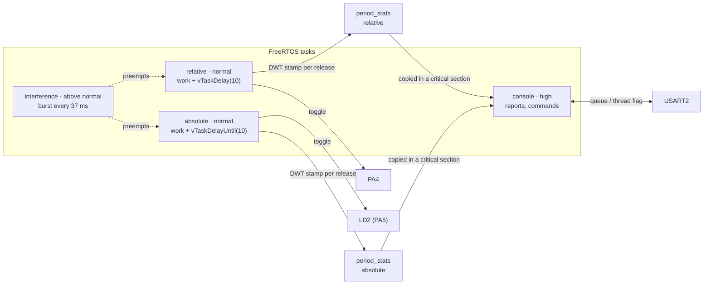

# Periodic Tasks on FreeRTOS: vTaskDelay Drift versus vTaskDelayUntil Jitter

-03234B?logo=stmicroelectronics&logoColor=white)


Two FreeRTOS tasks try to run every 10 ms, do the same work and have the same priority. They
differ in one line: one waits with `vTaskDelay(10)`, the other with `vTaskDelayUntil(&wake, 10)`.
A higher-priority task disturbs both with bursts of CPU load. Every release is **time-stamped
with the CPU cycle counter**, and the firmware reports period, **jitter**, rate and accumulated
**drift** for both tasks, with live histograms over the serial port.

**Highlights**
- Side-by-side measurement of relative versus absolute delays under identical load
- Release timestamps from the DWT cycle counter (15.6 ns resolution), exact across counter wrap
- Statistics per task: mean, min, max and standard deviation of the period, releases per second,
  lateness against the ideal 10 ms grid, and a histogram printed as text
- Adjustable work per cycle and interference burst from the console; B1 toggles interference
- Task-switch trace pins (PB12–PB15) and per-release GPIO toggles for a logic analyzer or scope
- Portable statistics and parser with 48 host test checks, plus the FreeRTOS scheduler model
  (9 tests) that produces the figures

---

<details>
<summary><h2>📘 More Explanation for Students (click to expand)</h2></summary>

**What is a periodic task?** Many embedded jobs must happen at a steady rate: read a sensor
every 10 ms, update a motor controller 1000 times a second, send a heartbeat once a second. In
FreeRTOS such a job is a task with a loop: do the work, then wait until it is time for the next
cycle. How you wait decides whether the rate is really steady.

**Why does `vTaskDelay` drift?** `vTaskDelay(10)` means "sleep for 10 ms *from now*". If the work
took 2 ms, one cycle lasts 2 + 10 = 12 ms. If another task delayed you by 3 ms, that cycle lasts
15 ms. Each of these delays is added to all the following cycles, so the task falls further and
further behind. This is called **drift**. Here the "10 ms" task really runs about 78 times a
second instead of 100.

**Why does `vTaskDelayUntil` not drift?** `vTaskDelayUntil(&wake, 10)` means "sleep until 10 ms
after my *previous* wake-up time". The task keeps a fixed timetable: 10, 20, 30 ms and so on. If
one cycle starts late because of a disturbance, the next wait is simply shorter, and the task is
back on its grid. Individual cycles still vary a little (this variation is called **jitter**),
but on average the rate is exactly 100 per second, no matter how long the work takes, as long as
the CPU has enough time left for it. If the tasks together need more than 100 % of the CPU, no
delay function can keep the rate (try `work 8`).

**How is this measured?** The Cortex-M3 has a cycle counter that counts at the CPU clock,
64 million times per second. At the start of every cycle each task reads it, which gives a
timestamp with a resolution of about 16 nanoseconds. The difference between two timestamps is
the period. From all periods the firmware calculates the average, the smallest and largest, the
standard deviation (a measure of jitter), and how far the task is behind the ideal timetable.

</details>

---

## Try it

1. Flash the board and open a terminal on the ST-LINK virtual COM port at **115200 8N1**.
2. Type `watch on`. Every 2 s both tasks report:

```text
work 2 ms, interference 3 ms every 37 ms
relative (vTaskDelay): <n> periods, mean <..> us (nominal 10000), min .., max .., jitter (sd) .. us
  rate .. /s, period error +.. %, lateness now .. us, worst .. us
  histogram rows: period deviation from 10 ms in 500 us bins, count, bar
absolute (vTaskDelayUntil): ...
```

3. Experiment: `work 0`, `work 4`, `burst 0`, `burst 9`, or press **B1** to switch the
   interference on and off. Each change resets the statistics.

| Command | Effect |
|---|---|
| `report` | Print the statistics of both tasks |
| `watch on\|off` | Print them every 2 s |
| `work <0..8>` | Busy time per cycle of both periodic tasks (ms) |
| `burst <0..9>` | Busy time of the interference task, every 37 ms (ms) |
| `reset` | Clear the statistics |
| **B1** | Interference on/off |

---

## What happens



*All figures: [tools/rtos_sim.py](tools/rtos_sim.py), a model of the FreeRTOS scheduling rules,
running the firmware's task set with 2 ms of work per cycle and a 3 ms burst every 37 ms. On the
board, `report` measures the same quantities.*

Both tasks have the same priority, so when both are ready FreeRTOS gives them alternate 1 ms
time slices. The interference task (higher priority) preempts both.



`relative` falls about 215 ms further behind every second. `absolute` stays within a few
milliseconds of its grid for ever. (Its line sits slightly below zero because the grid is
measured from its first release, which itself started a few milliseconds late.)



| | relative (`vTaskDelay`) | absolute (`vTaskDelayUntil`) |
|---|---|---|
| Mean period | 12.76 ms | **10.00 ms** |
| Cycles per second | ≈ 78 | **100** |
| Jitter (sd) | 1.30 ms | 0.87 ms |
| Behind schedule after 2 s | 430 ms | bounded (< 5 ms) |

`absolute` still has jitter: when a burst delays one release, the next period is shorter to catch
up, so its periods range from 6 to 13 ms around an exact 10 ms mean. `relative` never makes up
lost time, so all its periods are at least 12 ms.

## System overview



- **Release timestamp.** The first statement after the delay returns reads `DWT->CYCCNT`. This is
  when the task really starts its cycle, including any time it spent ready but waiting for the
  CPU.
- **Exact accumulation.** Periods are summed in raw cycles (64-bit), so the lateness against
  the ideal schedule has no rounding error, even after hours.
- **Consistent reports.** The tasks update their statistics inside a short critical section, and
  the console copies them the same way, so a report never mixes two updates.

## Watch it live

| Pin | Header | Signal |
|---|---|---|
| PA4 | A2 | Toggles at every `relative` release |
| PA5 | LD2 / D13 | Toggles at every `absolute` release |
| PB12 | CN10-16 | console running |
| PB13 | CN10-30 | relative running |
| PB14 | CN10-28 | absolute running |
| PB15 | CN10-26 | interference running |

On a scope, PA5 shows a steady 50 Hz square wave (one edge every 10 ms) with small timing wobble.
PA4 is slower and irregular. With the [logic analyzer](../sump-logic-analyzer) on PB12–PB15 you
can see the time slicing and preemption from the timeline above on real hardware.

---

## Timing and resources

| Item | Value |
|---|---|
| SYSCLK, DWT counter | 64 MHz (15.6 ns per count, wraps every 67 s; only differences are used) |
| RTOS tick | 1 kHz; HAL timebase on TIM4 |
| Nominal period | 10 ms; interference every 37 ms (not a multiple, so it hits every phase) |
| Heap (heap_4) | 6 KB |
| Memory (from the build) | 21.4 KB flash · 13.3 KB RAM |

## Firmware structure

| File | Role |
|---|---|
| `Core/Src/app_periodic.c` | Tasks: relative, absolute, interference, console with queue and thread-flag I/O |
| `Core/Src/period_stats.c` | Period, jitter, rate, lateness and histogram from timestamps (portable, tested) |
| `Core/Src/cmd.c` | Command parser (portable, tested) |
| `Core/Src/rtos_trace.c`, `Core/Inc/FreeRTOSConfig.h` | Task-switch trace pins, run-time stats, hooks |
| `Core/Src/main.c`, `*_msp.c`, `*_it.c` | STM32CubeMX-generated setup; task bodies call into `app_periodic.c` |
| `RTOS_Periodic_Jitter.ioc` | CubeMX configuration |
| `tests/test_main.c` | 48 host checks: exact periods across counter wrap, drift, bounded jitter, histogram bins, square root, report, commands |
| `tools/rtos_sim.py`, `tools/scenarios.py` | Scheduler model and this project's task set; 9 tests |
| `docs/generate_figures.py` | Regenerates the figures |

## Design decisions

- **Same priority, same work, one difference.** The two periodic tasks are identical except for
  the delay call, so every difference in the results comes from that call.
- **Interference at 37 ms.** A period that is not a multiple of 10 ms hits the periodic tasks at
  every possible phase, so the histograms show the full range of disturbance.
- **Timestamps, not tick counts.** The 1 ms RTOS tick would hide everything below a millisecond.
  The cycle counter shows the real release jitter.
- **Integer statistics.** Sums of cycles and of squared microseconds in 64-bit integers, with an
  integer square root, so no floating point is needed on the Cortex-M3.

## Revision history

The original class exercise had two tasks toggling LEDs with `osDelay(1)` and measured nothing.
It was rebuilt into a measured comparison of the two FreeRTOS delay functions.

---

## Build, test and flash

```bash
make              # build/rtos_periodic.elf / .hex / .bin (any arm-none-eabi-gcc)
make test         # 48 host checks (host C compiler)
python -m pytest tools                 # scheduler model and scenario tests
python docs/generate_figures.py        # regenerate the figures
```
In **STM32CubeIDE**: *File → Import → Existing Projects into Workspace*, select this folder.

## Bring-up checklist

1. `report` after a few seconds: `absolute` mean 10000 µs ± a few µs and about 100 releases per
   second; `relative` mean around 12–13 ms.
2. `burst 0`: `absolute` periods stay within about 1 ms of 10 ms (only `relative` can delay it);
   `relative` settles near 12–13 ms.
3. `work 0` and `burst 0`: both tasks run at exactly 10 ms.
4. `work 4`: `relative` drops to about 57 cycles per second; `absolute` still makes 100.
5. `work 8`: the CPU is overloaded (the two tasks alone need more than 100 %), so `absolute`
   misses its rate too (about 79 per second in the model).
6. Scope on PA5: 50 Hz square wave; on PA4: slower and irregular.
7. Logic analyzer on PB12–PB15: time slicing between relative and absolute, preemption by
   interference.

---
## 👤 About the Author

**Faizan Saleem Siddiqui**, Embedded Firmware Engineer | Visiting Faculty | Research Scholar

Electronics engineer with 2+ years of experience in embedded systems and firmware development.
I build production firmware for **BLE wearables and biosignal devices** on Nordic nRF52 (Zephyr / nRF
Connect SDK), including **secure OTA updates (MCUboot, signed images)**, **low-power battery
management** and **true-wireless Bluetooth audio**. My background also covers STM32 and ESP32 with
FreeRTOS, real-time data acquisition, digital signal processing, industrial IoT, and Python tooling
for data, automation and machine learning.

- 🎓 MS Electronics, Quaid-i-Azam University, Islamabad (BS Electronics: 1st position, merit scholar)
- 🧑‍🏫 Visiting Faculty Member, Quaid-i-Azam University: teaching Real-Time Systems (STM32, FreeRTOS),
  Microcontroller Interfacing (ESP32) and AI/ML on Embedded Devices (TinyML)
- 🔬 Former Research Assistant, Autonomous Vehicle Engineering (COMSIP Lab, QAU)
- 🌍 Open to embedded / firmware engineering opportunities worldwide

[](https://www.linkedin.com/in/faizan-saleem-siddiqui-4411bb247/)
[](https://github.com/FaizanSSDQ)
[](mailto:faizansaleemsdq@gmail.com)

Application code licensed under the [MIT License](../../LICENSE). STM32 HAL and CMSIS files in
`Drivers/` are © STMicroelectronics and Arm, and FreeRTOS in `Middlewares/` is © Amazon.com, Inc.
(MIT), each under its own license.
