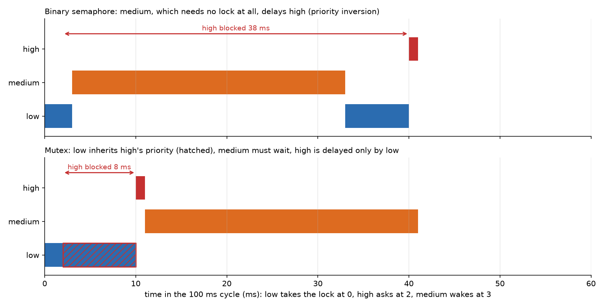
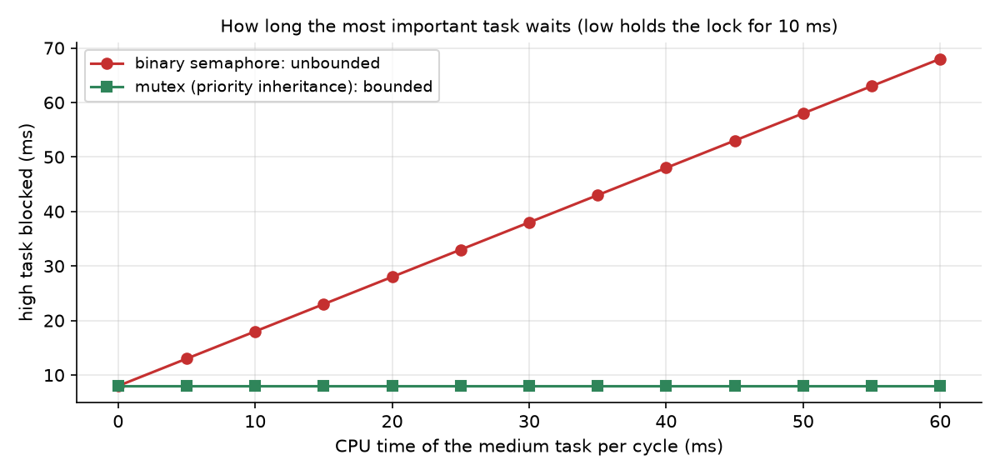
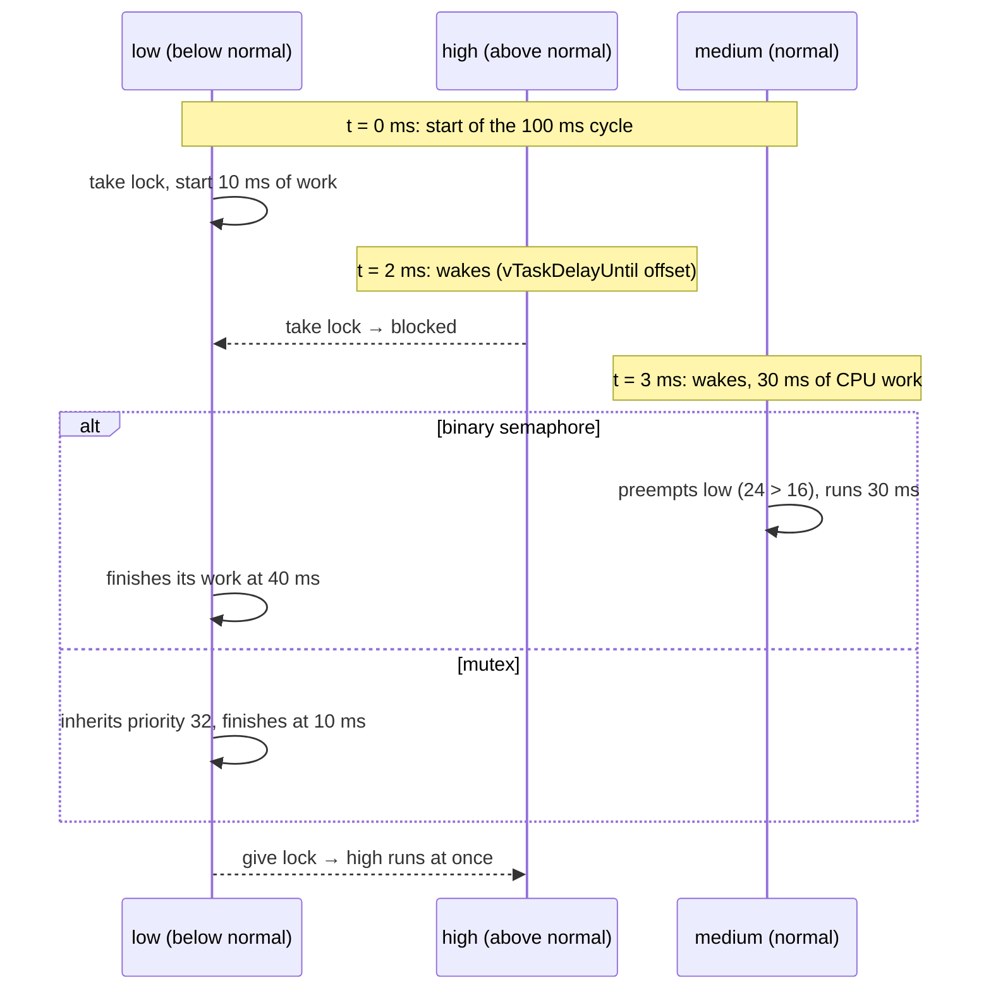

# Priority Inversion and Priority Inheritance on FreeRTOS (STM32)

-03234B?logo=stmicroelectronics&logoColor=white)


A live, measurable reproduction of **priority inversion**, the classic real-time bug in which a
high-priority task is held up by a medium-priority task that has nothing to do with it, and of
its cure, **priority inheritance**. Three tasks replay the same scene every 100 ms. The shared
lock can be switched at run time between a **binary semaphore** and a **mutex**, and the
high-priority task measures, with the CPU cycle counter, exactly how long it was blocked.

**Highlights**
- The textbook low / medium / high scenario, timed precisely with `vTaskDelayUntil` offsets
- Run-time switch between `osSemaphoreNew(1, 1)` and `osMutexNew` with `osMutexPrioInherit`
  (command or B1 button), with statistics kept separately for both
- Blocking time per cycle measured with the DWT cycle counter; the low task records the priority
  it actually ran at while holding the lock, so inheritance is visible in numbers
- Adjustable hold time and medium-task load show that the semaphore's delay is **unbounded**
  and the mutex's is not
- LD2 lights while the high task is blocked; task-switch trace pins PB12–PB15 for the
  [logic analyzer](../sump-logic-analyzer)
- Portable statistics and parser with 32 host test checks; a FreeRTOS scheduler model with
  priority inheritance (13 tests) reproduces the exact timings

---

<details>
<summary><h2>📘 More Explanation for Students (click to expand)</h2></summary>

**Why do tasks need locks?** When two tasks use the same thing, such as a UART, an SPI bus, a
shared buffer or a configuration structure, they must not use it at the same time, or the data
gets mixed up. So a task **takes a lock** before using the shared thing and **gives it back**
afterwards. If the lock is taken, the next task has to wait. In FreeRTOS such a lock can be a
**binary semaphore** (a simple "taken / free" token) or a **mutex** ("mutual exclusion", a lock
that also remembers which task owns it).

**What is priority inversion?** Imagine three tasks. **Low** takes the lock. Then **high**, the
most important task, wants the lock and must wait. That is expected and short, because low only
needs it for a few milliseconds. But now **medium** wakes up. It does not need the lock at all,
yet it has a higher priority than low, so the scheduler runs medium and low stops. Low cannot
finish and cannot give the lock back, so high keeps waiting for **as long as medium runs**. The
most important task is effectively running at the lowest priority: the priorities are
*inverted*. With a binary semaphore this delay has no upper limit.

**How does priority inheritance fix it?** A mutex knows its owner. When high starts waiting for
a mutex held by low, FreeRTOS temporarily raises low to high's priority: low **inherits** it. Now
medium cannot interrupt low, low finishes its short critical section, gives the mutex back, drops
to its normal priority, and high runs at once. High's waiting time is now limited to the time low
needs the lock, no matter what medium does. Use a mutex, not a binary semaphore, whenever tasks of
different priorities share a resource.

**Did this ever matter in real life?** Yes. In 1997 the Mars Pathfinder lander kept resetting
itself on Mars. The cause was exactly this pattern: a low-priority task held a lock needed by a
high-priority bus task, and medium-priority tasks kept low from finishing, so a watchdog
detected the stalled high-priority task and reset the computer. Engineers fixed it from Earth by
turning on priority inheritance for that lock. This project lets you reproduce the same effect
on a desk.

</details>

---

## Try it

1. Flash the board and open a terminal on the ST-LINK virtual COM port at **115200 8N1**.
2. Type `watch on`: one line per 100 ms cycle shows how long `high` waited for the lock.
3. Press **B1** (or type `mode mutex`) and watch the waiting time drop. `report` compares both:

```text
hold 10 ms, medium 30 ms; high waits for the lock:
lock         cycles     min ms    mean ms     max ms   holder prio
 semaphore      <n>        ...        ...        ...            16
*mutex          <n>        ...        ...        ...            32
```

`holder prio` is the highest priority `low` ran at while holding the lock: 16 (its own,
*below normal*) with the semaphore and 32 (*above normal*, inherited from `high`) with the mutex.
The `*` marks the active lock type.

| Command | Effect |
|---|---|
| `mode semaphore\|mutex` | Lock type (applied at the start of the next cycle) |
| `medium <0..60>` | CPU time of the medium task per cycle (ms) |
| `hold <1..20>` | How long low holds the lock (ms) |
| `report` | Blocking time of `high` for both lock types |
| `watch on\|off` | One line per cycle |
| `reset` | Clear the statistics |
| **B1** | Switch semaphore ↔ mutex |

---

## What happens



*Simulated with [tools/rtos_sim.py](tools/rtos_sim.py), a model of the FreeRTOS scheduling rules
including priority inheritance, running the firmware's scene (hold 10 ms, medium 30 ms). On the
board, `report` measures the same blocking times, and the trace pins show the same pattern on a
logic analyzer.*

| | Binary semaphore | Mutex |
|---|---|---|
| `high` blocked | (hold − 2) + medium = **38 ms** | hold − 2 = **8 ms** |
| `low` runs at | its own priority (16) | `high`'s priority (32) while `high` waits |
| `medium` | preempts `low`, delays `high` | waits until `low` releases the lock and `high` has run |
| Upper bound on `high`'s wait | none: grows with every medium-priority task | the lock-holding time |



The mutex does not make `medium` disappear: it still gets its full 30 ms, just after the critical
section instead of in the middle of it.

## How the scene is timed



- All three tasks start their schedule from the same tick and use `vTaskDelayUntil`, so the
  offsets of 0, 2 and 3 ms repeat exactly every cycle.
- `low` chooses the lock type at the start of each cycle, when nobody holds either lock, so
  switching modes is always safe.
- `high` reads `DWT->CYCCNT` just before `osSemaphoreAcquire` / `osMutexAcquire` and right after
  it returns. The difference is the blocking time, with 16 ns resolution.
- `low` samples `uxTaskPriorityGet(NULL)` while it works, so the inherited priority is captured
  from inside the critical section.

## Hardware

| Pin | Header | Signal |
|---|---|---|
| PA5 | LD2 | On while `high` is blocked on the lock (visibly longer with the semaphore) |
| PA4 | A2 | High while `low` holds the lock |
| PB12 | CN10-16 | console running |
| PB13 | CN10-30 | high running |
| PB14 | CN10-28 | medium running |
| PB15 | CN10-26 | low running |
| PC13 | B1 | Switch semaphore ↔ mutex |
| PA2 / PA3 | ST-LINK VCP | Console, 115200 8N1 |

## Timing and resources

| Item | Value |
|---|---|
| SYSCLK, DWT counter | 64 MHz |
| RTOS tick | 1 kHz; HAL timebase on TIM4 |
| Cycle | 100 ms: low at 0 ms, high at 2 ms, medium at 3 ms |
| Heap (heap_4) | 6 KB |
| Memory (from the build) | 23.2 KB flash · 11.9 KB RAM |

---

## Firmware structure

| File | Role |
|---|---|
| `Core/Src/app_inversion.c` | The three actors, lock selection, blocking-time measurement, console |
| `Core/Src/inversion_stats.c` | Blocking-time statistics per lock type, report and per-cycle line (portable, tested) |
| `Core/Src/cmd.c` | Command parser (portable, tested) |
| `Core/Src/rtos_trace.c`, `Core/Inc/FreeRTOSConfig.h` | Task-switch trace pins, run-time stats, hooks |
| `Core/Src/main.c`, `*_msp.c`, `*_it.c` | STM32CubeMX-generated setup; task bodies call into `app_inversion.c` |
| `RTOS_Priority_Inversion.ioc` | CubeMX configuration |
| `tests/test_main.c` | 32 host checks: separate statistics per lock, empty and full reports, per-cycle line, commands |
| `tools/rtos_sim.py`, `tools/scenarios.py` | Scheduler model with priority inheritance and this scene; 13 tests including exact blocking times |
| `docs/generate_figures.py` | Regenerates the figures |

## Design decisions

- **One scene, two locks.** Everything except the lock object is identical between the two
  modes, so the measured difference is caused by priority inheritance alone.
- **Offsets by `vTaskDelayUntil`.** The scenario must happen the same way every cycle to give
  stable statistics; fixed offsets from a common start tick make it deterministic.
- **Measure, don't assume.** The wait is measured by the task that suffers it, and the
  inherited priority by the task that receives it, both on the target.
- **Keep `medium` lock-free.** The point of the demo is that a task with no connection to the
  resource can still block the most important task.

## Revision history

The original class exercise created four tasks (two of them empty, the "transmitter" and
"receiver" with commented-out code) and used no mutex or semaphore at all. It was rebuilt into a
complete priority-inversion experiment.

---

## Build, test and flash

```bash
make              # build/rtos_inversion.elf / .hex / .bin (any arm-none-eabi-gcc)
make test         # 32 host checks (host C compiler)
python -m pytest tools                 # scheduler model and scenario tests
python docs/generate_figures.py        # regenerate the figures
```
In **STM32CubeIDE**: *File → Import → Existing Projects into Workspace*, select this folder.

## Bring-up checklist

1. `watch on` with the semaphore: about 38 ms per cycle; LD2 glows noticeably.
2. B1 → mutex: about 8 ms per cycle; `report` shows holder priority 32.
3. `medium 60`: the semaphore wait rises to about 68 ms; the mutex stays at about 8 ms.
4. `hold 1`: no waiting at all in either mode (low is done before high asks).
5. Logic analyzer on PB12–PB15: semaphore mode shows medium running while high waits; mutex
   mode shows low running straight through until it releases the lock.

---
## 👤 About the Author

**Faizan Saleem Siddiqui**, Embedded Firmware Engineer | Visiting Faculty | Research Scholar

Electronics engineer with 2+ years of experience in embedded systems and firmware development.
I build firmware for **BLE wearables** and **Bluetooth TWS audio devices** on Nordic nRF52 (Zephyr /
nRF Connect SDK), including **secure OTA updates (MCUboot, signed images)**, **low-power battery
management** and **charging-case firmware**. My background also covers STM32 and ESP32 with
FreeRTOS, real-time data acquisition, digital signal processing, industrial IoT, and Python tooling
for data, automation and machine learning.

- 🎓 MS Electronics, Quaid-i-Azam University, Islamabad (BS Electronics: 1st position, merit scholar)
- 🧑‍🏫 Visiting Faculty Member, Quaid-i-Azam University: teaching Real-Time Systems (STM32, FreeRTOS),
  Microcontroller Interfacing (ESP32) and AI/ML on Embedded Devices (TinyML)
- 🔬 Former Research Assistant, Autonomous Vehicle Engineering (COMSIP Lab, QAU)
- 🌍 Open to embedded / firmware engineering opportunities worldwide

[](https://www.linkedin.com/in/faizan-saleem-siddiqui-4411bb247/)
[](https://github.com/FaizanSSDQ)
[](mailto:faizansaleemsdq@yahoo.com)

Application code licensed under the [MIT License](../../LICENSE). STM32 HAL and CMSIS files in
`Drivers/` are © STMicroelectronics and Arm, and FreeRTOS in `Middlewares/` is © Amazon.com, Inc.
(MIT), each under its own license.
