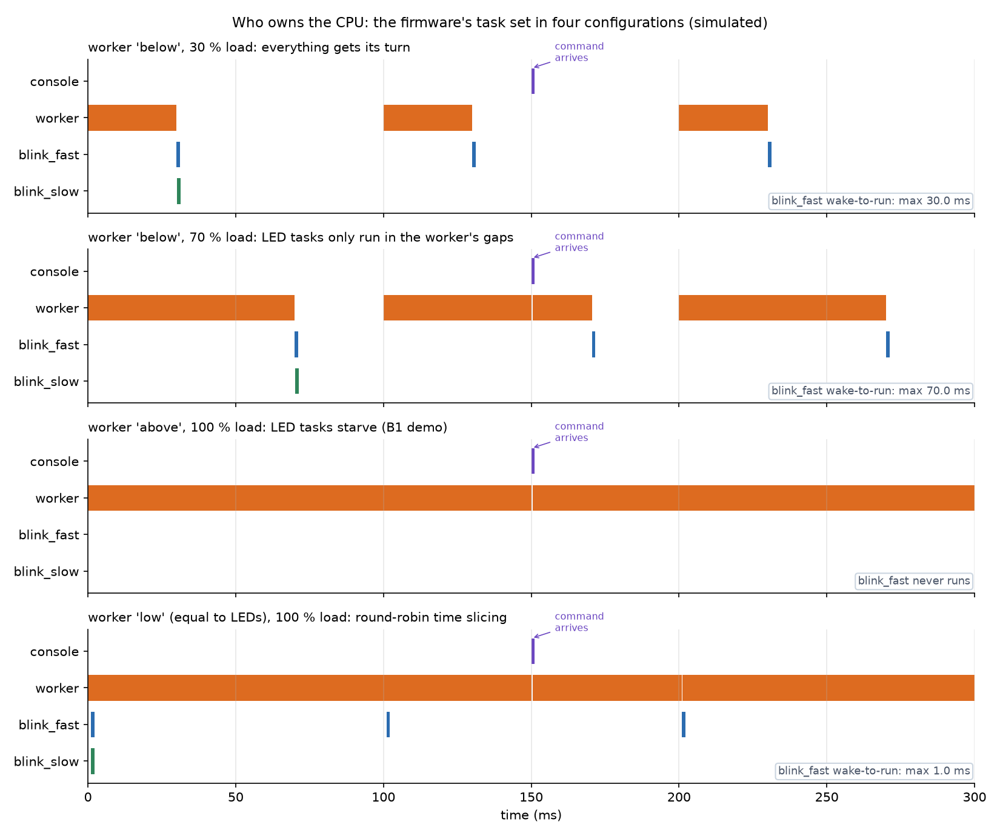
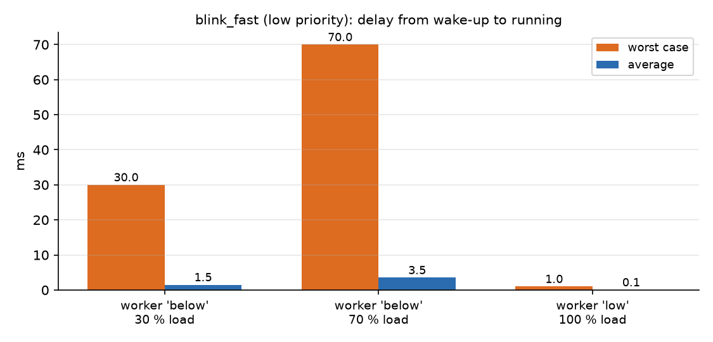
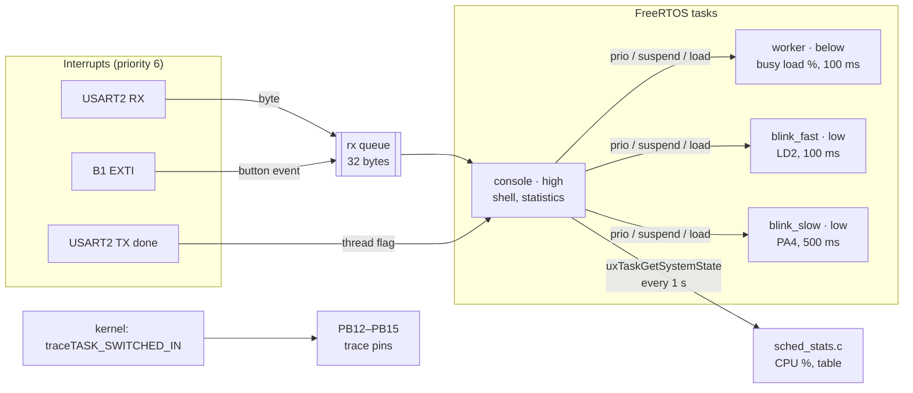

# FreeRTOS Task Scheduling on STM32: Priorities, Preemption and Run-Time Statistics

-03234B?logo=stmicroelectronics&logoColor=white)


An interactive FreeRTOS lab. Four tasks share one Cortex-M3: a console, a CPU-hungry worker
and two LED blinkers. From a serial terminal you change their **priorities**, the worker's
**CPU load**, or **suspend and resume** them, and a `top`-style table shows the effect live:
**CPU share per task** from FreeRTOS run-time statistics, task states, **stack high-water
marks** and heap usage. Every context switch also drives a **trace pin**, so the scheduler can be
watched on a logic analyzer.

**Highlights**
- Fixed-priority preemptive scheduling, starvation and round-robin time slicing, each
  reproducible with one command (or the B1 button)
- Run-time statistics on the DWT cycle counter: per-task CPU share over 1 s windows, exact
  across counter wrap-around
- Interrupt-driven console: RX bytes reach the task through a **message queue** from the ISR;
  TX uses interrupt mode while the task sleeps on a **thread flag** (no busy-waiting at high
  priority)
- `traceTASK_SWITCHED_IN` hook drives PB12–PB15, one pin per task, for a live timeline with the
  [logic analyzer](../sump-logic-analyzer) project
- Stack-overflow and malloc-failure hooks enabled; heap sized from measurement
- Portable command parser and statistics engine with 44 host test checks, plus a Python model of
  the FreeRTOS scheduler (9 tests) that produces the timelines below

---

<details>
<summary><h2>📘 More Explanation for Students (click to expand)</h2></summary>

**What is an RTOS, and what is a task?** A simple microcontroller program is one big loop
that does everything in turn. When it has to blink an LED, read a sensor, answer the serial port
and run a calculation, the loop gets complicated and one slow job delays all the others. A
**real-time operating system (RTOS)** such as FreeRTOS lets you write each job as its own small
program, a **task**, with its own infinite loop. The RTOS **scheduler** switches the single CPU
between tasks so fast that they appear to run at the same time. A task that has nothing to do
calls a delay or waits for data, and while it waits it uses no CPU time at all.

**What do priorities and preemption mean?** Every task has a **priority**. FreeRTOS always runs
the highest-priority task that is ready. If a more important task wakes up (for example the
console, because you pressed a key), it **preempts** the running task immediately: the less
important task is paused mid-instruction and continues later from exactly where it stopped. This
is what makes the system *real-time*: important work never waits for unimportant work.

**What are starvation and time slicing?** Priorities have a dark side. If a high-priority task
never waits (here: the worker at 100 % load), lower-priority tasks never get the CPU. They
**starve**, and the LEDs stop blinking even though their code is fine. Press B1 to see this. When
tasks have the **same** priority, FreeRTOS shares the CPU between them in turns of one tick
(1 ms), which is called **time slicing** or round-robin. Set the worker to `low`, the same as the
LEDs, and they blink again even at 100 % load.

**How does the `top` table know how much CPU each task uses?** FreeRTOS can keep a
**run-time counter** for every task: each time it switches tasks, it adds the time the
outgoing task ran. This project uses the processor's cycle counter (64 million counts per second)
as the clock. Once per second the console reads all counters and compares them with the reading
from a second earlier. The difference shows how many cycles each task used, so `worker 30.0 %`
means the worker ran for 0.3 s of the last second. The **idle task**, which runs when nobody else
wants the CPU, shows how much time is left over. The table also shows the smallest amount of free
stack each task has ever had, which tells you whether its stack is too small.

</details>

---

## Try it

1. Flash the board and open a serial terminal on the ST-LINK virtual COM port at **115200 8N1**.
2. LD2 blinks every 100 ms. An optional LED with a resistor on **PA4** blinks every 500 ms.
3. Type commands:

```text
FreeRTOS scheduling demo (V10.0.1) - type 'help'
> load 70
worker load 70 %
> prio worker above
worker priority above
> prio worker low
worker priority low
> suspend blink_fast
blink_fast suspended
> watch on
watch on
```

| Command | Effect |
|---|---|
| `top` | Table for the last second: task, priority, state, CPU share, minimum free stack, plus total CPU load and heap |
| `watch on\|off` | Print the table every second |
| `load <0..100>` | Share of each 100 ms period the worker spends in a busy loop |
| `prio <task> low\|below\|normal\|above` | Change the priority of `worker`, `blink_fast` or `blink_slow` |
| `suspend <task>` / `resume <task>` | Take a task out of scheduling / put it back |
| **B1** | Starvation demo: worker to 100 % at `above` (LEDs stop); press again to restore |

In the table, state is `R` running, `r` ready, `B` blocked and `S` suspended. Priorities are the
CMSIS-RTOS2 levels: `low` 8, `below` 16, `normal` 24, `above` 32, `high` 40 (the console).

---

## What the scheduler does



*Simulated with [tools/rtos_sim.py](tools/rtos_sim.py), a model of the FreeRTOS scheduling rules
running the same task set as the firmware (see [Watch it live](#watch-it-live) for the hardware
equivalent).*

| Setting | What happens | Why |
|---|---|---|
| worker `below`, 30 % | LEDs blink on time except when the worker is busy | LED tasks (`low`) run only when no higher task is ready |
| worker `below`, 70 % | LED toggles are delayed by up to 70 ms | The LEDs wait for the end of every worker burst |
| worker `above`, 100 % | LEDs stop completely; the console still answers | Starvation: the worker never blocks, and only `high` tasks preempt it |
| worker `low`, 100 % | LEDs blink normally again | Equal priority: FreeRTOS rotates the tasks every 1 ms tick |

In every case the console is never delayed: when a command arrives it preempts the worker at
once.



## System overview



### Run-time statistics

FreeRTOS calls `portGET_RUN_TIME_COUNTER_VALUE()` at every context switch and adds the elapsed
time to the outgoing task's counter. Here it returns `DWT->CYCCNT`, the core's 64 MHz cycle
counter. The counter is only 32 bits and wraps every 67 s, so the console never uses absolute
values. Every second it takes a snapshot (`uxTaskGetSystemState`) and computes each task's
**difference** to the previous snapshot. Unsigned subtraction keeps these differences exact
across a wrap, and the shares add up to 100 % including the idle task.

### Console without busy-waiting

The console has the highest application priority. If it polled the UART, a `top` printout
(tens of milliseconds at 115200 baud) would block every other task for that long. Instead:
- received bytes are pushed into a FreeRTOS **message queue** by the RX-complete interrupt, and
  the task sleeps in `osMessageQueueGet` (with a timeout that also paces the 1 s snapshots);
- output is sent with `HAL_UART_Transmit_IT`, and the task sleeps on a **thread flag** that the
  TX-complete interrupt sets.

The console's own CPU share in `top` therefore stays small even while it prints.

## Watch it live

`traceTASK_SWITCHED_IN()` is defined in `FreeRTOSConfig.h` and runs inside every context switch.
Each task's application tag holds its GPIO mask, and `rtos_trace.c` writes `GPIOB->BSRR` once to
raise the incoming task's pin and lower all the others. When the idle task runs, all pins are
low.

| Pin | Header | Task |
|---|---|---|
| PB12 | CN10-16 | console |
| PB13 | CN10-30 | worker |
| PB14 | CN10-28 | blink_fast |
| PB15 | CN10-26 | blink_slow |

Connect these pins (and GND) to channels 0–3 of a second NUCLEO-F103RB running the
[SUMP logic analyzer](../sump-logic-analyzer), capture at 100 kS/s in PulseView, and the
timelines above appear with real timing.

---

## Hardware

| Pin | Function |
|---|---|
| PA5 (LD2) | blink_fast LED |
| PA4 (A2) | blink_slow LED (external LED + 330 Ω to GND, optional) |
| PC13 (B1) | Starvation demo on/off |
| PA2 / PA3 | USART2 console via ST-LINK VCP, 115200 8N1 |
| PB12–PB15 | Task trace outputs |

## Timing and resources

| Item | Value |
|---|---|
| SYSCLK | HSI 8 MHz ÷ 2 × 16 = 64 MHz |
| RTOS tick | 1 kHz (SysTick); HAL timebase on TIM3 |
| Run-time counter | DWT cycle counter, 64 MHz, 1 s statistics windows |
| Heap (heap_4) | 6 KB; `top` reports the free and minimum-ever free bytes |
| Memory (from the build) | 22.8 KB flash · 13.8 KB RAM |

---

## Firmware structure

| File | Role |
|---|---|
| `Core/Src/app_sched.c` | Tasks: console (queue + thread-flag I/O, commands, snapshots), worker, blinkers |
| `Core/Src/sched_stats.c` | Per-task CPU share from counter snapshots, sorting, table formatting (portable, tested) |
| `Core/Src/cmd.c` | Command parser and priority names (portable, tested) |
| `Core/Src/rtos_trace.c` | Task-switch trace on GPIOB |
| `Core/Src/freertos.c` | Run-time counter, stack-overflow and malloc-failed hooks |
| `Core/Inc/FreeRTOSConfig.h` | Kernel configuration: run-time stats, task tags, overflow checking, trace macro |
| `Core/Src/main.c`, `*_msp.c`, `*_it.c` | STM32CubeMX-generated setup; task bodies only call into `app_sched.c` |
| `RTOS_Scheduling.ioc` | CubeMX configuration (FreeRTOS CMSIS-V2, tasks, USART2, GPIO) |
| `tests/test_main.c` | 44 host checks: every command, priority names, CPU shares, counter wrap, table format |
| `tools/rtos_sim.py` | FreeRTOS scheduler model: priorities, preemption, time slicing, delays, mutexes |
| `tools/scenarios.py`, `tools/test_rtos_sim.py` | The firmware's task set as scenarios, and 9 tests of the model |
| `docs/generate_figures.py` | Regenerates the figures |

## Design decisions

- **Console at the highest priority, but asleep.** It must answer even when the worker starves
  everyone else, so it blocks on a queue and a thread flag instead of polling.
- **Statistics over windows.** Differences between 1 s snapshots make the 32-bit cycle counter
  usable indefinitely and show the *current* load, not an average since boot.
- **Worker load as a busy loop on the cycle counter.** This makes the load exact and independent
  of compiler optimisation, and `vTaskDelayUntil` keeps its period fixed.
- **Trace through task tags.** One register write per context switch costs a few cycles and needs
  no extra RAM, unlike a trace buffer.
- **Only `low` to `above` are settable.** Tasks can never be raised above the console, so the
  shell always stays in control.

## Revision history

The original class exercise had two LED tasks that suspended and resumed each other on timers.
Its condition `if (TaskState = 1)` was an assignment, so it was always true. The project was
rebuilt around measurement: run-time statistics, an interactive console, trace pins and a
scheduler model.

---

## Build, test and flash

```bash
make              # build/rtos_scheduling.elf / .hex / .bin (any arm-none-eabi-gcc)
make test         # 44 host checks of the parser and statistics (host C compiler)
python -m pytest tools                 # scheduler model tests
python docs/generate_figures.py        # regenerate the figures
```
In **STM32CubeIDE**: *File → Import → Existing Projects into Workspace*, select this folder.

## Bring-up checklist

1. The banner appears; `top` lists console, worker, blink_fast, blink_slow, IDLE and Tmr Svc.
2. Default load: worker ≈ 30 %, CPU busy ≈ 30 %, every stack has spare words.
3. `load 70` → worker ≈ 70 %; LD2 visibly stutters.
4. B1 → LEDs stop, worker ≈ 100 %, console still answers; B1 again → normal.
5. `prio worker low` + `load 100` → LEDs blink, worker ≈ 99 %.
6. `suspend blink_fast` → state `S`, LD2 stops; `resume blink_fast` → blinks again.
7. Logic analyzer on PB12–PB15: the task pattern matches the timelines in this README.

---
## 👤 About the Author

**Faizan Saleem Siddiqui**, Embedded Firmware Engineer | Visiting Faculty | Research Scholar

Electronics engineer with 2+ years of experience in embedded systems and firmware development.
I build production firmware for **BLE wearables and biosignal devices** on Nordic nRF52 (Zephyr / nRF
Connect SDK), including **secure OTA updates (MCUboot, signed images)**, **low-power battery
management** and **true-wireless Bluetooth audio**. My background also covers STM32 and ESP32 with
FreeRTOS, real-time data acquisition, digital signal processing, industrial IoT, and Python tooling
for data, automation and machine learning.

- 🎓 MS Electronics, Quaid-i-Azam University, Islamabad (BS Electronics: 1st position, merit scholar)
- 🧑‍🏫 Visiting Faculty Member, Quaid-i-Azam University: teaching Real-Time Systems (STM32, FreeRTOS),
  Microcontroller Interfacing (ESP32) and AI/ML on Embedded Devices (TinyML)
- 🔬 Former Research Assistant, Autonomous Vehicle Engineering (COMSIP Lab, QAU)
- 🌍 Open to embedded / firmware engineering opportunities worldwide

[](https://www.linkedin.com/in/faizan-saleem-siddiqui-4411bb247/)
[](https://github.com/FaizanSSDQ)
[](mailto:faizansaleemsdq@gmail.com)

Application code licensed under the [MIT License](../../LICENSE). STM32 HAL and CMSIS files in
`Drivers/` are © STMicroelectronics and Arm, and FreeRTOS in `Middlewares/` is © Amazon.com, Inc.
(MIT), each under its own license.
