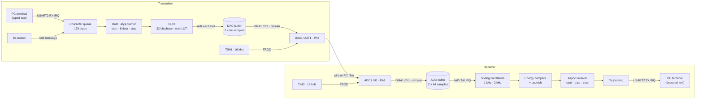
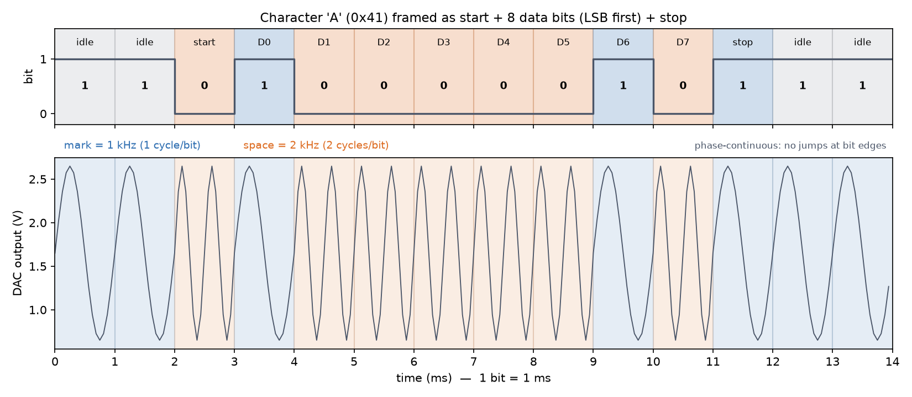
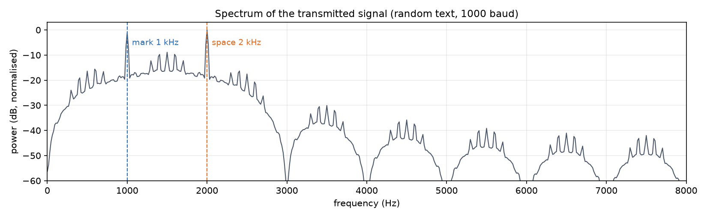
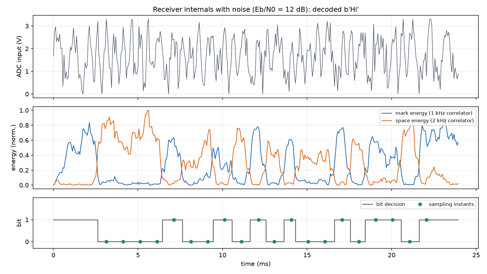
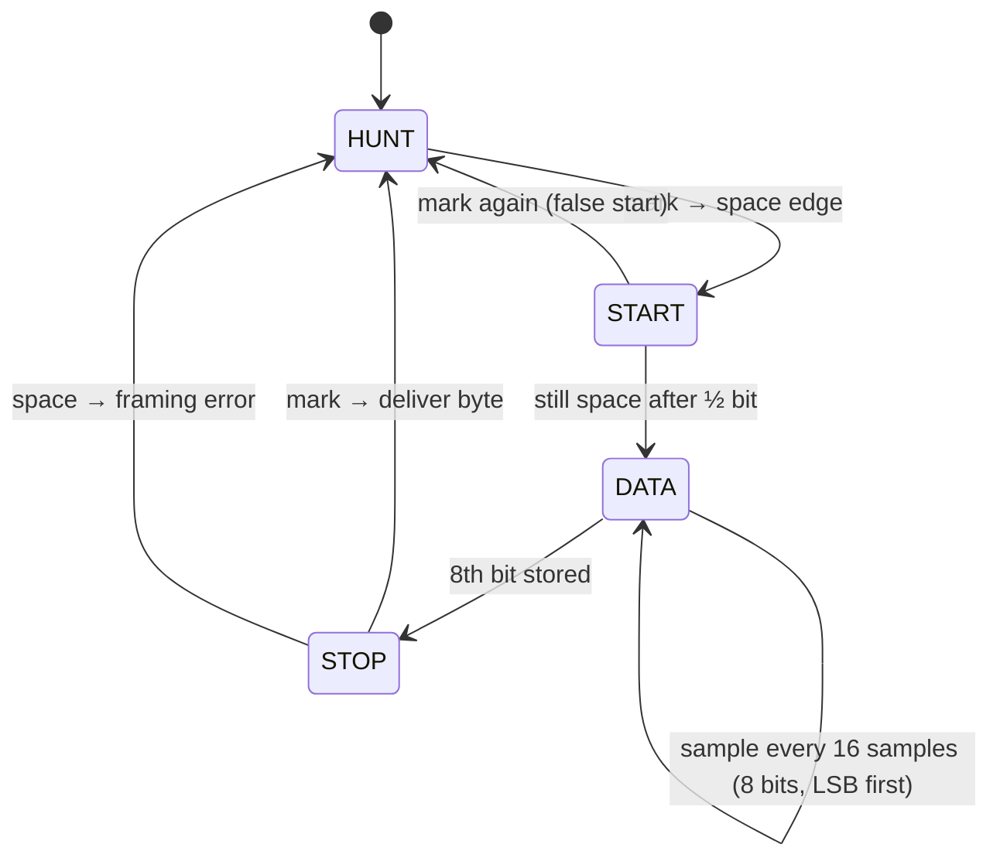
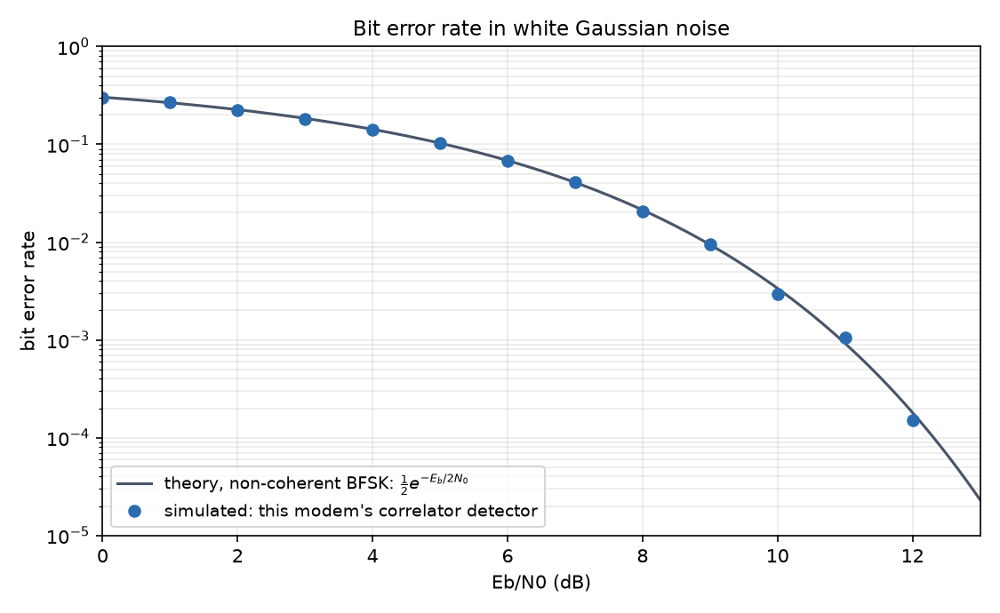
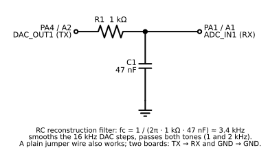

# FSK Modem on STM32: DAC Transmitter and ADC Receiver

-03234B?logo=stmicroelectronics&logoColor=white)


A complete frequency-shift-keying modem in firmware. Text typed in a serial terminal is framed
like UART characters, turned into **phase-continuous FSK tones by a numerically controlled
oscillator on the DAC**, received through the **ADC**, demodulated by **sliding correlators**
and printed back to the terminal. A single board talks to itself through one wire; two boards
talk to each other.

**Highlights**
- 1000 baud binary FSK: mark 1 kHz, space 2 kHz, sampled at 16 kHz on both sides
- Transmitter: 32-bit phase accumulator + sine table, refilled into a circular DAC DMA buffer
- Receiver: non-coherent detector with exact integer sliding correlators, start-bit
  synchronisation and framing checks, fed by timer-triggered ADC DMA
- Measured bit error rate matches the theoretical curve for non-coherent FSK
- Portable modem core with 51 host test checks (noise, attenuation, DC offset, any bit alignment)

---

<details>
<summary><h2>📘 More Explanation for Students (click to expand)</h2></summary>

**What is a modem?** A wire, a radio channel or a telephone line cannot carry "ones and zeros"
directly over long distances; it carries waves. A **mo**dulator-**dem**odulator turns digital
data into a signal that suits the channel, and turns the received signal back into data. Old
dial-up internet modems, garage remote controls and many simple radio links work this way. This
project builds both halves in firmware on one STM32 board: text typed on a PC goes out of the
board as sound-frequency tones and comes back in through another pin, where it is decoded and
printed.

**What is FSK?** In **Frequency-Shift Keying** each bit is sent as a short burst of a tone, and
the *frequency* of the tone tells which bit it is: here a 1 kHz tone means "1" and a 2 kHz tone
means "0". Each bit lasts 1 ms (1000 bits per second). The tones are made by the DAC
(digital-to-analog converter), which outputs voltages from numbers. A **numerically controlled
oscillator** steps through a table of sine values: stepping faster gives a higher frequency, and
switching between the two step sizes changes the tone without any jump in the waveform, which
keeps the signal clean.

**How does the receiver know which tone it hears?** The ADC (analog-to-digital converter)
measures the incoming voltage 16 000 times per second. For each tone, the receiver multiplies the
last 16 samples (exactly one bit) by a reference sine and cosine of that tone and adds the
results; this is called **correlation**, and it gives a large number only when the input
contains that tone. Comparing the "1 kHz energy" with the "2 kHz energy" decides the bit. Using
both sine and cosine means the receiver does not need to know the exact phase of the incoming
wave, which keeps it simple.

**How are bits grouped into characters?** Like a normal serial port (UART), every character is
sent as a **start bit** (0), eight data bits and a **stop bit** (1); between characters the line
rests at "1". The receiver waits for the 1→0 change that marks a start bit, then reads each bit
in its middle, and checks that the stop bit is really 1. If it is not, the character is rejected
as a *framing error*. Because each character carries its own start bit, small timing differences
between transmitter and receiver never add up. The Python model in `tools/` also adds random
noise to the signal and shows that the number of bit errors matches the textbook formula for
this kind of receiver.

</details>

---

## Try it

1. Flash the board and connect **PA4 (A2) to PA1 (A1)**, directly or through the RC filter below.
2. Open a serial terminal on the ST-LINK virtual COM port at **115200 baud, 8N1**.
3. Type. Each character leaves the board as audio-frequency tones, comes back through the ADC,
   is demodulated, and only then appears in the terminal. Press **B1** to send a test sentence.

```
STM32 FSK modem ready: 1000 baud, mark 1000 Hz, space 2000 Hz, fs 16 kHz.
Connect PA4 (A2) to PA1 (A1). Type to transmit; press B1 for a test message.

The quick brown fox jumps over the lazy dog 0123456789
```
Pull the wire while text is flowing: the interrupted character is normally rejected with a
framing error, and the squelch keeps the disconnected input silent. Put a scope probe on PA4
to see the tones.

---

## System overview



---

## Signal design

| Parameter | Value | Why |
|---|---|---|
| Sample rate | 16 kHz (TIM6 for DAC, TIM3 for ADC) | 32 MHz ÷ 2000, an exact integer division |
| Bit rate | 1000 baud → 16 samples per bit | 100 characters per second |
| Mark (1, idle) | 1 kHz = 1 cycle per bit | |
| Space (0) | 2 kHz = 2 cycles per bit | Both tones complete whole cycles within a bit, so they are **orthogonal** over the bit window: the detector rejects the other tone and any DC offset exactly |
| Amplitude | 1.65 V ± 1.0 V | Fits the 0–3.3 V ADC range with margin |
| Framing | 1 start, 8 data (LSB first), 1 stop | Same as a UART, so the receiver resynchronises on every character |



The oscillator adds a tuning word to a 32-bit phase every sample
(`f / fs × 2³²`: 2²⁸ for mark, 2²⁹ for space) and uses the top 8 bits to index a 256-entry sine
table. Switching tones only changes the increment, so the phase never jumps: no clicks, and a
compact spectrum.



---

## Receiver

For each tone, the demodulator correlates the last 16 samples (one bit) with a cosine and a sine
reference, and compares the energies `E = I² + Q²`. Using both cosine and sine makes the result
independent of the received phase (**non-coherent** detection), so transmitter and receiver
never need to share a clock phase.

Because both references repeat every 16 samples, the window slides with one multiply-add per
reference and per sample:

```
I_k(n) = I_k(n−1) + (x[n] − x[n−16]) · cos_k[n mod 16]        (exact integer arithmetic)
```

A squelch threshold treats a silent line as idle, so noise alone never produces characters.



### Character synchronisation



The correlation window ends at the current sample, so a start edge is seen about half a bit
late. Waiting another half bit puts every later sampling instant (green dots above) exactly
where the window covers one whole bit.

### Noise performance



The detector's simulated bit error rate (Python reference model of the same algorithm) sits on
the theoretical curve for non-coherent binary FSK, `Pb = ½·exp(−Eb/2N0)`: about 1 error in
300 bits at 10 dB and fewer than 1 in 5000 at 12 dB.

---

## Hardware

| Pin | Nucleo header | Function |
|---|---|---|
| PA4 | A2 | DAC1 OUT1, modem output (TX) |
| PA1 | A1 | ADC_IN1, modem input (RX) |
| PA2 / PA3 | ST-LINK VCP | USART2 terminal, 115200 baud, interrupt-driven |
| PC13 | B1 (blue button) | Send test sentence |
| PA5 | LD2 (green LED) | Toggles on every received character |



## Timing and resources

| Item | Value |
|---|---|
| SYSCLK | HSI 16 MHz × 6 ÷ 3 = 32 MHz |
| DAC and ADC rate | 32 MHz ÷ (PSC 0 + 1) ÷ (ARR 1999 + 1) = 16 kHz |
| DMA half-buffer | 64 samples = 4 ms (refill and processing deadline) |
| Character time | 10 bits = 10 ms → 100 characters/s |
| Memory (from the build) | 14.3 KB flash · 3.8 KB RAM |

---

## Firmware structure

| File | Role |
|---|---|
| `Core/Src/fsk_mod.c` | Character queue, UART-style framer, NCO modulator (portable, tested) |
| `Core/Src/fsk_demod.c` | Sliding correlators, squelch, async receiver state machine (portable, tested) |
| `Core/Src/fsk_tables.c` | Sine and correlator tables, generated by `tools/gen_tables.py` |
| `Core/Src/app_fsk.c` | Hardware glue: DAC/ADC DMA callbacks, UART terminal, button, status messages |
| `Core/Src/main.c`, `*_msp.c`, `*_it.c` | STM32CubeMX-generated setup; application hooks only in `USER CODE` blocks |
| `FSK_Modem.ioc` | CubeMX configuration (DAC, ADC, TIM3, TIM6, DMA, USART2) |
| `tests/test_main.c` | 51 host checks: clean and noisy loopback, all 255 byte values, 32 bit alignments, 15 % gain with DC offset, squelch |
| `tools/fsk_model.py` | Python reference model, BER simulation and its tests |
| `docs/generate_figures.py` | Regenerates every figure in this README |

## Design decisions

- **Orthogonal tones (1 and 2 kHz at 1000 baud)** instead of the Bell 202 pair (1200/2200 Hz).
  Whole cycles per bit make the one-bit correlator an exact matched filter, with no leakage
  between tones.
- **Non-coherent energy detection.** Comparing `I² + Q²` needs no carrier recovery or phase
  lock, which keeps the receiver simple while reaching the theoretical non-coherent error rate.
- **Sliding correlators in integers.** One multiply-add per reference per sample, exact (no
  accumulated rounding), and cheap on a Cortex-M3 without an FPU.
- **UART-style framing.** Every character carries its own start bit, so the receiver
  resynchronises 100 times a second and tolerates independent TX and RX clocks.
- **DMA everywhere for the signal path.** The DAC and ADC run from hardware timers through
  circular DMA; the CPU only refills or processes a half-buffer every 4 ms.
- **Squelch.** Without it, noise on an open input produces random characters.

## Revision history

The original university project with this name contained NRF24L01 radio code rather than an FSK
implementation (that code now lives in the Electronics-Engineering-Projects repository). This
modem was written from scratch to implement FSK transmission and reception properly.

---

## Build, test and flash

```bash
make              # build/fsk_modem.elf / .hex / .bin (any arm-none-eabi-gcc)
make test         # 51 host checks of the modem core (host C compiler)
python -m pytest tools                 # Python reference model tests
python docs/generate_figures.py        # regenerate the figures
```
In **STM32CubeIDE**: *File → Import → Existing Projects into Workspace*, select this folder.
Flash `build/fsk_modem.bin` by drag-and-drop onto the NUCLEO drive or with STM32CubeProgrammer.

## Bring-up checklist

1. Open the terminal before resetting the board: the banner appears.
2. Oscilloscope on PA4 with no typing: a steady 1 kHz sine, 0.65–2.65 V (idle mark tone).
3. Type `U` (alternating bits): the scope shows 1 kHz and 2 kHz bursts.
4. With PA4 wired to PA1, typed characters appear in the terminal and LD2 toggles.
5. Remove the wire mid-sentence: `[fsk] framing errors` may appear, nothing else is printed.
6. Press B1: the test sentence arrives intact.
7. Two boards: PA4 of board 1 to PA1 of board 2, GND to GND; type on board 1's terminal and
   read on board 2's.

---
## 👤 About the Author

**Faizan Saleem Siddiqui**, Embedded Firmware Engineer | Visiting Faculty | Research Scholar

Electronics engineer with 2+ years of experience in embedded systems and firmware development.
I build production firmware for **BLE wearables and biosignal devices** on Nordic nRF52 (Zephyr / nRF
Connect SDK), including **secure OTA updates (MCUboot, signed images)**, **low-power battery
management** and **true-wireless Bluetooth audio**. My background also covers STM32 and ESP32 with
FreeRTOS, real-time data acquisition, digital signal processing, industrial IoT, and Python tooling
for data, automation and machine learning.

- 🎓 MS Electronics, Quaid-i-Azam University, Islamabad (BS Electronics: 1st position, merit scholar)
- 🧑‍🏫 Visiting Faculty Member, Quaid-i-Azam University: teaching Real-Time Systems (STM32, FreeRTOS),
  Microcontroller Interfacing (ESP32) and AI/ML on Embedded Devices (TinyML)
- 🔬 Former Research Assistant, Autonomous Vehicle Engineering (COMSIP Lab, QAU)
- 🌍 Open to embedded / firmware engineering opportunities worldwide

[](https://www.linkedin.com/in/faizan-saleem-siddiqui-4411bb247/)
[](https://github.com/FaizanSSDQ)
[](mailto:faizansaleemsdq@gmail.com)

Application code licensed under the [MIT License](../../LICENSE). STM32 HAL and CMSIS files in
`Drivers/` are © STMicroelectronics and Arm under their own licenses.
