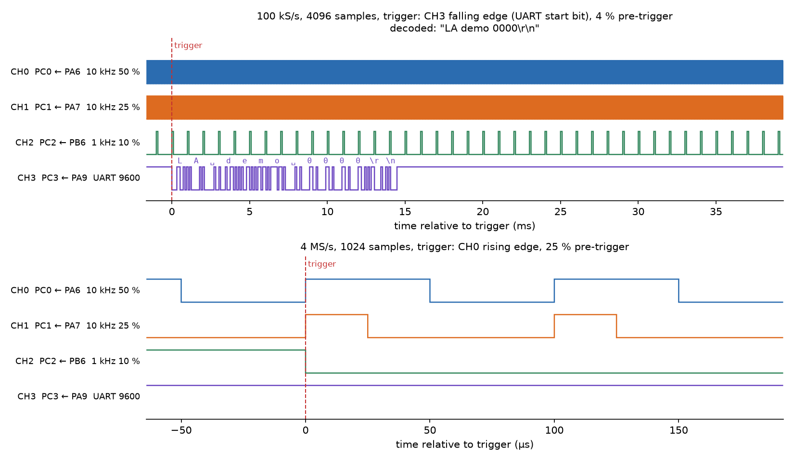
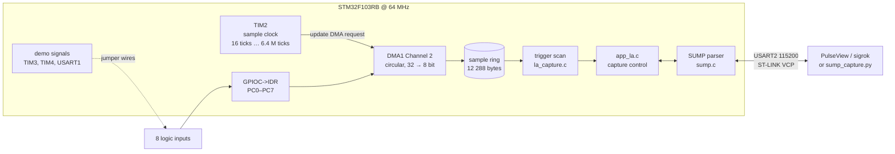
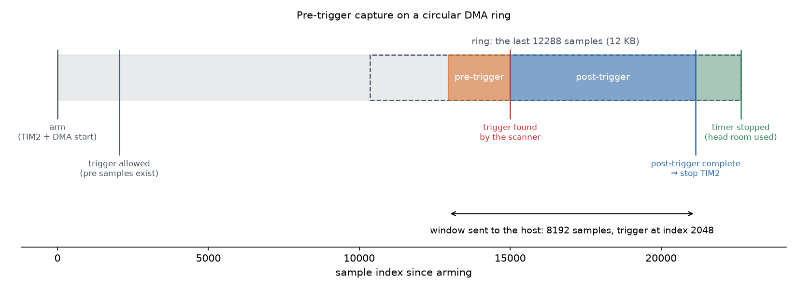
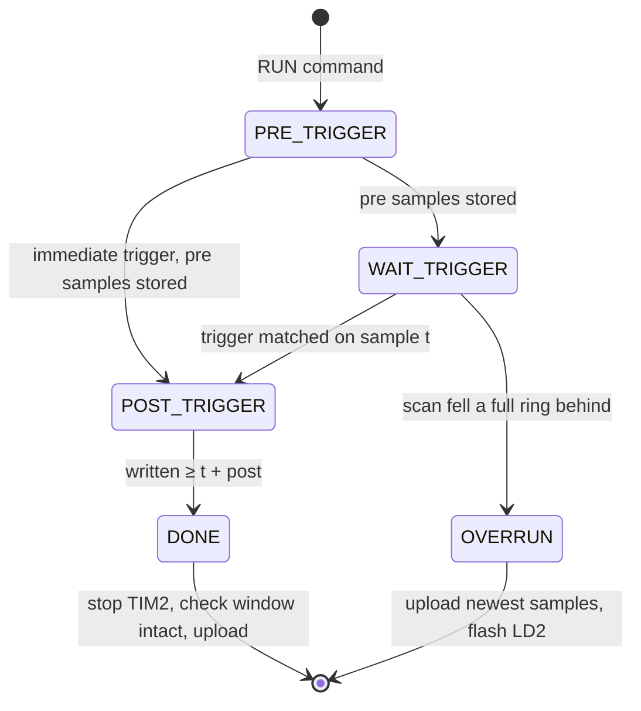
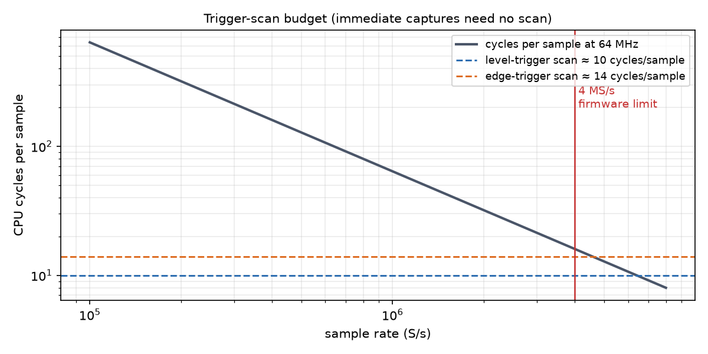
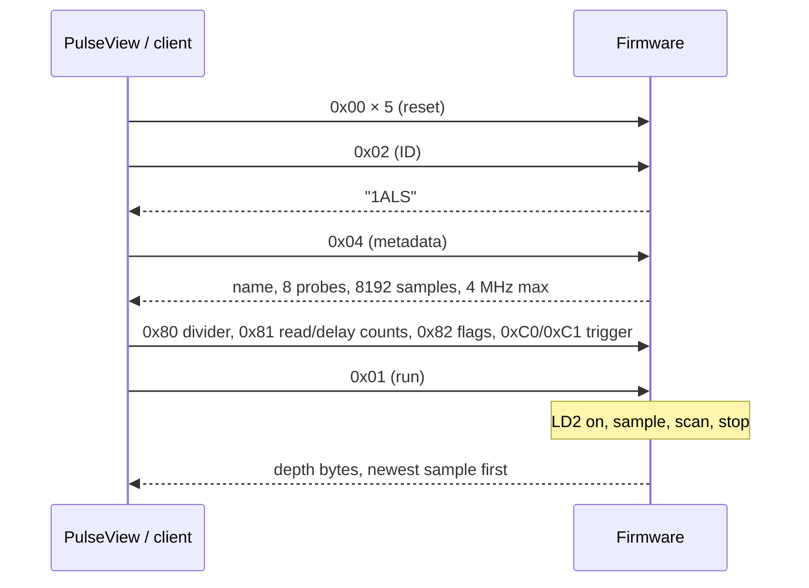

# 8-Channel Logic Analyzer on STM32: SUMP Protocol, PulseView Compatible

-03234B?logo=stmicroelectronics&logoColor=white)


A NUCLEO-F103RB turned into an 8-channel logic analyzer that works with **PulseView / sigrok**
out of the box. A timer paces **DMA transfers straight from the GPIO input register into a
circular sample ring**, with no CPU involvement while sampling. The firmware scans the ring for a
**level or edge trigger**, keeps a configurable **pre-trigger** history, and uploads the capture
over the ST-LINK virtual COM port using the open **SUMP** protocol.

**Highlights**
- 8 channels (PC0–PC7), 10 S/s to **4 MS/s**, up to 8192 samples per capture
- Timer-paced DMA: `TIM2 update → DMA1 Ch2 → GPIOC->IDR → 12 KB circular ring`
- Level triggers on any channel combination, plus rising/falling **edge triggers**
- Pre-trigger capture with overrun detection if the trigger scan ever falls behind the DMA
- SUMP / Openbench Logic Sniffer protocol: PulseView detects it as a standard device
- On-board **demo signals** (PWM and a 9600-baud UART) for testing with jumper wires only
- Hardware-independent core with 99 host test checks, a **host simulator** that runs the
  firmware's protocol and capture code on a PC, and 16 Python tests, all run in CI

<details>
<summary><b>📘 More explanation for students</b> (click to expand)</summary>

**What is a logic analyzer?** An oscilloscope shows how a voltage changes over time, with all
its detail. Digital circuits, though, only care whether a wire is LOW (0) or HIGH (1). A logic
analyzer records just that, for many wires at once, very quickly, and then draws them as a
timing diagram. Engineers use one to answer questions like "did the microcontroller actually send
the byte I think it sent?", "is my SPI clock running at the right speed?" or "which signal
changed first?". Commercial analyzers cost from about $15 to thousands of dollars; this project
turns a low-cost development board into one.

**How does this one sample the wires?** The eight inputs are pins PC0–PC7, and the STM32 has a
register (`GPIOC->IDR`) whose bits always show the current level of those pins. A hardware timer
(TIM2) "ticks" at the chosen sample rate, for example one million times per second. On every
tick the **DMA controller**, a small piece of hardware that copies data without using the CPU,
copies that register into memory. Because no software runs per sample, the samples are perfectly
evenly spaced, and the CPU is free for other work. The memory is used as a **ring buffer**: when
the DMA reaches the end it starts again at the beginning, overwriting the oldest samples, so the
buffer always holds the most recent 12 288 samples.

**What is a trigger, and why "pre-trigger"?** Usually you only care about a short moment, such
as when a button is pressed or a message starts. A **trigger** is the condition that marks that
moment, for example "channel 3 goes from HIGH to LOW" (a *falling edge*, which is how every UART
byte begins). The firmware checks each new sample against the trigger. Because the ring buffer
already holds the recent past, the capture can include what happened *before* the trigger as
well as after it; that is the *pre-trigger* part. Seeing the lead-up to an event is often
exactly what reveals a bug.

**What is SUMP, and how does the PC get the data?** After the capture, the data must reach a PC
program that draws it. Instead of inventing a new set of commands, the firmware speaks **SUMP**,
the serial command language of an open-source FPGA logic analyzer (the "SUMP" project, 2007) that
many hobby analyzers later copied. SUMP is the project's name, not an abbreviation. The PC sends
short commands such as "reset", "who are you?", "sample at 1 MHz", "capture 4096 samples" and
"run"; the board answers with its name and then the samples. Because the free program
**PulseView** already understands SUMP, it works with this board immediately, and its *protocol
decoders* can even turn the captured waveforms back into readable UART text, SPI bytes or I²C
messages. To try everything without extra hardware, the board also generates its own test
signals (PWM waves and a UART message) that you connect to the inputs with jumper wires.

</details>

---

## Try it

**With PulseView**

1. Flash the board. Wire the demo outputs to the inputs: **D12→A5, D11→A4, D10→PC2, D8→PC3**
   (table below).
2. In PulseView choose *Connect to Device*, driver **Openbench Logic Sniffer & SUMP compatibles
   (ols)**, interface *Serial Port*, the ST-LINK COM port, **115200** baud, then *Scan*. The
   device appears as **STM32F103 Logic Analyzer**.
3. Set 100 kHz and 4096 samples, add the **UART decoder** on channel 3 at 9600 baud, and run.
   The decoder shows `LA demo 0042` and so on. LD2 lights while the analyzer waits for a trigger.

**With the Python client** (also supports the edge triggers that PulseView does not send)

```bash
pip install pyserial matplotlib
python tools/sump_capture.py COM5 --info
python tools/sump_capture.py COM5 --rate 100k --trigger 3:f --pre 4 --uart 3:9600 --png uart.png --vcd uart.vcd
```

**Without a board**: `make sim` builds the host simulator, then use the port name `sim`:

```text
$ python tools/sump_capture.py sim --rate 100k --trigger 3:f --pre 4 --uart 3:9600
capturing 4096 samples at 100 kS/s, trigger 3:f
UART CH3: b'LA demo 0000\r\n'
```



*Both captures come from the host simulator: the firmware's own SUMP parser, trigger and capture
engine running on modeled versions of the demo outputs.*

---

## System overview



The sampling path is pure hardware. TIM2 overflows at the sample rate, and each update event
asks DMA1 Channel 2 to read `GPIOC->IDR`. The DMA reads the 32-bit register and stores only its
low byte (the STM32F1 DMA truncates when the destination is narrower), which is exactly PC0–PC7.
The CPU's only job during a capture is scanning new samples for the trigger.

## Capture engine



The DMA writes the ring forever, in circular mode. Its transfer-complete interrupt counts laps,
so the firmware always knows the absolute number of samples written:

```
written = laps × 12288 + (12288 − CNDTR)
```

`la_ring_written()` reads `CNDTR` first and the transfer-complete flag second, with interrupts
disabled. If the flag is pending, the ring has just wrapped but the interrupt has not counted
the lap yet, and a small position belongs to the next lap. This closes the race between the
counter register and the lap count.



- A trigger may only fire once `pre` samples exist before it, so the window always starts with
  real data. The scan starts at sample `pre`, seeded with sample `pre − 1` so that an edge on the
  very first eligible sample is still seen.
- The returned window is `[t − pre, t − pre + depth)`, so the trigger sample is at index `pre`.
- The ring (12 288) is larger than the largest capture (8192). The spare 4096 samples are the
  head room the scan may lag behind the DMA, and the time the main loop has to stop the timer
  after the last post-trigger sample. Both limits are checked; neither fails silently.

### Triggers

| Condition | Meaning | PulseView | Python client |
|---|---|---|---|
| `0` / `1` | channel low / high | ✅ | `--trigger 2:1` |
| `r` / `f` | rising / falling edge | | `--trigger 3:f` |
| none | start immediately | ✅ | (default) |

All conditions must hold on the same sample: `(s & level_mask) == level_value`, and every
channel in the rising/falling masks changed in that direction since the previous sample.

The trigger scan walks the ring in contiguous segments with a plain pointer, without 64-bit
arithmetic or a wrap check per sample. The compiled `-O2` inner loop is 8 instructions for level
triggers. Immediate captures skip the scan entirely.



## SUMP protocol



| Command | Bytes | Use in this firmware |
|---|---|---|
| `0x00` reset | 1 | Aborts a capture. Five in a row always resynchronise the parser. |
| `0x01` run | 1 | Arms the capture |
| `0x02` ID | 1 | Replies `1ALS` |
| `0x04` metadata | 1 | Name, version, probes, sample memory, max rate, protocol version |
| `0x80` divider | 5 | Rate = 100 MHz / (divider + 1), mapped to the nearest TIM2 period |
| `0x81` counts | 5 | Read count and delay count (samples after the trigger), in units of 4 |
| `0xC0` / `0xC1` | 5 | Stage-0 trigger mask and value (level trigger) |
| `0xC3` | 5 | **Extension:** rising-edge mask, falling-edge mask. A reset clears it. |

The sample rate is converted with integer arithmetic: `ticks = round(64 MHz × (divider + 1) /
100 MHz)`. The result is split into a 16-bit prescaler and period, so any rate from 4 MS/s down
to below 10 S/s is reachable.

---

## Hardware

| Pin | Nucleo header | Function |
|---|---|---|
| PC0 | A5 (CN8-6) | CH0 input |
| PC1 | A4 (CN8-5) | CH1 input |
| PC2 | CN7-35 | CH2 input |
| PC3 | CN7-37 | CH3 input |
| PC4 | CN10-34 | CH4 input |
| PC5 | CN10-6 | CH5 input |
| PC6 | CN10-4 | CH6 input |
| PC7 | D9 | CH7 input |
| PA2 / PA3 | ST-LINK VCP | USART2 host link, 115200 baud 8N1 |
| PA5 | LD2 | On while armed; flashes after an overrun |

**Inputs are 3.3 V logic.** PC6 and PC7 are 5 V tolerant; PC0–PC5 are not, so use a divider or
level shifter on those for 5 V signals. Inputs have internal pull-downs: an unconnected channel
reads 0. Connect the board GND to the circuit under test.

### Demo signals

| Output | Header | Signal | Wire to |
|---|---|---|---|
| PA6 (TIM3_CH1) | D12 | 10 kHz square, 50 % | A5 (CH0) |
| PA7 (TIM3_CH2) | D11 | 10 kHz pulse, 25 %, rising with PA6 | A4 (CH1) |
| PB6 (TIM4_CH1) | D10 | 1 kHz pulse, 10 % | PC2 (CH2) |
| PA9 (USART1_TX) | D8 | 9600 baud 8N1, `LA demo NNNN\r\n` every 50 ms | PC3 (CH3) |

## Timing and resources

| Item | Value |
|---|---|
| SYSCLK | HSI 8 MHz ÷ 2 × 16 = 64 MHz; TIM2 clock 64 MHz |
| Sample rate | 64 MHz ÷ ticks, ticks ≥ 16 → max 4 MS/s |
| Capture depth | 4 … 8192 samples (ring 12 288 samples) |
| Scan head room | 4096 samples = 1.0 ms at 4 MS/s |
| Upload time | 8192 bytes at 115 200 baud ≈ 0.71 s |
| Memory (from the build) | 11.8 KB flash · 14.2 KB RAM (12 KB is the ring) |

---

## Firmware structure

| File | Role |
|---|---|
| `Core/Src/la_capture.c` | Pre-trigger capture engine, DMA write-count logic (portable, tested) |
| `Core/Src/la_trigger.c` | Level and edge trigger matching (portable, tested) |
| `Core/Src/sump.c` | SUMP parser, metadata, sample-rate to timer conversion (portable, tested) |
| `Core/Src/app_la.c` | Hardware glue: TIM2/DMA control, lap counting, USART2 link, upload, LED |
| `Core/Src/demo_signals.c` | PWM and UART test signals |
| `Core/Src/main.c`, `*_msp.c`, `*_it.c` | STM32CubeMX-generated setup; application hooks only in `USER CODE` blocks |
| `Logic_Analyzer.ioc` | CubeMX configuration (TIM2 + DMA, TIM3, TIM4, USART1, USART2, GPIO) |
| `tests/test_main.c` | 99 host checks: triggers, capture windows for any poll size, ring wrap, overrun limits, SUMP encoding |
| `tests/sim_device.c` | Host simulator: the portable modules on stdin/stdout with modeled inputs |
| `tools/sump_capture.py` | SUMP client: capture, VCD export, PNG plot, UART decode |
| `tools/test_*.py` | Client unit tests and end-to-end tests against the simulator |
| `docs/generate_figures.py` | Regenerates every figure in this README |

## Design decisions

- **DMA from the GPIO input register.** A timer-paced DMA gives jitter-free sampling up to
  MS/s rates that an interrupt per sample could never reach on a Cortex-M3.
- **Circular ring plus software trigger.** The F103 has no hardware pattern match on GPIO, so
  the trigger is found by scanning. A circular ring gives pre-trigger history for free, and the
  lap-counted write position makes the scan exact even across many wraps.
- **SUMP instead of a custom protocol.** Speaking an existing protocol means PulseView's
  decoders (UART, SPI, I²C, and many more) work immediately, with no host software to write.
- **Edge triggers as a small extension.** Command `0xC3` is unused by SUMP. A standard client
  never sends it, and a reset clears it, so compatibility is unaffected.
- **Fail loudly.** If the scan or the timer stop falls behind, the capture is reported as an
  overrun (LD2 flashes) instead of returning a silently corrupted window.
- **Portable core and simulator.** Everything except register access builds on a PC. The
  simulator lets the whole host-to-firmware path be tested in CI without hardware.

## Revision history

The original university project here was a CubeMX skeleton: a timer blinking the LED and an
unused ADC, with no capture code. The analyzer was written from scratch on the same board.

---

## Build, test and flash

```bash
make              # build/logic_analyzer.elf / .hex / .bin (any arm-none-eabi-gcc)
make test         # 99 host checks + builds the host simulator (host C compiler)
python -m pytest tools                 # client tests + end-to-end tests on the simulator
python docs/generate_figures.py        # regenerate the figures (needs the simulator)
```
In **STM32CubeIDE**: *File → Import → Existing Projects into Workspace*, select this folder.
Flash `build/logic_analyzer.bin` by drag-and-drop onto the NUCLEO drive or with STM32CubeProgrammer.

## Bring-up checklist

1. `python tools/sump_capture.py COMx --info` prints the device name, 8 probes, 8192 samples
   and 4000000 Hz.
2. Scope or LED check: D12 shows 10 kHz, D10 shows short 1 kHz pulses.
3. Wire D12→A5 and capture 1 MS/s, 8192 samples: CH0 shows a 100 µs period with 50 % duty.
4. Wire D8→PC3, capture 100 kS/s with trigger `3:f`, decode UART at 9600: `LA demo NNNN\r\n`.
5. PulseView: scan finds the device; the same captures and the UART decoder work.
6. Rising-edge trigger at 4 MS/s on CH0 (`--trigger 0:r --pre 25`): the edge sits at 25 %.
7. Raise the rate with an edge trigger on a busy input until LD2 flashes, and note the highest
   overrun-free rate.
8. Leave a trigger unmatched, then send a reset (rerun the client): LD2 turns off and the
   board answers immediately.

---
## 👤 About the Author

**Faizan Saleem Siddiqui**, Embedded Firmware Engineer | Visiting Faculty | Research Scholar

Electronics engineer with 2+ years of experience in embedded systems and firmware development.
I build production firmware for **BLE wearables and biosignal devices** on Nordic nRF52 (Zephyr / nRF
Connect SDK), including **secure OTA updates (MCUboot, signed images)**, **low-power battery
management** and **true-wireless Bluetooth audio**. My background also covers STM32 and ESP32 with
FreeRTOS, real-time data acquisition, digital signal processing, industrial IoT, and Python tooling
for data, automation and machine learning.

- 🎓 MS Electronics, Quaid-i-Azam University, Islamabad (BS Electronics: 1st position, merit scholar)
- 🧑‍🏫 Visiting Faculty Member, Quaid-i-Azam University: teaching Real-Time Systems (STM32, FreeRTOS),
  Microcontroller Interfacing (ESP32) and AI/ML on Embedded Devices (TinyML)
- 🔬 Former Research Assistant, Autonomous Vehicle Engineering (COMSIP Lab, QAU)
- 🌍 Open to embedded / firmware engineering opportunities worldwide

[](https://www.linkedin.com/in/faizan-saleem-siddiqui-4411bb247/)
[](https://github.com/FaizanSSDQ)
[](mailto:faizansaleemsdq@gmail.com)

Application code licensed under the [MIT License](../../LICENSE). STM32 HAL and CMSIS files in
`Drivers/` are © STMicroelectronics and Arm under their own licenses.
